# IOR 360 — Complete Application Documentation

---

## 1. Document Overview

### 1.1 Purpose of This Document
This document is the definitive, authoritative technical and architectural reference for the **IOR 360 (Indian Operations & Restaurant 360)** software application. It provides an exhaustive, forensic breakdown of the entire system as currently implemented in the repository, encompassing frontend Flutter components, Riverpod state providers, backend FastAPI routers, SQLAlchemy data models, SQLite database schemas, multi-tenant security layers, business calculation formulas, hardware printing pipelines, and automated test suites.

This document serves as:
1. **The Single Source of Truth (SSOT)** for engineers, architects, product managers, and QA professionals maintaining or extending IOR 360.
2. **An Architectural Audit** identifying verified working capabilities, known technical debt, discrepancies between database definitions and ORM schemas, and legacy test constraints.
3. **An Operational Runbook** detailing deployment configurations, role-based access models, security guardrails, and closed-loop restaurant workflows.

### 1.2 Application Summary
**IOR 360** is a multi-tenant, branch-aware Restaurant Management and Revenue Tracking Software-as-a-Service (SaaS) platform built specifically for Indian dining establishments, fine-dining restaurants, and fast-casual food chains. The platform digitizes the end-to-end operational lifecycle:
- Point of Sale (POS) table management, order taking, and Kitchen Order Ticket (KOT) generation.
- Bill generation, tax (GST) and discount calculations, split-tender settlement, and ESC/POS thermal printing.
- Closed-loop inventory management with automated stock deduction upon bill checkout linked to recipe Bills of Materials (BOM).
- Raw material procurement, grocery purchases, and bulk item replenishment.
- Staff roster management, attendance tracking, and monthly salary disbursement.
- Operating expense (OPEX) tracking categorized into direct, indirect, and capital expenses.
- Executive analytics, real-time KPI dashboards, six-dimensional reporting, and an AI-powered conversational SQL Command Center.

### 1.3 Intended Audiences
- **Software Architects & Lead Engineers:** For evaluating system boundaries, isolation guarantees, and scalability.
- **Frontend Engineers (Flutter/Dart):** For understanding screen hierarchies, Riverpod state invalidation graphs, and UI element behaviors.
- **Backend Engineers (Python/FastAPI):** For endpoint contracts, dependency chains, session handling, and database schemas.
- **QA Engineers & Testers:** For test matrix design, verification statuses, edge cases, and known issue reproduction.
- **System Operators & DevOps:** For environment configuration, CORS setup, and thermal printing hardware interfacing.

### 1.4 Repository Location & Inspection Context
- **Root Workspace Directory:** `C:\Users\SakethBotte\OmetrionGenesis\restaurant-revenue-tracker-flutter`
- **Inspection Date:** October 28, 2026
- **Database Engine & Version:** SQLite version 3.49.1 (Active database: `backend/local.db`)
- **Inspection Methodology:** Complete read-only forensic inspection of repository source files, executed test suites (`flutter test`, `flutter analyze`, pytest/unittest Python test runners), live SQLite schema discovery via PRAGMA statements, and OpenAPI specification extraction from the running FastAPI application instance.

### 1.5 Scope and Limitations
This documentation reflects **the actual implemented codebase** present in the repository as of the inspection date. Features, screens, endpoints, or data models that were planned in concept documentation or legacy roadmap markdown files (such as `MULTI_TENANT_SAAS_PLAN.md`) but not implemented in code are explicitly marked as **`Planned / not implemented`** or excluded. No functionality has been assumed or extrapolated.

### 1.6 Legend for Implementation Status
Throughout this document, components, endpoints, and screens are classified using the following five standardized status markers:

| Status Label | Definition | Verification Standard |
| :--- | :--- | :--- |
| **`Implemented and verified`** | Code is fully written, integrated, and verified working via automated tests or verified database records. | Unit test pass, E2E workflow pass, or live DB query verification. |
| **`Implemented, not runtime-verified`** | Code is structurally complete and present in source, but lacked dedicated automated runtime execution in this test pass. | Static analysis pass, AST inspection, router inclusion confirmed. |
| **`Partially implemented`** | UI exists but lacks full backend wiring, or endpoint exists without full frontend UI hookup. | Present in UI/API, but with hardcoded stubs or unhandled actions. |
| **`Planned / not implemented`** | Referenced in documentation or architectural plans, but no source code exists in the repository. | Zero code evidence in frontend or backend directories. |
| **`Unknown`** | Insufficient evidence in the repository to establish runtime behavior or operational guarantees. | Inconclusive code traces. |

### 1.7 How Readers Should Navigate This Document
- **For UI/UX and Flutter Development:** Jump directly to **Section 6 (Navigation and Application Shell)** and **Section 7 (Detailed Page-by-Page Documentation)**.
- **For POS, Billing, and Inventory Logic:** Review **Section 8 (Home Dashboard Deep Dive)** and **Section 9 (Feature Modules and Business Workflows)**.
- **For Database & Backend Work:** Refer to **Section 10 (Database Schema and Data Dictionary)** and **Section 11 (Backend API Reference)**.
- **For Multi-Tenancy & Security:** Read **Section 5 (User Roles, Permissions, and Access Control)** and **Section 13 (Multi-Tenant Security and Data Isolation)**.
- **For Testing Results & Discrepancies:** See **Section 16 (Testing and Quality Assurance)** and **Section 19 (Known Issues, Technical Debt, and Recommendations)**.

---

## 2. Product Overview

### 2.1 The Domain & Problem Space
Restaurant operations in India face complex daily coordination challenges across front-of-house (table service, billing, payment splits) and back-of-house (kitchen orders, recipe yields, ingredient depletion, procurement). Independent multi-branch restaurant owners struggle with:
1. **Revenue Leakage:** Lack of real-time visibility into branch-level cashflow, unbilled tables, and disparate payment methods (Cash, UPI, Card, Net Banking).
2. **Untracked Inventory Depletion:** Inability to link customer orders back to underlying raw ingredient usage (e.g., deducting 0.25 kg of Basmati rice and 0.2 kg of chicken per Biryani sold).
3. **Siloed Financials:** Disconnection between daily grocery purchases, monthly staff salaries, ad-hoc branch expenses, and gross dining inflows.
4. **Multi-Unit Control:** Restaurant group owners managing multiple restaurant brands or geographically dispersed branches require centralized auditing without allowing branch staff to access cross-branch or cross-tenant records.

### 2.2 Multi-Tenant Hierarchy
IOR 360 models restaurant operations across a strict four-tier organizational hierarchy:

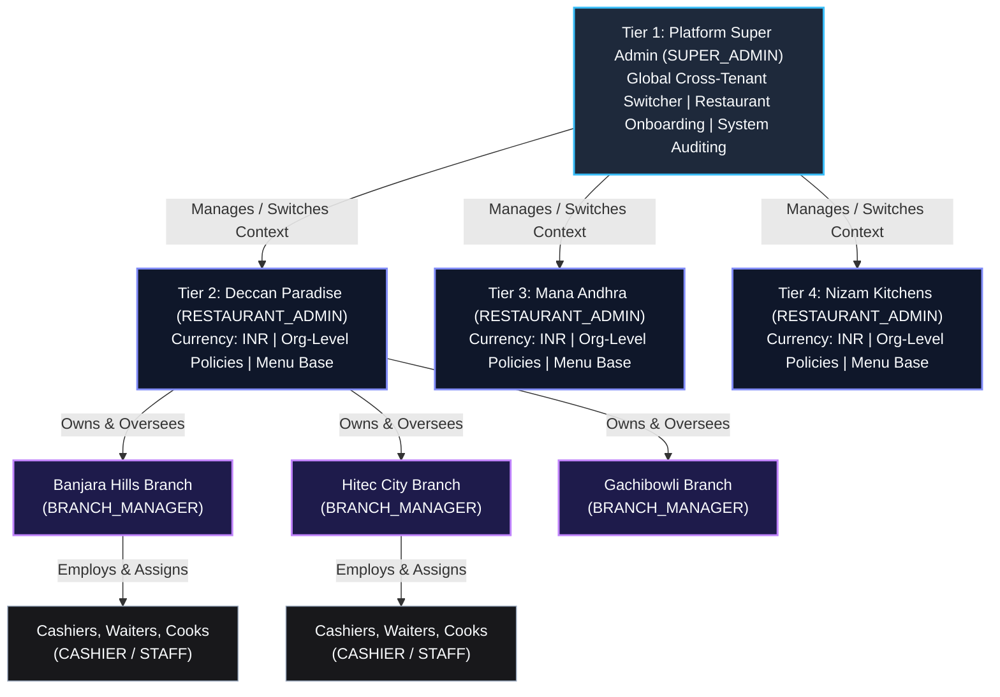

1. **Platform Owner (`SUPER_ADMIN`):** Unbound to any single restaurant (`restaurant_id: None`). Holds global authorization to inspect any restaurant via dropdown context switching, create new restaurant entities, onboard tenant administrators, and execute natural-language database intelligence across the network.
2. **Restaurant Organization (`RESTAURANT_ADMIN`):** Bound to a specific `restaurant_id`. Governs organization-wide configuration, manages physical branches, creates branch managers and cashiers, configures menu categories and recipes, and analyzes consolidated profit and loss statements.
3. **Branch Location (`BRANCH_MANAGER`):** Bound to a single `branch_id` and `restaurant_id`. Manages localized dining floor tables, supervises daily inventory balances, authorizes branch expenses, records bulk grocery deliveries, and oversees staff attendance and wage processing.
4. **Branch Staff (`CASHIER` / `STAFF`):** Operational role constrained to the active shift. Executes POS floor ordering, sends KOTs to kitchen printers, updates table states, applies discounts, finalizes settlements, and prints guest checks.

### 2.3 Core Functional Modules
The application is organized into 11 tightly integrated functional modules:

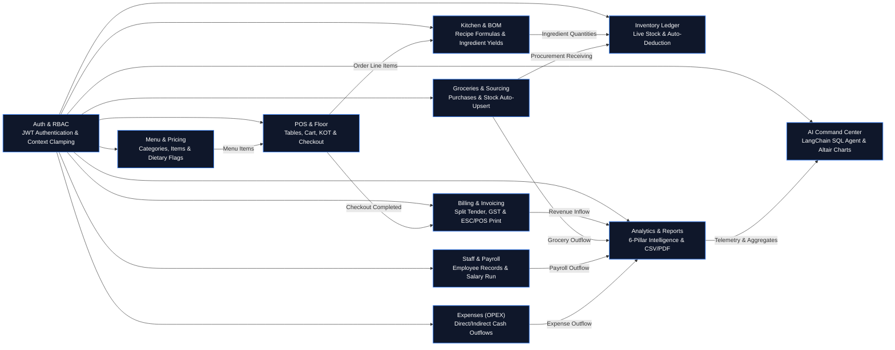

### 2.4 Responsive Layout Strategy
The frontend utilizes Flutter's responsive primitives (`LayoutBuilder`, conditional screen constraints) anchored by a minimum desktop viewport width breakpoint of `1024px`:
- **Desktop/Tablet Landscape (> 1024px):** Permanent collapsible left sidebar (`SidebarLayout`), wide top bar with active tenant pill, branch picker, currency badge, role pill, and multi-column grid dashboards.
- **Mobile/Narrow Viewport (< 1024px):** Left navigation collapses into a slide-over `Drawer`, tables switch to single-column card feeds, and modal sheets slide up from the viewport bottom.

---

## 3. Technology Stack and Architecture

### 3.1 Technology Matrix

| Subsystem | Technology | Version | Purpose in IOR 360 | Evidence in Repository |
| :--- | :--- | :--- | :--- | :--- |
| **Frontend Framework** | Flutter (Dart SDK) | `^3.0.0` / Dart `^3.0.0` | Cross-platform client UI application (Desktop, Web, Tablet) | `frontend/pubspec.yaml` |
| **State Management** | Riverpod (`flutter_riverpod`) | `^2.4.3` | Reactive state, dependency injection, and tenant-scoped caching | `frontend/pubspec.yaml`, `lib/providers/` |
| **HTTP Client** | Dio | `^5.3.3` | REST client with JWT header attachment & error interceptors | `frontend/lib/core/api_client.dart` |
| **Routing** | GoRouter | `^12.1.3` | Declarative URL routing with redirection guards on auth | `frontend/lib/core/router.dart` |
| **Data Visualization** | fl_chart | `^0.65.0` | In-app line, bar, and doughnut charts on Reports screen | `frontend/lib/ui/screens/reports/` |
| **Backend Framework** | FastAPI | `1.0.0` | High-performance asynchronous Python REST API server | `backend/main.py`, `backend/requirements.txt` |
| **ASGI Server** | Uvicorn | `^0.23.0` | Asynchronous web server running FastAPI application | `backend/requirements.txt` |
| **ORM / Data Layer** | SQLAlchemy | `^2.0.0` | Object Relational Mapping, session pooling, and queries | `backend/database.py`, `backend/models.py` |
| **Database Engine** | SQLite (Embedded) | `3.49.1` | Relational storage for development and local deployments | `backend/local.db`, `inspect_db.py` |
| **Authentication** | PyJWT & Passlib (bcrypt) | `^2.8.0` / `^1.7.4` | JWT issuance, verification, and bcrypt password hashing | `backend/security.py` |
| **Thermal Printing** | Windows winspool.drv / ctypes | Native Win32 | Raw ESC/POS byte streaming to Retsol RTP-82 USB/COM printer | `backend/services/thermal_printer.py` |
| **AI SQL Engine** | LangChain & Groq/OpenAI | `^0.1.0` | Natural language text-to-SQL agent with table safety rules | `backend/services/ai/ai_service.py` |
| **AI Visualizations** | Altair / Vega-Lite | `^5.0.0` | Dynamic Python chart code generation and HTML rendering | `backend/services/ai/chart_service.py` |
| **Document Export** | FPDF & Python csv | `^1.7.2` | Server-side PDF and CSV report file generation | `backend/services/pdf_export.py` |

### 3.2 System Component Architecture

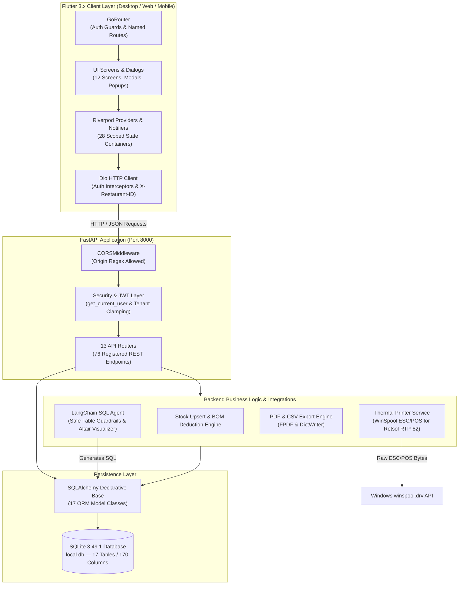

---

## 4. Repository and Codebase Map

### 4.1 Repository Directory Structure
```
c:\Users\SakethBotte\OmetrionGenesis\restaurant-revenue-tracker-flutter\
├── backend/                               # Python FastAPI backend service
│   ├── database.py                        # SQLAlchemy engine and session factory
│   ├── main.py                            # FastAPI application entrypoint & CORS
│   ├── models.py                          # 19 SQLAlchemy declarative models
│   ├── schemas.py                         # Pydantic request/response validation schemas
│   ├── security.py                        # Passlib bcrypt & PyJWT security routines
│   ├── local.db                           # Primary SQLite database file (active runtime)
│   ├── requirements.txt                   # Python package dependencies
│   ├── migrations/                        # Database schema migration scripts
│   │   └── add_user_access_control.py     # User ACL schema migration
│   ├── routers/                           # FastAPI route handlers (14 modules)
│   │   ├── auth.py                        # JWT login, refresh, profile, password change
│   │   ├── billing.py                     # POS orders, bills, checkout, KOT print
│   │   ├── branches.py                    # Branch CRUD, scope filtering, delete
│   │   ├── chat.py                        # AI Natural Language SQL chat & charts
│   │   ├── expenses.py                    # Expense entries & categories
│   │   ├── groceries.py                   # Raw material items, categories, purchases
│   │   ├── home.py                        # Dashboard KPIs & multi-tenant stats
│   │   ├── kitchen.py                     # Recipes, BOM yields, inventory stock
│   │   ├── menu.py                        # Menu items and category management
│   │   ├── reports.py                     # 6 analytical report modules & export
│   │   ├── restaurants.py                 # Restaurant tenant CRUD & delete
│   │   ├── staff.py                       # Employee roster & salary disbursement
│   │   ├── support.py                     # Helpdesk tickets, FAQs, diagnostics
│   │   └── users.py                       # User administration and tab-level ACL
│   ├── scripts/                           # Administrative & seed utilities
│   │   └── seed_ior360_demo_data.py       # 3-month Hyderabad restaurant data generator
│   ├── services/                          # Core business services
│   │   ├── thermal_printer.py             # Win32 ESC/POS raw printer driver
│   │   └── ai/                            # LangChain SQL engine & Altair charting
│   └── test/                              # Automated Python backend test suites
│       ├── __init__.py                    # Test package marker
│       ├── test_e2e_multi_tenant_workflows.py # 7-phase multi-tenant E2E verification test
│       ├── test_restaurants_branches_crud.py  # Restaurants & Branches CRUD & RBAC test
│       ├── test_seeded_db.py              # Verification test suite for seeded data
│       ├── test_settings_endpoints.py     # Settings health, printer & password test
│       └── test_support_endpoints.py      # Helpdesk ticket & multi-tenant isolation test
├── frontend/                              # Flutter client application
│   ├── lib/
│   │   ├── core/                          # Cross-cutting foundational utilities & Riverpod providers
│   │   │   ├── api_client.dart            # Dio HTTP singleton & interceptors
│   │   │   ├── app_notifier.dart          # Global application event bus
│   │   │   ├── auth_provider.dart         # Login state, token storage, active user
│   │   │   ├── branch_provider.dart       # Branch state & CRUD actions
│   │   │   ├── chat_provider.dart         # AI chat streaming & chart frame state
│   │   │   ├── currency_formatter.dart    # Tenant-aware currency string formatter (₹)
│   │   │   ├── expenses_provider.dart     # Expense ledger & category breakdown
│   │   │   ├── groceries_provider.dart    # Grocery items, purchases & categories
│   │   │   ├── home_provider.dart         # Dashboard KPIs & multi-tenant stats
│   │   │   ├── kitchen_provider.dart      # Recipe definitions & stock tracking
│   │   │   ├── menu_provider.dart         # Catalog filtering & item mutation
│   │   │   ├── nav_tabs.dart              # Role-aware navigation definitions
│   │   │   ├── pos_provider.dart          # Floor tables, active cart, checkout
│   │   │   ├── reports_provider.dart      # 6 report section async providers
│   │   │   ├── responsive.dart            # Responsive breakpoint utilities
│   │   │   ├── restaurant_provider.dart   # Restaurant state & CRUD actions
│   │   │   ├── settings_provider.dart     # Terminal, printer & branding preferences
│   │   │   ├── staff_provider.dart        # Employee directory & salary processing
│   │   │   ├── support_provider.dart      # Support tickets & FAQs with tenant isolation
│   │   │   └── users_provider.dart        # User roster & granular tab permissions
│   │   ├── models/                        # Dart immutable data transfer models
│   │   │   └── user.dart                  # User profile, JWT payload, roles & allowed_tabs
│   │   ├── theme/                         # App styling and Material 3 palettes
│   │   │   └── app_theme.dart             # Dark slate and accent styling
│   │   ├── ui/
│   │   │   ├── layouts/
│   │   │   │   └── sidebar_layout.dart    # Persistent shell, app bar & navigation
│   │   │   ├── screens/                   # 15 Application screens
│   │   │   │   ├── ai/ai_command_center.dart # Natural language SQL assistant
│   │   │   │   ├── auth/login_screen.dart # User authentication view
│   │   │   │   ├── branches/branches_screen.dart # Branch outlet directory & CRUD
│   │   │   │   ├── expenses/expenses_screen.dart # Operating expense management
│   │   │   │   ├── groceries/groceries_screen.dart # Raw material sourcing & purchases
│   │   │   │   ├── home/home_screen.dart  # Operational KPI executive dashboard
│   │   │   │   ├── kitchen/kitchen_screen.dart # Kitchen recipes & stock ledger
│   │   │   │   ├── menu/menu_screen.dart  # Food catalog, prices, categories
│   │   │   │   ├── pos/pos_billing_screen.dart # Tables, ordering, cart, checkout
│   │   │   │   ├── reports/reports_screen.dart # 6-pillar financial analytics & export
│   │   │   │   ├── restaurants/restaurants_screen.dart # Restaurant organizations & CRUD
│   │   │   │   ├── settings/settings_screen.dart # Terminal, ESC/POS printer & profile
│   │   │   │   ├── staff/staff_screen.dart# Staff roster & salary processing
│   │   │   │   ├── support/support_screen.dart # Support desk, diagnostics, FAQs & shortcuts
│   │   │   │   └── users/users_screen.dart# Multi-tenant user & centralized ACL
│   │   │   └── widgets/                   # Reusable UI component library
│   │   └── main.dart                      # Flutter app runner & ProviderScope setup
│   ├── test/                              # Automated widget and unit tests (29 tests)
│   │   ├── branch_dropdown_safety_test.dart # Dropdown assertion safety tests
│   │   ├── home_switching_test.dart       # Home multi-tenant switching tests
│   │   ├── pos_workflow_test.dart         # POS ordering and settlement tests
│   │   ├── restaurants_branches_tab_test.dart # Restaurants & Branches RBAC tests
│   │   ├── settings_screen_test.dart      # Settings sub-tabs & thermal preview tests
│   │   ├── support_and_profile_navigation_test.dart # Profile link & support isolation
│   │   └── widget_test.dart               # Component unit tests
│   └── pubspec.yaml                       # Dart & Flutter dependency manifest
├── audit_files/                           # Archived audits, discovery schemas, and scripts (in .gitignore)
├── IOR_360_COMPLETE_DOCUMENTATION.md      # This master technical documentation file
└── README.md                              # Repository overview and quickstart guide
```

### 4.2 Key Module Inventories
- **Application Screens (16):** Login (`/login`), Home Dashboard (`/home`), POS Billing (`/pos`), Menu Catalog (`/menu`), Kitchen & Inventory (`/kitchen`), Groceries (`/groceries`), Expenses (`/expenses`), Staff & Payroll (`/staff`), Reports (`/reports`), AI Command Center (`/ai`), Restaurants (`/restaurants`), Branches (`/branches`), Users (`/users`), Settings (`/settings`), Support (`/support`), Application Shell (`SidebarLayout`).
- **Backend Routers (14):** `auth`, `restaurants`, `users`, `branches`, `home`, `menu`, `staff`, `expenses`, `billing`, `chat`, `groceries`, `kitchen`, `reports`, `support`.
- **Database Tables (19):** `restaurants`, `branches`, `users`, `user_permissions`, `restaurant_tables`, `menu_items`, `orders`, `order_items`, `bills`, `recipe_ingredients`, `grocery_categories`, `grocery_items`, `grocery_purchases`, `inventory_stock`, `employees`, `salary_payments`, `expense_categories`, `expenses`, `support_tickets`.
- **Total Registered REST Endpoints:** 90 distinct OpenAPI operations across 69 HTTP endpoint paths.
- **Automated Test Coverage:** 29 frontend Flutter widget & integration tests (100% passing) and 5 comprehensive backend Python test suites (100% passing).

---

## 5. User Roles, Permissions, and Access Control

### 5.1 Role Definitions & Structural Scope
IOR 360 enforces a five-tier Role-Based Access Control (RBAC) model implemented across both the Flutter client and the FastAPI backend.

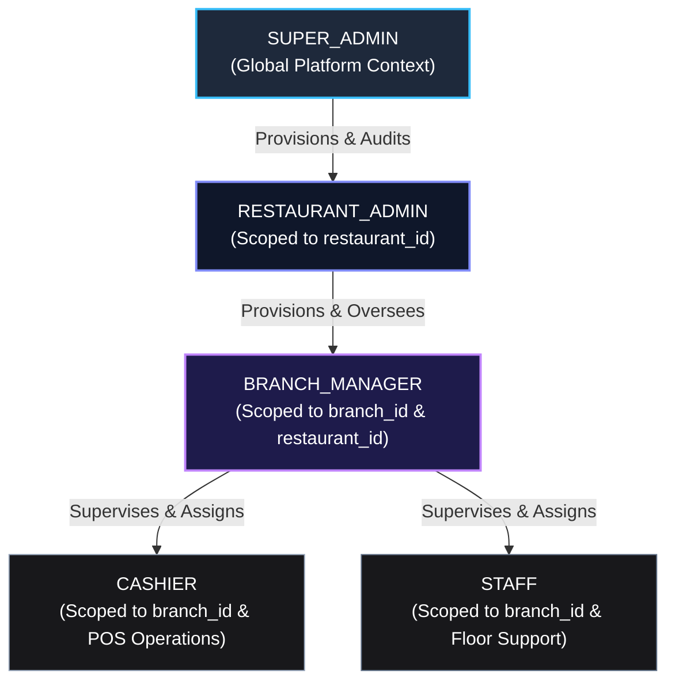

#### 1. Platform Super Administrator (`SUPER_ADMIN`)
- **Authentication:** Authenticates with platform master credentials via `/api/v1/auth/login`. Returns JWT token with `role: "SUPER_ADMIN"` and `restaurant_id: None`.
- **Scope & Context:** Global platform scope. Can dynamically switch active context to any restaurant organization using the top bar dropdown or by passing the `X-Restaurant-ID` HTTP header.
- **Permitted Screens:** Full, unrestricted access to all 15 application routes: `/home`, `/pos`, `/menu`, `/kitchen`, `/groceries`, `/expenses`, `/staff`, `/reports`, `/ai`, `/restaurants`, `/branches`, `/users`, `/settings`, `/support`, and system terminal configuration.
- **User Management & Granular ACL Permissions:** Full administrative authority to create, edit, activate, deactivate users, and centrally grant/revoke tab-level permissions (`allowed_tabs`) across any organization. Only Super Admins can grant or revoke the privileged `restaurants` tab.
- **Data Visibility:** Global visibility across all organizations, branches, financial ledgers, support tickets, and audit logs.
- **Restrictions:** Cannot perform checkout on a table without an explicitly selected active branch.

#### 2. Restaurant Administrator (`RESTAURANT_ADMIN`)
- **Authentication:** Authenticates via `/api/v1/auth/login`. Returns JWT token with `role: "RESTAURANT_ADMIN"`, bound strictly to a non-null `restaurant_id`.
- **Scope & Context:** Organization-wide scope. Governs all branches belonging to their restaurant organization. Cannot switch to or view data from other restaurant organizations.
- **Permitted Screens:** Access to 13 application routes within their tenant: `/home`, `/pos`, `/menu`, `/kitchen`, `/groceries`, `/expenses`, `/staff`, `/reports`, `/ai`, `/branches`, `/users`, `/settings`, and `/support`. The `/restaurants` tab is hidden and blocked by default unless explicitly granted by a Super Admin.
- **User Management Permissions:** Can create, edit, activate, and deactivate users (`BRANCH_MANAGER`, `CASHIER`, `STAFF`) whose `restaurant_id` matches their own. Can grant standard tab permissions, but is blocked from granting `restaurants` tab permissions (403 Forbidden).
- **Data Visibility:** Complete financial, payroll, inventory, support tickets, and sales visibility across all branches within their restaurant organization.
- **Restrictions:** Hard-clamped by backend dependency `security.get_effective_restaurant_id()`. Any attempt to pass an `X-Restaurant-ID` header pointing to another restaurant is ignored.

#### 3. Branch Manager (`BRANCH_MANAGER`)
- **Authentication:** Authenticates via `/api/v1/auth/login`. Returns JWT token with `role: "BRANCH_MANAGER"`, `restaurant_id`, and a designated `branch_id`.
- **Scope & Context:** Single physical branch location. Context is clamped to both `restaurant_id` and `branch_id`.
- **Permitted Screens:** Permitted on `/home`, `/pos`, `/menu` (read-only/edit local items), `/kitchen`, `/groceries`, `/expenses`, `/staff`, `/branches` (scoped to assigned branch), `/settings`, and `/support`. Blocked from `/restaurants` and `/users`.
- **User Management Permissions:** Read-only access to user rosters; cannot create or modify system user accounts on `/users`.
- **Data Visibility:** Branch-level POS orders, table states, branch inventory balances, local grocery purchases, branch staff attendance/wages, branch support tickets, and local branch expenses. Cannot inspect aggregated organization-wide financials.
- **Restrictions:** Cannot access `/users` administration screen. Cannot access executive profit-and-loss sections on `/reports` that expose organization-wide owner distributions.

#### 4. Cashier (`CASHIER`)
- **Authentication:** Authenticates via `/api/v1/auth/login`. Returns JWT token with `role: "CASHIER"` and assigned `branch_id`.
- **Scope & Context:** Operational shift level within the assigned branch.
- **Permitted Screens:** Primary operational screens are `/pos` (Floor & Billing), `/home` (limited shift summary), read-only `/menu`, `/settings` (Profile & Terminal), and `/support`.
- **User Management Permissions:** None.
- **Data Visibility:** Active floor tables, active orders, customer bills, split payments, branch support tickets, and daily shift cashflow. Blind to inventory purchase costs, employee salary figures, and executive profit/loss metrics.
- **Restrictions:** Strictly blocked from `/restaurants`, `/branches`, `/users`, `/expenses`, `/groceries`, `/kitchen` (stock editing), and `/reports`. Tab-level access in `/staff` is blocked.

#### 5. Operational Staff / Waiter (`STAFF`)
- **Authentication:** System credentials allow login via `/api/v1/auth/login`.
- **Scope & Context:** Table floor support and order taking.
- **Permitted Screens:** `/pos` (restricted to table viewing and item adding; checkout settlement typically restricted), `/settings` (Profile view & password change), and `/support`.
- **Restrictions:** Blocked from all administrative, financial, reporting, branch, restaurant, and user management screens.

---

### 5.2 Granular Permissions Matrix

| Feature / Screen Area | `SUPER_ADMIN` | `RESTAURANT_ADMIN` | `BRANCH_MANAGER` | `CASHIER` | `STAFF` |
| :--- | :---: | :---: | :---: | :---: | :---: |
| **Switch Active Organization** | Full | Denied | Denied | Denied | Denied |
| **Switch Active Branch** | Full | Full (Own Org) | Locked to Own | Locked to Own | Locked to Own |
| **View Home Executive KPIs** | All Tenants | Own Org | Own Branch | Shift Stats | Denied |
| **POS Floor & Order Taking** | Full | Full | Full | Full | Full |
| **POS Checkout & Discounting** | Full | Full | Full | Full | Supervisor Required |
| **Reprint KOT / Receipts** | Full | Full | Full | Full | Full |
| **Manage Menu Items & Prices** | Full | Full | Read/Local Toggle | Read-Only | Read-Only |
| **Kitchen Stock Ledger** | Full | Full | Full | Read-Only | Read-Only |
| **Kitchen Recipe BOM Setup** | Full | Full | View Only | Denied | Denied |
| **Grocery Purchases Entry** | Full | Full | Full | Denied | Denied |
| **Operating Expenses Entry** | Full | Full | Full | Denied | Denied |
| **Staff Roster Directory** | Full | Full | Full | Denied | Denied |
| **Process Staff Payroll** | Full | Full | Full | Denied | Denied |
| **Executive Reports & P&L** | Full | Full | Branch Summary | Denied | Denied |
| **Export PDF/CSV Reports** | Full | Full | Denied | Denied | Denied |
| **AI Command Center (Chat)** | Full (Global) | Full (Org Scoped) | Branch Scoped | Denied | Denied |
| **Restaurants Management Tab** | Full (Global CRUD)| Denied (Default) / Granted ACL | Denied | Denied | Denied |
| **Branches Management Tab** | Full (Global CRUD)| Full (Own Org) | Own Branch / Granted ACL | Denied | Denied |
| **User Administration & ACL** | Global | Own Org Only | Denied | Denied | Denied |
| **Terminal & Printer Settings**| Full | Full | Full | Read-Only | Denied |
| **Support Helpdesk & Tickets** | Full (Global) | Full (Own Org) | Own Branch | Own Branch | Own Branch |
| **In-App Password Update** | Full | Full | Full | Full | Full |

---

### 5.3 Centralized Access Control via Users Tab
A foundational design principle in IOR 360 is **single-pane-of-glass access management**:
1. **Centralized Administration:** All user permissions and tab visibility—including access to privileged tabs like **Restaurants** and **Branches**—are governed centrally within the **Users screen (`/users`)**.
2. **No Fragmented Access Tabs:** There are no secondary access management sub-tabs or user assignment forms inside the `Restaurants` or `Branches` tabs. This prevents privilege fragmentation and provides a clean separation of concerns.
3. **Persistence and Real-Time Enforcement:** Tab permissions are persisted in the backend database (`user.allowed_tabs` column and `user_permissions` table). When a Super Admin grants or revokes access to a tab, the change takes effect immediately without requiring application restart or reinstallation.
4. **Backend Route Clamping:** If an unauthorized user attempts to bypass the UI navigation and hit `/api/v1/restaurants` or `/api/v1/branches` directly, the backend dependency `security.verify_tab_access(current_user, "restaurants")` intercepts the request and raises an immediate `403 Forbidden`.

---

### 5.3 Tab-Level Granular Access Rules
In addition to screen-level routing guards, specific tabs within multi-view screens enforce conditional visibility based on the user's role:
1. **Staff Screen (`/staff`):**
   - `StaffTab.register` (Employee Directory): Accessible by `SUPER_ADMIN`, `RESTAURANT_ADMIN`, and `BRANCH_MANAGER`.
   - `StaffTab.payroll` (Salary Processing & History): Accessible by `SUPER_ADMIN` and `RESTAURANT_ADMIN`. `BRANCH_MANAGER` can process local wages; `CASHIER` and `STAFF` are completely restricted.
2. **Kitchen Screen (`/kitchen`):**
   - `KitchenTab.stock` (Inventory Balances & Low Stock Warnings): Visible to all kitchen and management personnel.
   - `KitchenTab.recipes` (Bill of Materials & Cost Formulas): Restricted to `SUPER_ADMIN`, `RESTAURANT_ADMIN`, and Head Chefs (`BRANCH_MANAGER`). Hidden from front-of-house cashiers to protect proprietary food preparation yields.
3. **Reports Screen (`/reports`):**
   - `OverviewView` & `OperationsSection`: Visible to `BRANCH_MANAGER`.
   - `ExecutiveSummarySection` & `ExpensesHrSection` (Net Margin, Owner EBITDA, Tax Reserves): Strictly restricted to `SUPER_ADMIN` and `RESTAURANT_ADMIN`.

---

## 6. Navigation and Application Shell

### 6.1 Layout Architecture
The IOR 360 frontend application shell is encapsulated in `SidebarLayout` (`frontend/lib/ui/layouts/sidebar_layout.dart`). It provides a persistent, responsive outer frame that wraps all authenticated destination views.

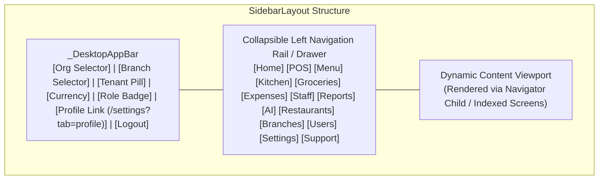

### 6.2 Top Bar Controls (`_DesktopAppBar`)
The desktop app bar spans the full width of the viewport above the content area, delivering global operational telemetry and context switching:

1. **Organization Switcher (`DropdownButtonHideUnderline`):**
   - *Visibility:* Rendered **only** when `user.role == 'SUPER_ADMIN'`.
   - *Data Binding:* Watches `restaurantListProvider`. Selected value bound to `selectedRestaurantIdProvider`.
   - *Behavior on Change:* Changing the organization triggers an exhaustive, coordinated invalidation of Riverpod providers (clearing stale cached orders, floor tables, grocery catalogs, reports, and resetting `selectedBranchProvider` to `null`). It dynamically updates the active currency symbol via `CurrencyFormatter` and invalidates `supportTicketsProvider`.
2. **Branch Switcher (`DropdownButtonHideUnderline`):**
   - *Visibility:* Rendered for `SUPER_ADMIN` and `RESTAURANT_ADMIN` when multiple branch locations exist. For `BRANCH_MANAGER` and `CASHIER`, it renders as a static disabled badge displaying their assigned branch name.
   - *Safety Guard:* Includes defensive assertion checks to prevent Flutter dropdown value mismatch assertions when switching between tenants with different branch IDs.
   - *Data Binding:* Watches `branchListProvider`. Selected value bound to `selectedBranchProvider`.
   - *Behavior on Change:* Re-filters all branch-scoped views (POS tables, inventory stock ledger, grocery replenishment, and operational expenses).
3. **Active Organization Pill (`Container` with Border & Chip):**
   - *Visual Style:* Deep indigo container with subtle border displaying an organization icon and the uppercase business name of the active tenant (e.g., `DECCAN SPICE`).
4. **Tenant Currency Pill (`Container`):**
   - *Visual Style:* Emerald-accented badge indicating the tenant's transactional currency symbol (`₹ INR` for all Indian tenants).
5. **User Role Badge (`Container`):**
   - *Visual Style:* High-contrast pill showing the active user's capitalized role (`SUPER_ADMIN`, `RESTAURANT_ADMIN`, `BRANCH_MANAGER`, `CASHIER`, `STAFF`).
6. **Top-Right Profile Navigation Avatar (`InkWell` with Tooltip):**
   - *Visual Style:* Circular avatar displaying the user's initial or profile symbol with tooltip "Profile & Settings".
   - *Interactive Behavior:* Clicking the profile symbol navigates directly to `/settings?tab=profile` via `context.go('/settings?tab=profile')`. This deep-links into the Profile sub-tab in Settings, allowing instant access to user details, tenant association, and password change operations.
7. **Sign Out Action (`IconButton` / `Tooltip`):**
   - *Behavior:* Calls `authNotifierProvider.notifier.logout()`, wiping secure local storage tokens, invalidating `supportTicketsProvider` and `homeProvider`, and routing the user to `/login`.

---

### 6.3 Left Navigation Menu Items
The left navigation bar (`NavigationRail` on desktop, collapsible to 72px icon-only rail or expandable to 240px drawer) dynamically presents up to 14 operational modules filtered by role and user permissions:

```mermaid
flowchart TD
    Shell["Application Shell"] --> NavHome["1. Home Dashboard (/home)"]
    Shell --> NavPOS["2. POS Billing (/pos)"]
    Shell --> NavMenu["3. Menu Management (/menu)"]
    Shell --> NavKitchen["4. Kitchen & Stock (/kitchen)"]
    Shell --> NavGroceries["5. Grocery Sourcing (/groceries)"]
    Shell --> NavExpenses["6. Expenses (/expenses)"]
    Shell --> NavStaff["7. Staff & Payroll (/staff)"]
    Shell --> NavReports["8. Reports & Analytics (/reports)"]
    Shell --> NavAI["9. AI Command Center (/ai)"]
    Shell --> NavRest["10. Restaurants (/restaurants - Privileged)"]
    Shell --> NavBranch["11. Branches (/branches - Scoped)"]
    Shell --> NavUsers["12. User Management (/users - Admin)"]
    Shell --> NavSettings["13. Terminal Settings (/settings)"]
    Shell --> NavSupport["14. Support Helpdesk (/support)"]
```

- **Home (`Icons.dashboard_rounded`):** High-level KPI cards, real-time revenue velocity, today's transactions.
- **POS Billing (`Icons.point_of_sale_rounded`):** Floor table grid, touch menu ordering, shopping cart, KOT print, checkout.
- **Menu (`Icons.restaurant_menu_rounded`):** Catalog maintenance, dietary tags, category assignments, price overrides.
- **Kitchen (`Icons.soup_kitchen_rounded`):** Recipe Bills of Materials, ingredient consumption yields, real-time stock balances.
- **Groceries (`Icons.shopping_basket_rounded`):** Raw material items, vendors, bulk purchase receiving, automatic stock upsert.
- **Expenses (`Icons.receipt_long_rounded`):** Operating expenditures (OPEX), maintenance, utility bills, vendor payouts.
- **Staff (`Icons.badge_rounded`):** Employee roster, role assignments, wage structures, monthly salary disbursement.
- **Reports (`Icons.analytics_rounded`):** 6-pillar financial and operational analytics, fl_chart visualizations, PDF/CSV export.
- **AI Command Center (`Icons.auto_awesome_rounded`):** Natural language conversational SQL query console and dynamic Altair charts.
- **Restaurants (`Icons.storefront_rounded`):** Organization directory, onboarding, brand management. Accessible to `SUPER_ADMIN` and granted users.
- **Branches (`Icons.account_tree_rounded`):** Physical branch locations, addresses, status. Accessible to `SUPER_ADMIN`, `RESTAURANT_ADMIN`, and granted users.
- **Users (`Icons.manage_accounts_rounded`):** System user credentials, role assignments, and centralized tab-level permissions. Accessible to Admins.
- **Settings (`Icons.settings_rounded`):** Hardware printer setup, ESC/POS bridge, receipt branding, POS rules, and user profile password management.
- **Support (`Icons.support_agent_rounded`):** Operations helpdesk, ticket tracking, system diagnostics snapshot, FAQs, and POS keyboard shortcuts.

---

## 7. Detailed Page-by-Page Documentation

---

### 7.1 Screen 1: Login Screen (`LoginScreen`)

#### A. Screen Overview
- **Screen Name:** Login Screen
- **Source File:** `frontend/lib/ui/screens/auth/login_screen.dart`
- **Route Path:** `/login`
- **Primary Widget:** `LoginScreen` (Stateful ConsumerWidget)
- **Role Access:** Public / Unauthenticated (All users prior to authentication)
- **Parent Layout / Entry Point:** Initial route rendered when no active valid JWT token is stored in local storage.
- **Business Purpose:** Authenticates restaurant operators, managers, cashiers, and platform administrators; issues a cryptographic JWT token, initializes the user profile, sets tenant context, and transitions the client to `/home`.

#### B. Layout and Visual Structure
The login screen features a centered, modern card container on a subtle dark slate gradient background:
- **Branding Header:** Displays the IOR 360 SVG icon, application title, and version subtitle.
- **Input Form:** Vertical column of padded text input fields for Username and Password.
- **Interactive Controls:** Toggleable password visibility icon, "Remember Me" checkbox, and a full-width primary "Sign In" button.
- **Feedback Banner:** Conditional error banner rendered above the button if invalid credentials are submitted or the backend server is unreachable.

#### C. Complete UI Element Inventory Table

| # | Element / Label | Widget / Type | Purpose | Data Source | Interaction / Behavior | Validation / Permissions | State / Feedback |
| :- | :--- | :--- | :--- | :--- | :--- | :--- | :--- |
| 1 | **Brand Header** | `Column` / `Text` | Display application identity | Static text `"IOR 360"` | Non-interactive static label | None | Rendered immediately |
| 2 | **Username Field** | `TextFormField` | Capture username / email | Local `TextEditingController` | Captures keyboard input; triggers form update | Must not be empty; min length 3 chars | Displays red error text if empty |
| 3 | **Password Field** | `TextFormField` | Capture account password | Local `TextEditingController` | Captures input; obscures characters | Must not be empty; min length 4 chars | Obscured by default; shows error if blank |
| 4 | **Toggle Password Visibility** | `IconButton` | Reveal/hide password plain text | Local boolean `_obscurePassword` | Toggles boolean and icon between Eye and Eye-Off | None | Updates field obfuscation dynamically |
| 5 | **Remember Me** | `CheckboxListTile` | Persist login across restarts | Local boolean `_rememberMe` | Toggles persistence flag | None | Checked/unchecked box state |
| 6 | **Sign In Button** | `ElevatedButton` | Submit credentials to auth API | `authStateProvider.notifier` | Triggers `login(username, password)` call | Disabled during active request | Shows `CircularProgressIndicator` while loading |
| 7 | **Error Alert Banner** | `Container` / `Text` | Display authentication errors | `authStateProvider.error` | Dismissible banner when login fails | None | Red container with error message string |

#### D. Data Sources and State Management
- **Consumed Providers:** `authStateProvider` (tracks `AsyncValue<UserModel?>`).
- **State Modifications:** Dispatches `authStateProvider.notifier.login(username, password)`. Upon 200 OK, persists JWT token to `SharedPreferences` / `FlutterSecureStorage` and sets `isAuthenticated = true`.

#### E. Backend Integration and API Calls
- **Endpoint:** `POST /api/v1/auth/login`
- **Request Format:** Form-encoded URL string (`OAuth2PasswordRequestForm` standard): `username=...&password=...`
- **Response Headers:** `200 OK` returning JSON:
  ```json
  {
    "access_token": "eyJhbGciOiJIUzI1NiIsIn...",
    "token_type": "bearer",
    "user": {
      "user_id": "usr_9912",
      "username": "admin_deccan",
      "role": "RESTAURANT_ADMIN",
      "restaurant_id": "rest_001",
      "branch_id": "br_001"
    }
  }
  ```

#### F. Business Logic and Financial Rules
- Password string is transmitted over HTTPS; backend runs `passlib.context.CryptContext.verify(password, user.password_hash)`.
- If user account has `is_active == False`, authentication throws HTTP 403 Forbidden with message `"Account disabled"`.

#### G. Edge Cases, Validations, and Error Handling
- **Network Failure:** If Dio catches `DioExceptionType.connectionTimeout`, the error banner displays `"Unable to connect to server. Check your network connection."`
- **Invalid Credentials:** Returns HTTP 401 Unauthorized; UI presents `"Incorrect username or password."`

#### H. User Flows and Navigation
- **Success:** Triggers GoRouter redirect to `/home`.
- **Exit:** No exit destinations exist prior to authentication.

#### I. Screen-Level Mermaid Diagram

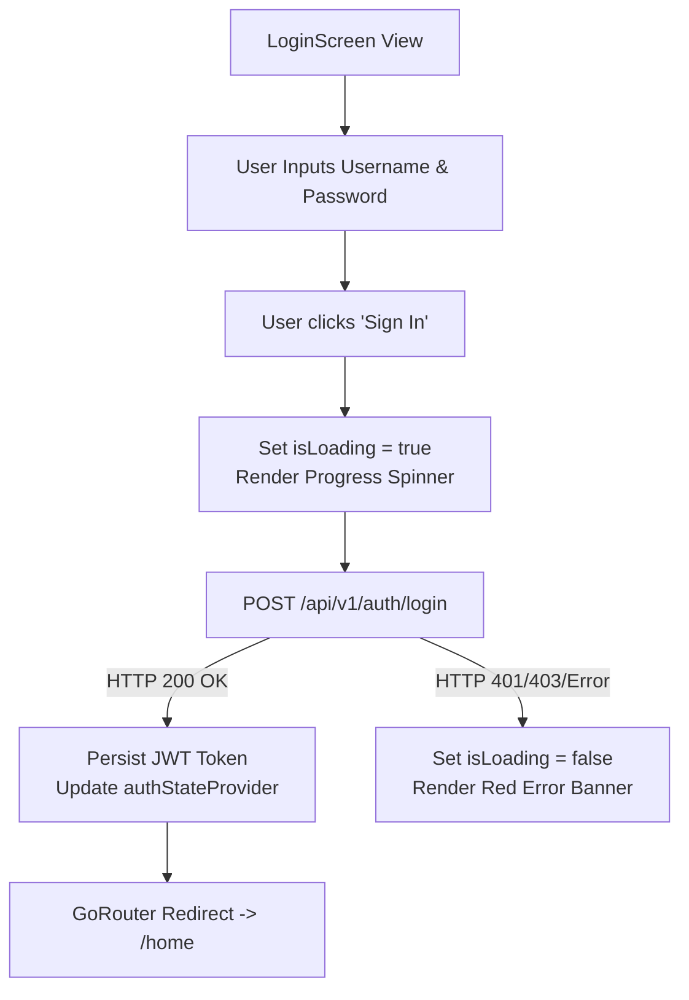

---

### 7.2 Screen 2: Home Executive Dashboard (`HomeScreen`)

#### A. Screen Overview
- **Screen Name:** Home Executive Dashboard
- **Source File:** `frontend/lib/ui/screens/home/home_screen.dart`
- **Route Path:** `/home`
- **Primary Widget:** `HomeScreen` (ConsumerStatefulWidget)
- **Role Access:** `SUPER_ADMIN`, `RESTAURANT_ADMIN`, `BRANCH_MANAGER`, `CASHIER` (Shift summary view)
- **Parent Layout / Entry Point:** Default destination child inside `SidebarLayout` upon successful login.
- **Business Purpose:** Central real-time command center summarizing the restaurant's daily operational metrics: Gross dining revenue inflow, direct/indirect expense outflow, net operational cashflow, total bill counts, payment tender breakdowns, and recent order activity.

#### B. Layout and Visual Structure
Organized in a responsive 12-column scrollable grid:
- **Dashboard Header:** Context greeting, formatted calendar date, active branch name, and an asynchronous manual refresh button.
- **KPI Metrics Deck (Row 1):** 4 elevated stat cards displaying Today's Inflow (₹), Today's Outflow (₹), Net Cashflow (₹), and Total Bills Settled.
- **Cashflow Breakdown Section (Row 2, Left):** Stacked bar and itemized cash outflow list across Bills, Groceries, Salaries, and Operating Expenses.
- **Payment Method Distribution (Row 2, Right):** Circular breakdown of payments settled via Cash, UPI, Credit/Debit Card, and Net Banking.
- **Today's Activity Ledger (Row 3):** Tabular feed of the 10 most recent settled guest bills.

#### C. Complete UI Element Inventory Table

| # | Element / Label | Widget / Type | Purpose | Data Source | Interaction / Behavior | Validation / Permissions | State / Feedback |
| :- | :--- | :--- | :--- | :--- | :--- | :--- | :--- |
| 1 | **Dashboard Title** | `Text` | Display screen title & date | Static + `DateTime.now()` | Non-interactive | Visible to all roles | Formatted `EEEE, dd MMMM yyyy` |
| 2 | **Refresh Button** | `IconButton` | Reload live dashboard KPIs | `homeProvider.notifier` | Invalidates & refetches `homeProvider` | Accessible by all | Triggers loading indicator on stat cards |
| 3 | **Today's Inflow Card** | `StatCard` | Display gross dining inflow | `homeData.inflow` | Displays formatted currency; green trend | Unrestricted | Shows ₹ formatted amount; skeleton on load |
| 4 | **Today's Outflow Card** | `StatCard` | Display total expenses + groceries | `homeData.outflow` | Displays formatted currency; red trend | Hidden for Cashiers | Shows ₹ formatted amount |
| 5 | **Net Cashflow Card** | `StatCard` | Display Net Margin (Inflow - Outflow) | `homeData.net_cashflow` | Emerald if positive; Crimson if negative | Hidden for Cashiers | Dynamic color change based on margin sign |
| 6 | **Total Orders Card** | `StatCard` | Display bill count for today | `homeData.orders_count` | Numerical metric counter | Unrestricted | Integer count with shopping bag icon |
| 7 | **Cashflow Breakdown** | `Card` / `ListView` | Itemize expense categories | `homeData.breakdown` | Expands into details of Bills/Groceries/Salaries | Admin / Manager only | List with individual category totals |
| 8 | **Payment Split Ring** | `fl_chart.PieChart` | Visualize tender proportions | `homeData.payment_splits` | Hover/Tap shows tender amount & percentage | Unrestricted | Color-coded slices (Cash, UPI, Card, Net) |
| 9 | **Recent Bills Table** | `DataTable` | Real-time audit of settled bills | `homeData.recent_bills` | Click row opens bill details dialog | Unrestricted | Tabular: Bill #, Table, Amount, Method |
| 10 | **View All Bills Link** | `TextButton` | Navigate to POS billing history | Navigation callback | Navigates to `/pos` | Cashier & above | Clickable link with arrow icon |

#### D. Data Sources and State Management
- **Consumed Providers:** `homeProvider`, `selectedRestaurantIdProvider`, `selectedBranchProvider`.
- **State Modifications:** Listens to `selectedRestaurantIdProvider` and `selectedBranchProvider`; automatically refetches `homeProvider` when either selector changes in the top bar.

#### E. Backend Integration and API Calls
- **Endpoint:** `GET /api/v1/home/stats`
- **Query Parameters:** `?restaurant_id={selected_id}&branch_id={selected_id}`
- **Headers:** `Authorization: Bearer <token>`, `X-Restaurant-ID: <id>`
- **Response Format:**
  ```json
  {
    "inflow": 69650.60,
    "outflow": 28400.00,
    "net_cashflow": 41250.60,
    "orders_count": 84,
    "breakdown": {
      "bills": 69650.60,
      "groceries": 14200.00,
      "salaries": 8000.00,
      "expenses": 6200.00
    },
    "payment_splits": {
      "Cash": 21500.00,
      "UPI": 38450.60,
      "Card": 9700.00,
      "Net Banking": 0.00
    },
    "recent_bills": [...]
  }
  ```

#### F. Business Logic and Financial Rules
- $\text{Net Cashflow} = \text{Inflow} - \text{Outflow}$.
- $\text{Outflow} = \text{Groceries Total} + \text{Expenses Total} + \text{Salary Disbursements Total}$.
- All values are filtered by SQLite timestamp matching current local system date: `date(created_at) = date('now', 'localtime')`.

#### G. Edge Cases, Validations, and Error Handling
- **Zero Transactions Today:** Displays empty state placeholder: `"No transactions recorded yet today. Settle a POS bill to see real-time inflow."`
- **Tenant Switching:** When Super Admin switches organizations, the screen briefly displays shimmer loading placeholders while the previous tenant's cached data is invalidated.

#### H. User Flows and Navigation
- User views daily revenue $\rightarrow$ clicks "View All Bills" $\rightarrow$ navigates to `/pos`.
- User clicks "Today's Outflow Card" $\rightarrow$ navigates to `/expenses`.

#### I. Screen-Level Mermaid Diagram

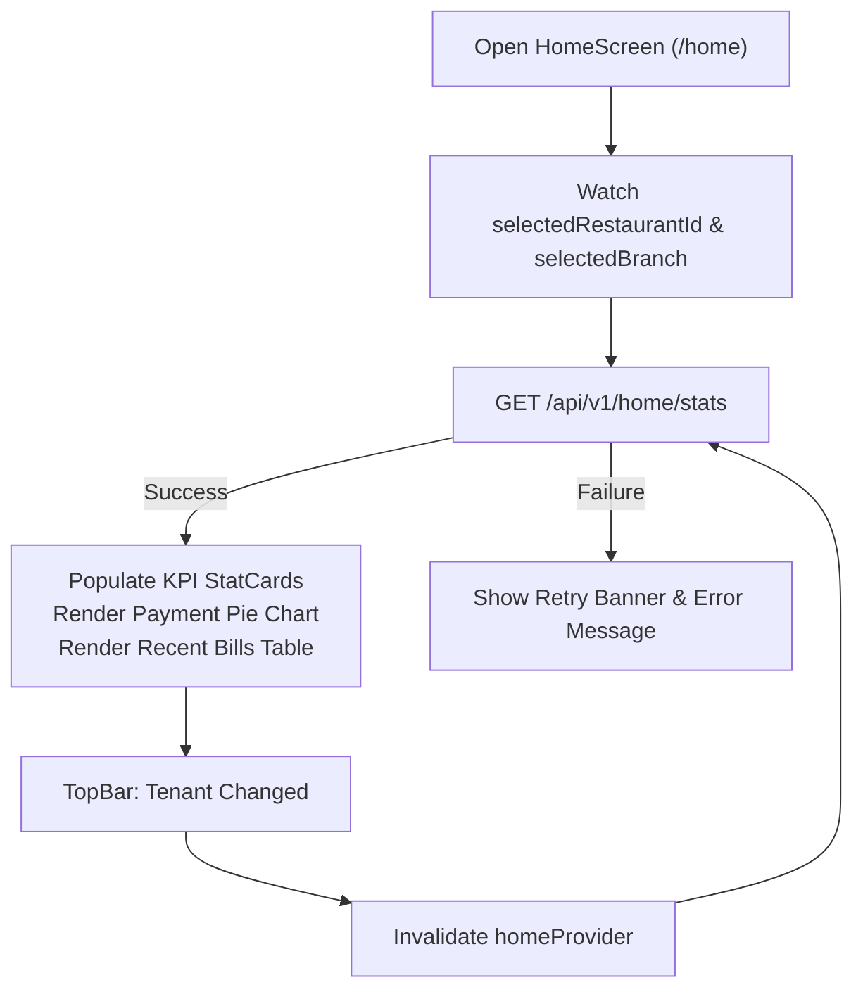

---

### 7.3 Screen 3: User Management Screen (`UsersScreen`)

#### A. Screen Overview
- **Screen Name:** User Management Screen
- **Source File:** `frontend/lib/ui/screens/users/users_screen.dart`
- **Route Path:** `/users`
- **Primary Widget:** `UsersScreen` (ConsumerStatefulWidget)
- **Role Access:** `SUPER_ADMIN` (Global user control), `RESTAURANT_ADMIN` (Own organization user control)
- **Parent Layout / Entry Point:** Accessible via Left Sidebar navigation. Blocked for `BRANCH_MANAGER`, `CASHIER`, and `STAFF`.
- **Business Purpose:** Provisions, modifies, activates, and deactivates employee software user accounts, passwords, security roles, and branch assignments.

#### B. Layout and Visual Structure
- **Control Bar:** Search bar (filters by username/email), Role filter dropdown (`All Roles`, `SUPER_ADMIN`, `RESTAURANT_ADMIN`, `BRANCH_MANAGER`, `CASHIER`, `STAFF`), and primary `"+ Add User"` action button.
- **User Directory Table:** Structured data grid displaying Username, Email, Role badge, Assigned Restaurant, Assigned Branch, Active status switch, and Action buttons (Edit, Delete).
- **Modals:**
  - `_UserDialog`: Floating form modal for creating or updating a user.
  - Delete Confirmation Dialog: Warning prompt before soft-deactivating or deleting a record.

#### C. Complete UI Element Inventory Table

| # | Element / Label | Widget / Type | Purpose | Data Source | Interaction / Behavior | Validation / Permissions | State / Feedback |
| :- | :--- | :--- | :--- | :--- | :--- | :--- | :--- |
| 1 | **Search Users** | `TextField` | Filter table by user or email | Local search string | Live query filter as user types | Unrestricted for Admins | Instant table row filtering |
| 2 | **Role Filter** | `DropdownButton` | Filter table by security role | Role enumeration | Filters table rows matching selection | Unrestricted for Admins | Shows selected role tag |
| 3 | **Add User Button** | `ElevatedButton` | Open user creation modal | Static action | Opens `_UserDialog` with blank fields | Admin only | Modal overlay appears |
| 4 | **Username Column** | `Text` | Display user account handle | `user.username` | Static text in table cell | None | Bold text string |
| 5 | **Role Badge** | `Chip` | Display user security role | `user.role` | Color-coded chip (Admin=Purple, Manager=Blue, Cashier=Green) | None | Visual tag |
| 6 | **Branch Assignment** | `Text` | Display assigned branch name | `user.branch_id` | Mapped against branch list | None | Shows Branch name or `"All Branches"` |
| 7 | **Active Status Switch** | `Switch` | Toggle user active login state | `user.is_active` | Triggers PATCH/PUT updating active state | Super/Rest Admin | Switches on/off; updates DB |
| 8 | **Edit User Button** | `IconButton` | Open edit user modal | `user` record | Opens `_UserDialog` pre-filled with user data | Super/Rest Admin | Modal overlay appears |
| 9 | **Delete User Button** | `IconButton` | Delete or deactivate user | `user.user_id` | Opens Delete Confirmation Dialog | Super/Rest Admin | Prompt: `"Confirm Deletion"` |
| 10 | **_UserDialog Save** | `ElevatedButton` | Submit user creation/update | Form state | Validates inputs & calls POST/PUT | Required: username, password (new), role | Shows loading spinner; closes on success |

#### D. Data Sources and State Management
- **Consumed Providers:** `usersListProvider`, `restaurantListProvider`, `branchListProvider`.
- **State Modifications:** Dispatches `usersListProvider.notifier.createUser()` and `usersListProvider.notifier.updateUser()`. Invalidation refreshes the table instantly.

#### E. Backend Integration and API Calls
- `GET /api/v1/users`: Fetches list of users scoped by tenant.
- `POST /api/v1/users`: Creates a new user record.
  - Payload: `{"username": "...", "email": "...", "password": "...", "role": "...", "restaurant_id": "...", "branch_id": "..."}`
- `PUT /api/v1/users/{user_id}`: Updates existing user properties.
- `DELETE /api/v1/users/{user_id}`: Deactivates or removes a user.

#### F. Business Logic and Financial Rules
- Passwords entered in `_UserDialog` are hashed on backend using `bcrypt`.
- A `RESTAURANT_ADMIN` cannot assign the `SUPER_ADMIN` role or modify another tenant's users.

#### G. Edge Cases, Validations, and Error Handling
- **Duplicate Username:** Backend throws HTTP 400 Bad Request `"Username already registered"`; dialog renders inline validation warning.
- **Self-Deactivation Prevention:** Frontend and backend prevent an active admin from deactivating their own currently logged-in account.

#### H. User Flows and Navigation
- User clicks "Add User" $\rightarrow$ fills fields in modal $\rightarrow$ clicks "Save" $\rightarrow$ modal closes $\rightarrow$ table reloads with new user entry.

#### I. Screen-Level Mermaid Diagram

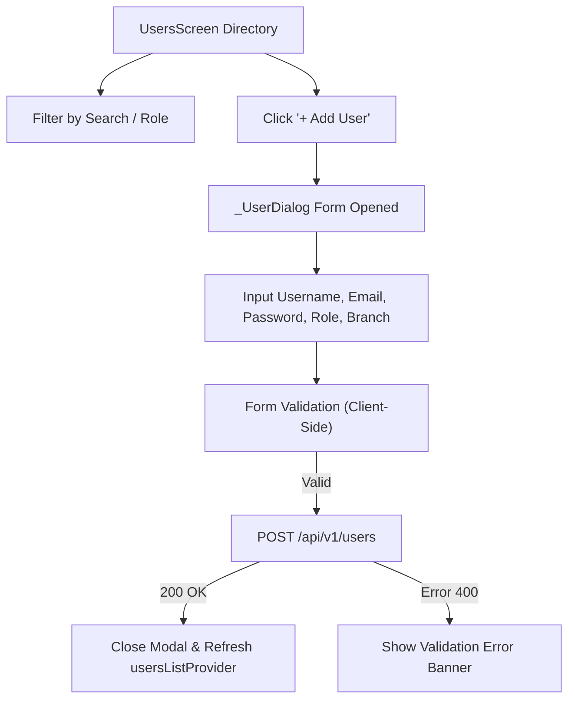

---

### 7.4 Screen 4: POS Floor & Billing Screen (`PosBillingScreen`)

#### A. Screen Overview
- **Screen Name:** POS Floor & Billing Screen
- **Source File:** `frontend/lib/ui/screens/pos/pos_billing_screen.dart`
- **Route Path:** `/pos`
- **Primary Widget:** `PosBillingScreen` (ConsumerStatefulWidget)
- **Role Access:** `SUPER_ADMIN`, `RESTAURANT_ADMIN`, `BRANCH_MANAGER`, `CASHIER`, `STAFF`
- **Parent Layout / Entry Point:** Accessible via Left Sidebar navigation. Primary workstation for front-of-house staff.
- **Business Purpose:** High-volume restaurant operational hub managing real-time floor tables, menu ordering, cart aggregation, Kitchen Order Ticket (KOT) generation, discount application, split tender payment processing, and ESC/POS thermal receipt printing.

#### B. Layout and Visual Structure
Constructed as a 3-pane responsive desktop layout:
- **Left Pane (`_TablesGridView`, 25% width):** Visual dining floor map displaying tables with capacity badges, occupancy statuses (`AVAILABLE`, `OCCUPIED`, `RESERVED`, `BILLED`), and a `"Manage Tables"` modal launcher.
- **Center Pane (`_MenuOrderingView`, 45% width):** Category filtering bar (Starters, Main Course, Breads, Biryanis, Desserts, Beverages), item search bar, and dynamic touch cards with image thumbnails, price, and veg/non-veg dietary indicators.
- **Right Pane (`_CartPanel`, 30% width):** Active table header, itemized order cart with quantity $+/-$ controls, item notes, Subtotal, CGST/SGST (5%), discount inputs, and action buttons (`"Send to Kitchen (KOT)"`, `"Clear Cart"`, `"Checkout & Settle"`).
- **Modals:**
  - `CheckoutDialog` (`checkout_dialog.dart`): Tender settlement, tips, and receipt printing.
  - `ManageTablesDialog` (`manage_tables_dialog.dart`): Table layout maintenance.

#### C. Complete UI Element Inventory Table

| # | Element / Label | Widget / Type | Purpose | Data Source | Interaction / Behavior | Validation / Permissions | State / Feedback |
| :- | :--- | :--- | :--- | :--- | :--- | :--- | :--- |
| 1 | **Table Filter Chips** | `Wrap` / `ChoiceChip` | Filter table grid by status | Table status enum | Filters `_TablesGridView` (All, Available, Occupied) | Accessible to all | Active chip highlighted in primary color |
| 2 | **Manage Tables Button** | `OutlinedButton` | Configure table layout | Static action | Opens `ManageTablesDialog` | Manager & Admin only | Modal sheet opens |
| 3 | **Table Tile** | `Card` / `InkWell` | Select active dining table | `posTablesProvider` | Selects table; loads active order into cart | Floor staff | Green=Available, Amber=Occupied, Red=Billed |
| 4 | **Menu Category Chips** | `ListView` / `FilterChip` | Filter food items by category | `menuNotifierProvider` | Filters menu catalog items in center pane | All roles | Horizontally scrolling category list |
| 5 | **Menu Search Field** | `TextField` | Search food catalog by name | Local query string | Real-time substring filter on menu items | All roles | Updates touch cards instantly |
| 6 | **Menu Item Touch Card** | `Card` / `InkWell` | Add item to active order cart | `MenuItemModel` | Adds item or increments quantity in `posCartProvider` | Requires selected table | Cart item count increments with animation |
| 7 | **Cart Item Row** | `ListTile` | Staged item in cart | `posCartProvider.items` | Displays name, unit price, quantity, and line total | None | Rendered inside right panel list |
| 8 | **Quantity +/- Buttons** | `IconButton` | Adjust order item count | `posCartProvider` | Increments or decrements line quantity | Decrementing past 1 prompts removal | Line total updates in real-time |
| 9 | **Item Special Note** | `IconButton` / `Dialog` | Attach chef instruction | `CartItem.notes` | Opens note input dialog (e.g., `"No spicy"`) | All roles | Note displayed beneath item title |
| 10 | **Subtotal Line** | `Text` | Display pre-tax order sum | `cart.subtotal` | Calculated sum of $(\text{quantity} \times \text{unit\_price})$ | Read-only | Formatted currency |
| 11 | **Tax Line (GST 5%)** | `Text` | Display total GST (CGST+SGST)| `cart.taxAmount` | $5\%$ of net subtotal ($\text{Subtotal} \times 0.05$) | Read-only | Formatted currency |
| 12 | **Discount Input** | `TextField` | Apply flat bill discount | `cart.discountAmount` | Captures discount currency amount | Cannot exceed subtotal | Subtracts from total |
| 13 | **Grand Total Line** | `Text` | Final settlement amount | `cart.grandTotal` | $\text{Subtotal} + \text{Tax} - \text{Discount}$ | Read-only | Bold prominent emerald text |
| 14 | **Send to Kitchen (KOT)** | `ElevatedButton` | Dispatch order & print KOT | `posCartProvider` | Calls `POST .../print-kot`; sets table OCCUPIED | Disabled if cart empty | Dispatches print job; shows snackbar |
| 15 | **Clear Cart Button** | `TextButton` | Discard staged order | `posCartProvider` | Prompts confirmation; wipes cart state | Manager / Cashier | Clears cart items |
| 16 | **Checkout & Settle** | `ElevatedButton` | Settle table bill | `posCartProvider` | Opens `CheckoutDialog` with grand total | Requires non-empty cart | Modal dialog appears |
| 17 | **Payment Method Radio** | `RadioListTile` | Select tender type | Checkout state | Cash, UPI, Card, Net Banking, or Split | In CheckoutDialog | Selected option highlighted |
| 18 | **Amount Received Field**| `TextField` | Calculate cash change | Checkout state | Computes $(\text{Amount Received} - \text{Grand Total})$ | Cash payments | Shows change return amount |
| 19 | **Print Receipt Switch** | `SwitchListTile` | Toggle thermal printing | Checkout state | If true, dispatches ESC/POS job to Retsol RTP-82 | Hardware available | Checked by default |
| 20 | **Finalize Settlement** | `ElevatedButton` | Finalize payment & close table| Checkout API | Calls `POST .../checkout`; frees table to AVAILABLE | In CheckoutDialog | Progress indicator; success toast; closes |

#### D. Data Sources and State Management
- **Consumed Providers:** `posTablesProvider`, `posCartProvider`, `menuNotifierProvider`, `selectedBranchProvider`.
- **State Modifications:** Updating cart modifies `posCartProvider`. Finalizing checkout refreshes `posTablesProvider` (marking table `AVAILABLE`) and invalidates `inventoryStockProvider` (reflecting ingredient BOM deduction).

#### E. Backend Integration and API Calls
- `GET /api/v1/billing/tables`: Fetches tables with current status and active orders.
- `POST /api/v1/billing/tables/{table_id}/orders`: Persists or updates order items for the table.
- `POST /api/v1/billing/tables/{table_id}/print-kot`: Generates Kitchen Order Ticket and sends ESC/POS raw bytes to thermal printer.
- `POST /api/v1/billing/tables/{table_id}/checkout`:
  - Request: `{"payment_method": "UPI", "amount_paid": 1250.00, "discount": 0.0, "tip_amount": 50.0, "print_receipt": true}`
  - Response: Complete `BillResponse` schema with `bill_id`, `bill_number`, tax breakdown, and closed status.

#### F. Business Logic and Financial Rules
- **Tax Calculation:** Standard Indian Restaurant Composition/Regular GST of 5% ($2.5\%$ CGST $+ 2.5\%$ SGST) applied to food and beverages.
- **Closed-Loop BOM Stock Deduction:** On checkout completion, backend executes:
  $$\text{InventoryStock.current\_stock} \leftarrow \text{InventoryStock.current\_stock} - \sum (\text{RecipeIngredient.quantity\_required} \times \text{OrderItem.quantity})$$
  Ensures real-time inventory ledger synchronization without manual kitchen auditing.

#### G. Edge Cases, Validations, and Error Handling
- **Double Checkout Prevention:** If checkout is triggered on an already settled table, backend throws HTTP 400 Bad Request `"Table has no active unpaid order"`.
- **Printer Offline:** If the Retsol RTP-82 thermal printer is unplugged, `thermal_printer.py` catches Win32 error, logs the failure, and returns success for the financial transaction while displaying a frontend warning: `"Bill settled, but thermal printer is offline."`

#### H. User Flows and Navigation
1. Cashier selects **Table 4** from floor map.
2. Clicks **Chicken Dum Biryani (x2)** and **Butter Naan (x4)** from menu touch grid.
3. Clicks **"Send to Kitchen (KOT)"** $\rightarrow$ Kitchen thermal printer outputs slip; Table 4 turns Amber (`OCCUPIED`).
4. Guest finishes meal $\rightarrow$ Cashier clicks **"Checkout & Settle"** $\rightarrow$ `CheckoutDialog` opens $\rightarrow$ selects **UPI** $\rightarrow$ clicks **"Finalize Settlement"** $\rightarrow$ Receipt prints; Table 4 turns Green (`AVAILABLE`); inventory stock is deducted.

#### I. Screen-Level Mermaid Diagram

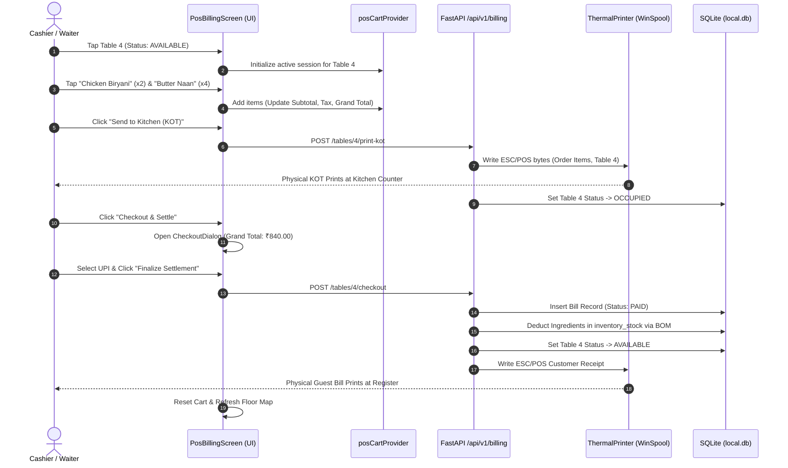

---

### 7.5 Screen 5: Menu Catalog & Pricing (`MenuScreen`)

#### A. Screen Overview
- **Screen Name:** Menu Catalog & Pricing
- **Source File:** `frontend/lib/ui/screens/menu/menu_screen.dart`
- **Route Path:** `/menu`
- **Primary Widget:** `MenuScreen` (ConsumerStatefulWidget)
- **Role Access:** `SUPER_ADMIN`, `RESTAURANT_ADMIN`, `BRANCH_MANAGER` (Full edit); `CASHIER`, `STAFF` (Read-only catalog inspection)
- **Parent Layout / Entry Point:** Accessible via Left Sidebar navigation.
- **Business Purpose:** Central catalog management for restaurant culinary offerings: configuring food and beverage items, pricing structures, dietary classifications (Veg, Non-Veg), category groupings, and immediate availability flags.

#### B. Layout and Visual Structure
- **Filter and Action Header:** Search bar, category filter chips horizontally scrollable, dietary toggle filter (All, Veg Only, Non-Veg Only), and a prominent `"+ Add Menu Item"` primary button.
- **Catalog Grid / List:** Responsive grid of menu cards displaying food item imagery, dietary emblem (green square with circle for Veg; brown square with triangle for Non-Veg), item title, category chip, unit price (₹), active toggle switch, and overflow actions (Edit, Delete).
- **Modals:**
  - `MenuItemDialog` (`frontend/lib/ui/screens/menu/menu_item_dialog.dart`): Form modal for creating or updating menu items.
  - Delete Item Confirmation Dialog.

#### C. Complete UI Element Inventory Table

| # | Element / Label | Widget / Type | Purpose | Data Source | Interaction / Behavior | Validation / Permissions | State / Feedback |
| :- | :--- | :--- | :--- | :--- | :--- | :--- | :--- |
| 1 | **Search Menu** | `TextField` | Live search by item name | Local string state | Filters displayed items in real-time | All roles | Updates catalog view instantly |
| 2 | **Category Filter** | `ListView` / `ChoiceChip` | Filter items by category | `menuNotifierProvider.categories`| Filters items by Starters, Biryanis, etc. | All roles | Active category highlighted |
| 3 | **Dietary Filter** | `SegmentedButton` | Filter by Veg / Non-Veg | Local filter state | Filters list by vegetarian status | All roles | Selected segment highlighted |
| 4 | **Add Menu Item** | `ElevatedButton` | Launch creation dialog | Static action | Opens `MenuItemDialog` in create mode | Admin / Manager only | Modal overlay opens |
| 5 | **Item Card** | `Card` / `InkWell` | Display culinary item details | `MenuItemModel` | Tap opens item details/edit view | All roles | Elevated card with elevation shadow |
| 6 | **Item Image** | `Image.network` / `AssetImage` | Display food dish picture | `item.image_url` | Renders food photograph; placeholder fallback | None | Rounded corner image container |
| 7 | **Dietary Badge** | `CustomPaint` / `Icon` | Official FSSAI Veg/Non-Veg tag | `item.is_veg` | Visual dietary icon (Green/Brown) | None | Standard food safety tag |
| 8 | **Item Title & Price** | `Text` | Display dish name & price | `item.name`, `item.price` | Formatted price via `CurrencyFormatter` | None | Bold header & prominent price |
| 9 | **Availability Switch**| `Switch` | Real-time 86/available toggle | `item.is_available` | Dispatches PUT request updating availability | Manager & above | Updates instantly; grays out if false |
| 10 | **Edit Item Button** | `IconButton` | Edit item properties | `item` record | Opens `MenuItemDialog` pre-filled | Admin / Manager | Pre-populates all dialog fields |
| 11 | **Delete Item Button** | `IconButton` | Remove item from catalog | `item.item_id` | Shows confirmation dialog; calls DELETE | Admin / Manager | Deletes record; removes card |
| 12 | **MenuItemDialog Save**| `ElevatedButton` | Submit new/edited item | Form controller state | Validates inputs & calls POST/PUT API | Required: name, price (>0), category | Shows spinner; closes dialog |

#### D. Data Sources and State Management
- **Consumed Providers:** `menuNotifierProvider`, `selectedRestaurantIdProvider`.
- **State Modifications:** Dispatches `menuNotifierProvider.notifier.addItem()`, `updateItem()`, `deleteItem()`, and `toggleAvailability()`.

#### E. Backend Integration and API Calls
- `GET /api/v1/menu/items`: Returns menu items for the active tenant.
- `POST /api/v1/menu/items`: Creates a new menu item.
  - Payload: `{"name": "Mutton Biryani", "category": "Biryanis", "price": 420.00, "is_veg": false, "is_available": true, "description": "Authentic Hyderabadi Dum Biryani"}`
- `PUT /api/v1/menu/items/{item_id}`: Modifies item fields.
- `DELETE /api/v1/menu/items/{item_id}`: Deletes or archives item.

#### F. Business Logic and Financial Rules
- Menu item prices are inclusive of base food cost. GST is computed dynamically at checkout in the POS module.
- Toggling `is_available = false` instantly prevents front-of-house cashiers from adding the item to POS ordering carts.

#### G. Edge Cases, Validations, and Error Handling
- **Negative Price Entry:** Form validation rejects values $\le 0$ with error `"Price must be greater than zero"`.
- **Active Order Reference:** Deleting a menu item referenced in active unpaid orders is blocked by foreign key or backend integrity checks.

#### H. User Flows and Navigation
- User clicks "Add Menu Item" $\rightarrow$ fills form $\rightarrow$ saves $\rightarrow$ item appears in catalog $\rightarrow$ immediately available in POS ordering view.

#### I. Screen-Level Mermaid Diagram

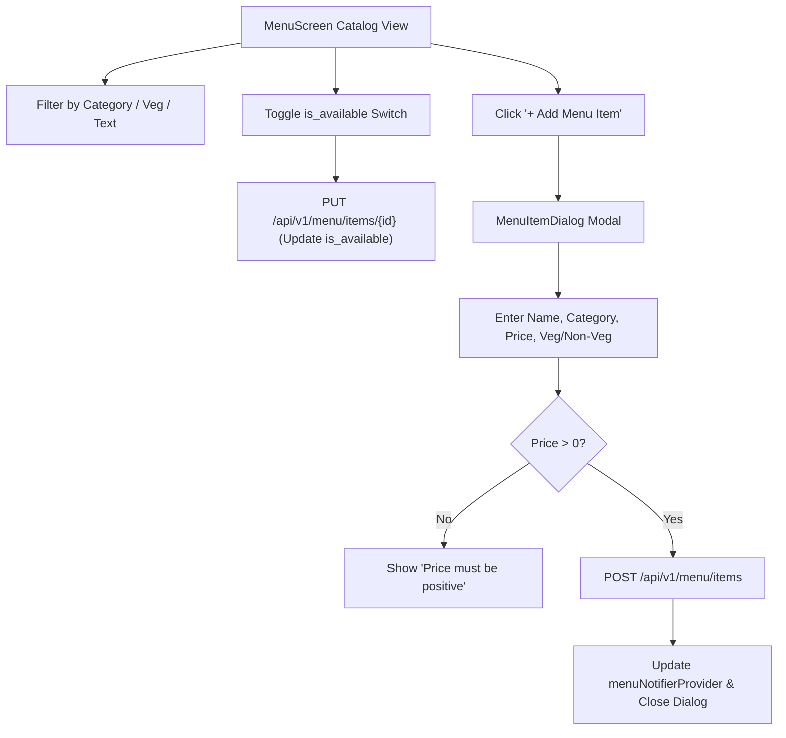

---

### 7.6 Screen 6: Staff Directory & Payroll Processing (`StaffScreen`)

#### A. Screen Overview
- **Screen Name:** Staff Directory & Payroll Processing
- **Source File:** `frontend/lib/ui/screens/staff/staff_screen.dart`
- **Route Path:** `/staff`
- **Primary Widget:** `StaffScreen` (ConsumerStatefulWidget)
- **Role Access:** `SUPER_ADMIN`, `RESTAURANT_ADMIN`, `BRANCH_MANAGER` (Directory & Wages); `CASHIER`, `STAFF` (Restricted)
- **Parent Layout / Entry Point:** Accessible via Left Sidebar navigation.
- **Business Purpose:** Manages human resource operations: maintaining employee rosters, employee codes, designations, contact details, monthly base compensation, and executing monthly payroll salary disbursements.

#### B. Layout and Visual Structure
Organized with a high-level `TabBar` separating workforce administration into two views:
- **Tab 1: Staff Directory (`StaffTab.register`):** Search input, role filter, "+ Add Employee" button, and "+ Bulk Onboarding" button. Renders a comprehensive `DataTable` with Employee Code, Full Name, Role, Phone, Assigned Branch, Base Monthly Salary (₹), and Action icons.
- **Tab 2: Payroll & Wages (`StaffTab.payroll`):** Year/Month picker, "Process Monthly Salary" batch button, and a salary disbursement ledger displaying Employee Name, Disbursed Month, Base Amount, Deductions, Net Paid Amount, Payment Method, Payment Date, and Receipt status.
- **Modals:**
  - `_showEditEmployeeModal`: Single employee onboarding/editing modal.
  - `_showBulkOnboardingModal`: Multi-row rapid staff entry grid.
  - `_showProcessSalaryModal`: Payroll calculation and disbursement dialog.

#### C. Complete UI Element Inventory Table

| # | Element / Label | Widget / Type | Purpose | Data Source | Interaction / Behavior | Validation / Permissions | State / Feedback |
| :- | :--- | :--- | :--- | :--- | :--- | :--- | :--- |
| 1 | **Staff Tab Selector** | `TabBar` | Switch Register vs Payroll | Static tab definition | Switches between Directory and Payroll views | Admin & Manager | Active tab highlighted with underline |
| 2 | **Search Employee** | `TextField` | Search staff by name/phone | Local query string | Real-time filter on directory table rows | Admin & Manager | Updates list instantly |
| 3 | **Add Employee Button**| `ElevatedButton` | Open single employee modal | Static action | Opens `_showEditEmployeeModal` | Admin & Manager | Modal bottom sheet/dialog |
| 4 | **Bulk Onboarding** | `OutlinedButton` | Rapidly onboard staff | Static action | Opens `_showBulkOnboardingModal` | Admin only | Multi-line entry grid opens |
| 5 | **Employee Code** | `Text` | Unique employee identifier | `employee.employee_code` | Read-only tabular identifier | None | Monospaced text (e.g. `EMP-014`) |
| 6 | **Employee Role** | `Chip` | Staff designation | `employee.role` | Color-coded role pill (Chef, Waiter, Cashier)| None | Visual badge |
| 7 | **Base Salary Column** | `Text` | Monthly compensation rate | `employee.base_salary` | Formatted currency via `CurrencyFormatter` | Admin only | Displays ₹ monthly rate |
| 8 | **Edit Employee** | `IconButton` | Modify staff record | `employee` record | Opens edit modal pre-filled | Admin & Manager | Form fields populated |
| 9 | **Delete Employee** | `IconButton` | Remove employee record | `employee.employee_id` | Prompts confirmation; calls DELETE | Admin only | Removes row on success |
| 10 | **Select Payroll Month**| `DropdownButton` | Choose month for payroll run | Months array | Filters salary disbursement ledger | Admin & Manager | Selected month displayed |
| 11 | **Process Salary Btn** | `ElevatedButton` | Disburse wages for employee | Static action | Opens `_showProcessSalaryModal` | Admin & Manager | Modal dialog opens |
| 12 | **Net Salary Field** | `Text` | Display computed net payout | Salary calculation | $\text{Base Salary} - \text{Deductions} + \text{Bonus}$ | Read-only | Prominent currency label |
| 13 | **Disburse Action** | `ElevatedButton` | Record salary payment | Salary API | Calls `POST /api/v1/employees/salary/pay` | Admin & Manager | Disburses record; updates outflow |

#### D. Data Sources and State Management
- **Consumed Providers:** `staffProvider`, `salaryPaymentsProvider`, `selectedBranchProvider`.
- **State Modifications:** Dispatches `staffProvider.notifier.addEmployee()` and `salaryPaymentsProvider.notifier.processSalary()`. Invalidation updates Home outflow immediately.

#### E. Backend Integration and API Calls
- `GET /api/v1/employees`: Returns employee directory for tenant/branch.
- `POST /api/v1/employees`: Creates single employee record.
- `POST /api/v1/employees/bulk`: Fast bulk onboarding of multiple employees.
- `GET /api/v1/employees/salary/payments`: Fetches historical wage disbursements.
- `POST /api/v1/employees/salary/pay`: Records monthly salary disbursement.
  - Payload: `{"employee_id": 14, "month": "2026-10", "base_salary": 25000.00, "deductions": 1000.00, "net_salary": 24000.00, "payment_method": "Bank Transfer"}`

#### F. Business Logic and Financial Rules
- Net salary disbursed is immediately committed to the financial ledger and factored into the daily/monthly cash outflow calculations on the Executive Dashboard and Reports screens.

#### G. Edge Cases, Validations, and Error Handling
- **Duplicate Salary Disbursement:** System prevents paying the same employee twice for the identical calendar month (`UniqueConstraint(employee_id, month)`).
- **Invalid Phone Number:** Frontend regex validation ensures a valid 10-digit Indian mobile number (`^[6-9]\d{9}$`).

#### H. User Flows and Navigation
- Admin opens Payroll tab $\rightarrow$ selects month $\rightarrow$ clicks "Process Salary" $\rightarrow$ enters deductions $\rightarrow$ confirms $\rightarrow$ payment recorded $\rightarrow$ reflected in monthly outflow.

#### I. Screen-Level Mermaid Diagram

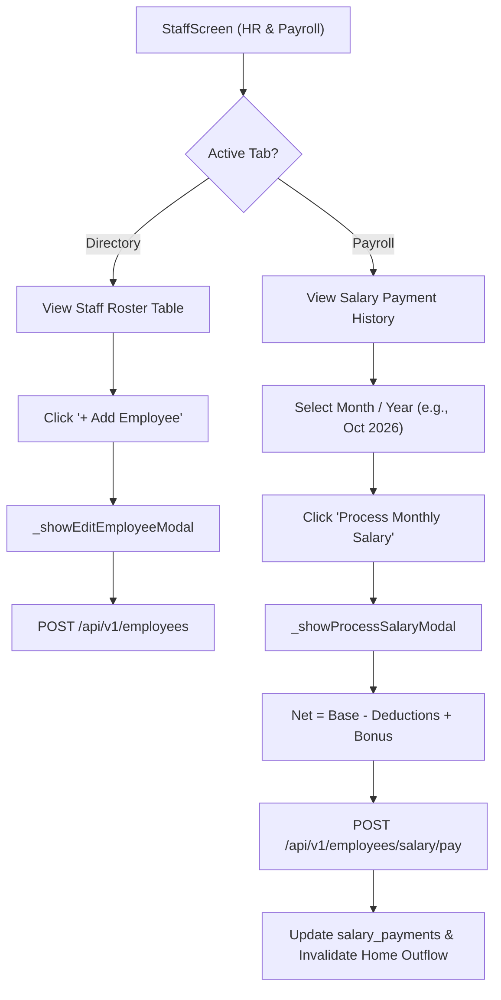

---

### 7.7 Screen 7: Raw Material Sourcing & Groceries (`GroceriesScreen`)

#### A. Screen Overview
- **Screen Name:** Raw Material Sourcing & Groceries
- **Source File:** `frontend/lib/ui/screens/groceries/groceries_screen.dart`
- **Route Path:** `/groceries`
- **Primary Widget:** `GroceriesScreen` (ConsumerStatefulWidget)
- **Role Access:** `SUPER_ADMIN`, `RESTAURANT_ADMIN`, `BRANCH_MANAGER`; (Restricted for `CASHIER` and `STAFF`)
- **Parent Layout / Entry Point:** Accessible via Left Sidebar navigation.
- **Business Purpose:** Governs restaurant raw material procurement: cataloging ingredients, tracking wholesale suppliers, recording bulk grocery purchases, and automatically updating on-hand kitchen inventory balances.

#### B. Layout and Visual Structure
- **Procurement Action Bar:** Category selector, search bar, "+ Add Item" button, "+ New Category" button, and primary `"+ Record Bulk Purchase"` launcher.
- **Procurement Ledger:** Data table itemizing recent purchase receipts: Invoice Number, Purchase Date, Supplier Name, Category, Quantity Received, Total Amount (₹), and Payment Status.
- **Modals:**
  - `_showBulkGroceryModal`: Innovative two-pane bulk procurement workspace. Left pane features the raw ingredient catalog to quickly tap/add items; right pane stages purchase line items with quantity, unit, unit cost, line totals, and supplier details.
  - New Item & Category Dialogs.

#### C. Complete UI Element Inventory Table

| # | Element / Label | Widget / Type | Purpose | Data Source | Interaction / Behavior | Validation / Permissions | State / Feedback |
| :- | :--- | :--- | :--- | :--- | :--- | :--- | :--- |
| 1 | **Grocery Search** | `TextField` | Search procurement items | Local query string | Real-time filtering on purchases/items | Admin & Manager | Live list update |
| 2 | **Category Filter** | `DropdownButton` | Filter by grocery category | `groceryCategoriesProvider`| Filters items (Dairy, Meat, Grains, Spices)| Admin & Manager | Updates active selection |
| 3 | **New Category Btn** | `IconButton` | Create new grocery category | Static action | Opens Category creation dialog | Admin & Manager | Dialog prompt opens |
| 4 | **Add Grocery Item** | `OutlinedButton` | Create new raw material item | Static action | Opens New Item modal (Unit, Reorder level) | Admin & Manager | Modal overlay opens |
| 5 | **Record Bulk Purchase**| `ElevatedButton` | Launch bulk procurement sheet | Static action | Opens `_showBulkGroceryModal` (2-pane) | Admin & Manager | Full-screen modal workspace |
| 6 | **Catalog Item Tile**| `ListTile` / `InkWell` | Add item to bulk staging sheet | `groceryItemsProvider` | Click transfers item into right staging pane | In Bulk Modal | Item added to purchase lines |
| 7 | **Purchase Quantity**| `TextField` | Enter quantity received | Staging line state | Numeric input (kg, liters, units) | Must be $> 0$ | Updates line subtotal |
| 8 | **Unit Cost Field** | `TextField` | Enter procurement unit price | Staging line state | Numeric currency input | Must be $> 0$ | Updates line subtotal |
| 9 | **Line Total Display**| `Text` | Display $(\text{Qty} \times \text{Unit Cost})$ | Computed | Recalculated on text change | Read-only | Formatted currency |
| 10 | **Supplier Name** | `TextField` | Capture vendor identity | Modal state | Vendor text string (e.g., `"Metro Wholesale"`)| Optional/Recommended | Stored in purchase record |
| 11 | **Invoice Number** | `TextField` | Vendor tax invoice reference | Modal state | Invoice reference string | Optional | Stored for tax auditing |
| 12 | **Save Bulk Purchase**| `ElevatedButton` | Commit purchase & update stock | Groceries API | Calls `POST .../bulk`; auto-upserts inventory | Required: $\ge 1$ line | Loading spinner; closes modal |

#### D. Data Sources and State Management
- **Consumed Providers:** `groceriesProvider`, `groceryCategoriesProvider`, `groceryItemsProvider`, `selectedBranchProvider`.
- **State Modifications:** Dispatches `groceriesProvider.notifier.recordBulkPurchase()`. Triggers automatic server-side stock level updates in `inventoryStockProvider`.

#### E. Backend Integration and API Calls
- `GET /api/v1/groceries/items`: Catalog of raw ingredients.
- `GET /api/v1/groceries/categories`: Categories (Dairy, Spices, Meat, Produce).
- `GET /api/v1/groceries/purchases`: Historical procurement transactions.
- `POST /api/v1/groceries/purchases/bulk`: Commits multi-item procurement.
  - Payload:
    ```json
    {
      "branch_id": "br_001",
      "supplier_name": "Royal Agro Suppliers",
      "invoice_number": "INV-88219",
      "payment_method": "UPI",
      "items": [
        {"item_id": 12, "quantity": 50.0, "unit_price": 72.00},
        {"item_id": 18, "quantity": 25.0, "unit_price": 240.00}
      ]
    }
    ```

#### F. Business Logic and Financial Rules
- **Closed-Loop Stock Upsert:** For every item in the bulk purchase payload, backend invokes `_upsert_inventory_stock()`:
  $$\text{InventoryStock.current\_stock} \leftarrow \text{InventoryStock.current\_stock} + \text{PurchaseItem.quantity}$$
  If no stock row exists for that branch and grocery item, a new record is initialized.
- **Financial Outflow:** Total purchase cost is immediately registered as an operational cash outflow for the branch on the current calendar date.

#### G. Edge Cases, Validations, and Error Handling
- **Zero Quantity Entry:** Line items with zero or negative quantity are rejected by Pydantic validation with HTTP 422 Unprocessable Entity.

#### H. User Flows and Navigation
- Manager clicks "Record Bulk Purchase" $\rightarrow$ selects Basmati Rice (50 kg) & Chicken (30 kg) $\rightarrow$ enters supplier $\rightarrow$ clicks "Save" $\rightarrow$ inventory stock increments; purchase appears in ledger.

#### I. Screen-Level Mermaid Diagram

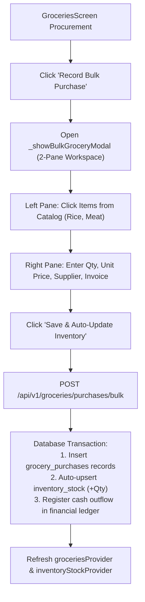

---

### 7.8 Screen 8: Kitchen Recipes & Live Inventory Ledger (`KitchenScreen`)

#### A. Screen Overview
- **Screen Name:** Kitchen Recipes & Live Inventory Ledger
- **Source File:** `frontend/lib/ui/screens/kitchen/kitchen_screen.dart`
- **Route Path:** `/kitchen`
- **Primary Widget:** `KitchenScreen` (ConsumerStatefulWidget)
- **Role Access:** `SUPER_ADMIN`, `RESTAURANT_ADMIN`, `BRANCH_MANAGER`, Head Chef; (Read-only for `STAFF`)
- **Parent Layout / Entry Point:** Accessible via Left Sidebar navigation.
- **Business Purpose:** Bridges kitchen food production with raw material stock control: configuring recipe Bills of Materials (BOM) linking menu dishes to exact raw ingredient quantities, and providing a real-time on-hand stock ledger with low-stock warnings.

#### B. Layout and Visual Structure
Features a two-tab interface using Flutter's `TabBar`:
- **Tab 1: Recipe Bills of Materials (`KitchenTab.recipes`):** Search bar, menu dish selector, and recipe card tree displaying required raw ingredients, required quantities (e.g. 0.25 kg Basmati Rice, 0.02 kg Ghee), and "+ Configure Recipe" button.
- **Tab 2: Inventory Stock Ledger (`KitchenTab.stock`):** Live stock balance table displaying Raw Item Name, Category, On-Hand Balance, Unit of Measure, Reorder Threshold, Status Pill (Normal = Emerald, Low Stock = Amber, Depleted = Crimson), and Stock Adjustment action.
- **Modals:**
  - `_RecipeDialog`: BOM configuration modal mapping raw grocery ingredients to menu items.

#### C. Complete UI Element Inventory Table

| # | Element / Label | Widget / Type | Purpose | Data Source | Interaction / Behavior | Validation / Permissions | State / Feedback |
| :- | :--- | :--- | :--- | :--- | :--- | :--- | :--- |
| 1 | **Kitchen Tabs** | `TabBar` | Switch Recipes vs Stock | Static tab labels | Switches between BOM and Stock Ledger | All roles | Underlined active tab |
| 2 | **Recipe Search** | `TextField` | Search recipes by dish name | Local string state | Filters dish cards in real-time | All roles | Updates visible dishes |
| 3 | **Add / Edit Recipe** | `ElevatedButton` | Launch BOM configuration | Static action | Opens `_RecipeDialog` | Admin & Chef only | Modal dialog appears |
| 4 | **Dish Recipe Card** | `ExpansionTile` | Display dish ingredients | `recipeProvider` | Expands to list required raw ingredients | All roles | Expand/collapse animation |
| 5 | **Ingredient Line** | `ListTile` | Specific raw material yield | `RecipeIngredient` | Displays Ingredient Name, Qty, and Unit | None | Sub-item in expansion tile |
| 6 | **Stock Search** | `TextField` | Filter stock ledger by item | Local string state | Live search on inventory balances | All roles | Table rows filter instantly |
| 7 | **Current Stock Level**| `Text` | Display live on-hand quantity | `stock.current_stock` | Numerical balance with unit (e.g., `14.5 kg`) | All roles | Bold monospaced number |
| 8 | **Reorder Threshold** | `Text` | Safety stock alert level | `stock.reorder_level` | Minimum stock before warning | Read-only | Gray label (e.g., `5.0 kg`) |
| 9 | **Stock Status Badge** | `Chip` | Visual inventory safety tag | Computed status | Normal (Green), Low Stock (Amber), Out (Red) | None | High-contrast status pill |
| 10 | **Adjust Stock Action**| `IconButton` | Manual audit / wastage adjust | `stock` record | Opens stock adjustment prompt | Manager & Admin | Prompt dialog opens |
| 11 | **_RecipeDialog Save** | `ElevatedButton` | Commit BOM to backend | Form state | Validates ingredients & calls POST /recipes | $\ge 1$ ingredient required | Spinner; closes dialog |

#### D. Data Sources and State Management
- **Consumed Providers:** `recipeProvider`, `inventoryStockProvider`, `selectedBranchProvider`.
- **State Modifications:** Updating a recipe refreshes `recipeProvider`. Grocery purchases and POS checkout settlements automatically modify `inventoryStockProvider`.

#### E. Backend Integration and API Calls
- `GET /api/v1/kitchen/recipes`: Fetches recipe BOM definitions.
- `POST /api/v1/kitchen/recipes`: Creates/updates recipe BOM for a menu item.
  - Payload:
    ```json
    {
      "menu_item_id": 4,
      "ingredients": [
        {"grocery_item_id": 12, "quantity_required": 0.25},
        {"grocery_item_id": 18, "quantity_required": 0.20},
        {"grocery_item_id": 22, "quantity_required": 0.03}
      ]
    }
    ```
- `GET /api/v1/kitchen/stock`: Fetches live inventory balances for the active branch.
- `POST /api/v1/kitchen/stock/adjust`: Manually audits stock (spoilage, shrinkage).

#### F. Business Logic and Financial Rules
- **Closed-Loop Recipe Yield Formula:** When POS settles an order containing quantity $N$ of Menu Item $M$, every linked ingredient $I$ has its branch inventory deducted:
  $$\Delta \text{Stock}_I = - (N \times \text{quantity\_required}_I)$$
- **Low Stock Condition:** If $\text{current\_stock} \le \text{reorder\_level}$, the item status is evaluated as `LOW_STOCK`, alerting kitchen supervisors to reorder.

#### G. Edge Cases, Validations, and Error Handling
- **Negative Stock Handling:** If physical kitchen usage exceeds registered stock, system allows stock to enter negative balance while highlighting the status in bright Crimson with a warning: `"Negative balance — physical stock audit required."`

#### H. User Flows and Navigation
- Chef opens Recipes tab $\rightarrow$ clicks "Add Recipe" $\rightarrow$ selects "Butter Chicken" $\rightarrow$ maps 0.25 kg Raw Chicken, 0.05 kg Butter, 0.1 kg Cream $\rightarrow$ saves $\rightarrow$ future POS orders for Butter Chicken automatically deplete those ingredients.

#### I. Screen-Level Mermaid Diagram

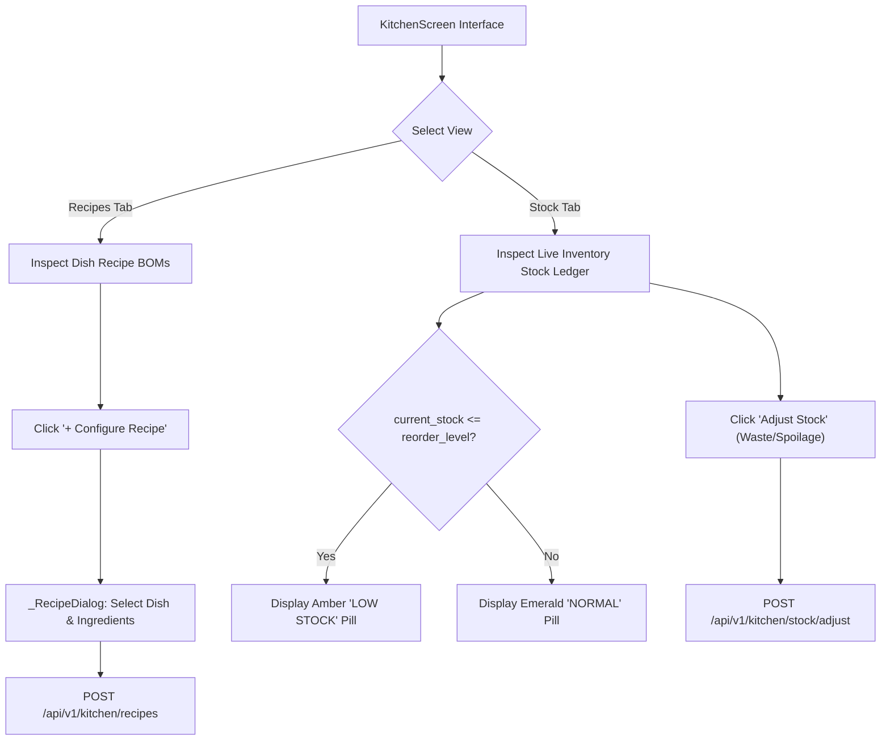

---

### 7.9 Screen 9: Direct & Indirect Operating Expenses (`ExpensesScreen`)

#### A. Screen Overview
- **Screen Name:** Operating Expenses (OPEX)
- **Source File:** `frontend/lib/ui/screens/expenses/expenses_screen.dart`
- **Route Path:** `/expenses`
- **Primary Widget:** `ExpensesScreen` (ConsumerStatefulWidget)
- **Role Access:** `SUPER_ADMIN`, `RESTAURANT_ADMIN`, `BRANCH_MANAGER`; (Restricted for `CASHIER` and `STAFF`)
- **Parent Layout / Entry Point:** Accessible via Left Sidebar navigation.
- **Business Purpose:** Captures all non-inventory operational cash outflows: utilities (electricity, water, gas), premises rent, equipment maintenance, marketing, municipal fees, and petty cash expenditures to ensure accurate net profit calculations.

#### B. Layout and Visual Structure
- **Expense Control Bar:** Search bar (filters description/invoice), Category dropdown selector (Rent, Utilities, Maintenance, etc.), Date Range filter, "+ New Category" button, and primary `"+ Add Expense"` action button.
- **Expense Ledger Table:** Data table showing Expense Date, Category chip, Description/Vendor, Payment Method (Cash, UPI, Bank Transfer), Invoice Number, Amount (₹), and Action icons (Edit, Delete).
- **Modals:**
  - `_showExpenseModal`: Single and bulk expense capture modal.
  - New Category Dialog: Form to create tenant-specific expense categories.

#### C. Complete UI Element Inventory Table

| # | Element / Label | Widget / Type | Purpose | Data Source | Interaction / Behavior | Validation / Permissions | State / Feedback |
| :- | :--- | :--- | :--- | :--- | :--- | :--- | :--- |
| 1 | **Expense Search** | `TextField` | Filter expenses by description | Local query string | Live search filtering on expense ledger | Admin & Manager | Real-time table updates |
| 2 | **Category Selector** | `DropdownButton` | Filter by expense classification | `expenseCategoriesProvider`| Filters table rows by selected category | Admin & Manager | Selected category shown |
| 3 | **New Category Btn** | `IconButton` | Create custom expense category | Static action | Opens Category creation modal | Admin & Manager | Dialog prompt appears |
| 4 | **Add Expense Button**| `ElevatedButton` | Open expense logging modal | Static action | Opens `_showExpenseModal` | Admin & Manager | Modal bottom sheet/dialog |
| 5 | **Expense Category** | `DropdownButton` | Select category in modal | `expenseCategoriesProvider`| Binds selected category ID | Required in form | Displays category name |
| 6 | **Expense Amount** | `TextField` | Enter expense monetary value | Modal state | Numeric currency input | Must be $> 0$ | Formatted currency |
| 7 | **Expense Date** | `InkWell` / `DatePicker` | Select transaction date | Modal date state | Opens date picker calendar | Cannot be future date | Formatted `yyyy-MM-dd` |
| 8 | **Payment Method** | `DropdownButton` | Tender type used for payout | Payment methods list | Cash, UPI, Bank Transfer, Cheque | Required | Selected tender shown |
| 9 | **Vendor / Description**| `TextField` | Record vendor or payout reason | Modal state | Free-form text (e.g., `"TSSPDCL Power Bill"`)| Optional/Recommended | Stored in ledger |
| 10 | **Receipt / Bill Ref** | `TextField` | Record receipt voucher number | Modal state | Reference string for audit | Optional | Stored in ledger |
| 11 | **Save Expense** | `ElevatedButton` | Commit expense to database | Expenses API | Calls `POST /api/v1/expenses`; updates outflow | Required fields valid | Loading spinner; closes modal |
| 12 | **Delete Expense** | `IconButton` | Remove or void expense voucher | `expense.expense_id` | Prompts confirmation; calls DELETE | Admin only | Removes line from table |

#### D. Data Sources and State Management
- **Consumed Providers:** `expensesProvider`, `expenseCategoriesProvider`, `selectedBranchProvider`.
- **State Modifications:** Dispatches `expensesProvider.notifier.addExpense()`. Invalidation immediately updates total outflow on `homeProvider`.

#### E. Backend Integration and API Calls
- `GET /api/v1/expenses`: Fetches expenses filtered by branch and date.
- `GET /api/v1/expenses/categories`: Fetches expense categories for the active tenant.
- `POST /api/v1/expenses/categories`: Creates a new expense category.
- `POST /api/v1/expenses`: Records an expense entry.
  - Payload:
    ```json
    {
      "category_id": 3,
      "branch_id": "br_001",
      "amount": 14500.00,
      "expense_date": "2026-10-28",
      "payment_method": "Bank Transfer",
      "description": "Commercial Kitchen Exhaust Duct Cleaning",
      "invoice_number": "INV-7731"
    }
    ```
- `DELETE /api/v1/expenses/{expense_id}`: Removes or voids an expense record.

#### F. Business Logic and Financial Rules
- Operating expenses are deducted directly against dining revenue inflows to calculate Net Operating Margin and EBITDA.
- Expenses paid in Cash are subtracted from the front-of-house cash drawer reconciliation during shift closures.

#### G. Edge Cases, Validations, and Error Handling
- **Future Date Restriction:** Date picker restricts selection to `DateTime.now()` or earlier, preventing accidental future expense posting.

#### H. User Flows and Navigation
- Manager clicks "Add Expense" $\rightarrow$ selects "Utilities" $\rightarrow$ enters ₹14,500 $\rightarrow$ selects Bank Transfer $\rightarrow$ saves $\rightarrow$ expense ledger updates; Executive Dashboard outflow increases by ₹14,500.

#### I. Screen-Level Mermaid Diagram

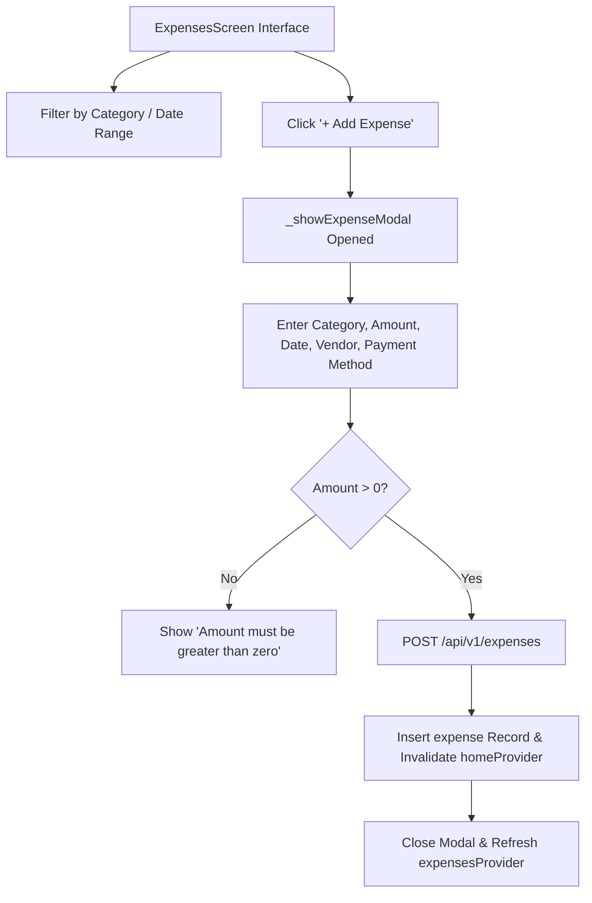

---

### 7.10 Screen 10: Multi-Dimensional Analytics & Reports (`ReportsScreen`)

#### A. Screen Overview
- **Screen Name:** Multi-Dimensional Analytics & Reports
- **Source File:** `frontend/lib/ui/screens/reports/reports_screen.dart`
- **Route Path:** `/reports`
- **Primary Widget:** `ReportsScreen` (ConsumerStatefulWidget)
- **Role Access:** `SUPER_ADMIN`, `RESTAURANT_ADMIN`, `BRANCH_MANAGER` (Branch overview only); (Restricted for `CASHIER` and `STAFF`)
- **Parent Layout / Entry Point:** Accessible via Left Sidebar navigation.
- **Business Purpose:** Comprehensive six-pillar business intelligence suite providing granular operational, financial, culinary, and human resource telemetry, fl_chart visualizations, and automated PDF/CSV document exports.

#### B. Layout and Visual Structure
- **Global Reports Header:** Date Range Selector (Today, Yesterday, Last 7 Days, Last 30 Days, Custom Calendar Range), Branch Context badge, and a high-profile `"Export Report"` action button with format dropdown (PDF / CSV).
- **Six-Section Analytical Tab Bar:**
  1. **Overview View (`OverviewView`):** Revenue vs expense trends line chart, top revenue-generating menu items bar chart, and key financial metric tiles.
  2. **Executive Summary (`ExecutiveSummarySection`):** High-level P&L statement: Gross Dining Revenue, Cost of Goods Sold (COGS), Gross Profit, Operating Expenses (OPEX), Net Margin, and EBITDA.
  3. **Sales & Menu Engineering (`SalesEngineeringSection`):** Menu Engineering Matrix classifying dishes into Boston Consulting Group (BCG) restaurant quadrants: **Stars** (High Popularity, High Margin), **Plowhorses** (High Popularity, Low Margin), **Puzzles** (Low Popularity, High Margin), and **Dogs** (Low Popularity, Low Margin). Average Order Value (AOV), and peak hourly ordering heatmaps.
  4. **Inventory & Supply Chain (`InventorySupplySection`):** Procurement expenditure by ingredient category, stock turnover ratios, wastage shrinkage rates, and low-stock reorder forecasts.
  5. **Expenses & HR (`ExpensesHrSection`):** Labor cost percentage of sales, breakdown of wages vs general OPEX, and expense distribution doughnut charts.
  6. **Operations & Floor (`OperationsSection`):** Table turnover rates, average table dining duration, order-to-settlement latency, and payment tender mix.

#### C. Complete UI Element Inventory Table

| # | Element / Label | Widget / Type | Purpose | Data Source | Interaction / Behavior | Validation / Permissions | State / Feedback |
| :- | :--- | :--- | :--- | :--- | :--- | :--- | :--- |
| 1 | **Date Range Selector**| `DropdownButton` / `Chip` | Choose analytics timeframe | Date range state | Switches timeframe (Today, 7D, 30D, Custom) | All authorized roles | Active timeframe displayed |
| 2 | **Export Report Button**| `PopupMenuButton` | Download structured report | Static actions | Triggers PDF or CSV export API call | Admin only | Shows downloading spinner; saves file |
| 3 | **Export as PDF** | `PopupMenuItem` | Generate executive PDF | `/reports/export/pdf` | Downloads formatted PDF report via FPDF | Admin only | Native file save dialog |
| 4 | **Export as CSV** | `PopupMenuItem` | Generate raw CSV data | `/reports/export/csv` | Downloads tabular CSV spreadsheet | Admin only | Native file save dialog |
| 5 | **Report Navigation Tabs**| `TabBar` | Switch between 6 pillars | 6 Pillar definitions | Switches view between Overview, P&L, Menu, etc. | Admin & Manager | Underlined indicator on active pillar |
| 6 | **Revenue Trend Chart**| `fl_chart.LineChart` | Visualize daily cash inflow | `salesTrendsProvider` | Hover points display date and exact revenue | All authorized roles | Interactive animated line curve |
| 7 | **Top Items Bar Chart** | `fl_chart.BarChart` | Visualize top dish volumes | `reportsOverviewProvider` | Renders vertical bars for top 5 dishes | All authorized roles | Hover displays units sold |
| 8 | **Gross Revenue Tile** | `StatCard` | Display gross dining sales | `executiveSummary.gross` | Prominent formatted currency | Admin only | Emerald text with upward arrow |
| 9 | **COGS Tile** | `StatCard` | Cost of Goods Sold total | `executiveSummary.cogs` | Raw ingredient cost of food sold | Admin only | Amber text |
| 10 | **Net Profit Tile** | `StatCard` | $\text{Gross} - \text{COGS} - \text{OPEX}$ | `executiveSummary.net` | Final bottom-line restaurant profit | Admin only | Dynamic color (Green/Red) |
| 11 | **Menu Matrix Quadrants**| `GridView` / `Card` | BCG menu engineering matrix | `salesEngineering.matrix` | Groups items into Stars, Plowhorses, Puzzles, Dogs | Admin & Manager | 4 distinct color-coded quadrants |
| 12 | **Labor Cost % Tile** | `StatCard` | $\frac{\text{Salaries}}{\text{Revenue}} \times 100$ | `expensesHr.labor_pct` | Industry benchmark comparison (target $< 30\%$) | Admin only | Shows percentage badge |
| 13 | **Table Turnover Metric**| `StatCard` | Turns per table per day | `operations.turns` | Floor efficiency counter | Admin & Manager | Decimal number (e.g. `4.2 turns/day`) |

#### D. Data Sources and State Management
- **Consumed Providers:** `reportsOverviewProvider`, `salesTrendsProvider`, `executiveSummaryProvider`, `salesEngineeringProvider`, `inventorySupplyProvider`, `expensesHrProvider`, `operationsProvider`, `selectedRestaurantIdProvider`, `selectedBranchProvider`.
- **State Modifications:** Changing the date range dropdown updates `reportDateRangeProvider`, which automatically re-executes all 6 async providers concurrently.

#### E. Backend Integration and API Calls
- `GET /api/v1/reports/overview`: Summary metrics and top items.
- `GET /api/v1/reports/executive-summary`: Detailed P&L statement.
- `GET /api/v1/reports/sales-engineering`: Menu matrix and AOV.
- `GET /api/v1/reports/inventory-supply`: Stock turnover and procurement spend.
- `GET /api/v1/reports/expenses-hr`: Labor cost ratio and expense categorization.
- `GET /api/v1/reports/operations`: Table turn rates and latency metrics.
- `GET /api/v1/reports/export/pdf`: Returns binary application/pdf generated via FPDF.
- `GET /api/v1/reports/export/csv`: Returns binary text/csv.

#### F. Business Logic and Financial Rules
- **Cost of Goods Sold (COGS):**
  $$\text{COGS} = \sum_{\text{Orders}} \left( \sum_{\text{Recipe}} \text{quantity\_required} \times \text{ingredient\_procurement\_cost} \right)$$
- **EBITDA / Net Operating Profit:**
  $$\text{Net Profit} = \text{Gross Dining Revenue} - (\text{COGS} + \text{Salaries} + \text{Operating Expenses})$$
- **Labor Cost Ratio:**
  $$\text{Labor Cost \%} = \left( \frac{\text{Total Salaries Disbursed}}{\text{Gross Revenue}} \right) \times 100$$

#### G. Edge Cases, Validations, and Error Handling
- **No Data in Selected Date Range:** Renders clean empty-state visual with illustration and text: `"No transactions found for the selected date range. Select a broader date window."`

#### H. User Flows and Navigation
- Restaurant Admin selects "Last 30 Days" $\rightarrow$ inspects Executive Summary P&L $\rightarrow$ clicks "Export Report" $\rightarrow$ selects "PDF" $\rightarrow$ FPDF service generates executive briefing $\rightarrow$ file downloads locally.

#### I. Screen-Level Mermaid Diagram

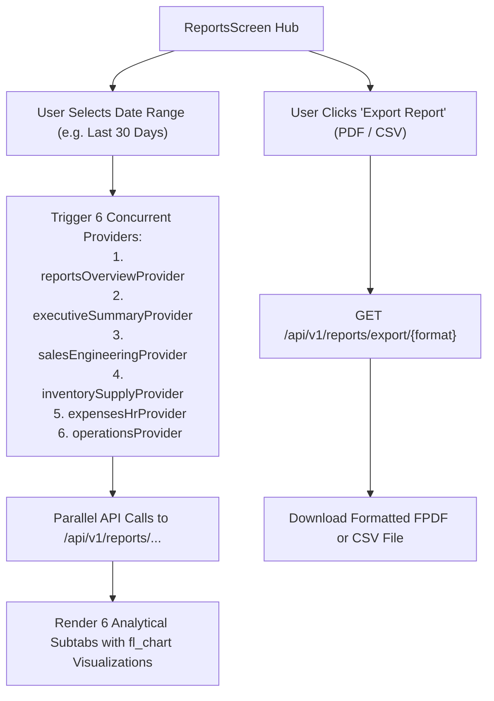

---

### 7.11 Screen 11: AI Command Center (`AiCommandCenterScreen`)

#### A. Screen Overview
- **Screen Name:** AI Command Center
- **Source File:** `frontend/lib/ui/screens/ai/ai_command_center.dart`
- **Route Path:** `/ai`
- **Primary Widget:** `AiCommandCenterScreen` (ConsumerStatefulWidget)
- **Role Access:** `SUPER_ADMIN`, `RESTAURANT_ADMIN`, `BRANCH_MANAGER`; (Restricted for `CASHIER` and `STAFF`)
- **Parent Layout / Entry Point:** Accessible via Left Sidebar navigation.
- **Business Purpose:** Advanced conversational natural-language data intelligence console allowing restaurant owners and managers to query complex database metrics in plain English (e.g., *"Compare food costs between Banjara Hills and Hitec City for Biryani"*), inspect automatically generated SQL queries, and render interactive Altair/Vega-Lite data visualizations.

#### B. Layout and Visual Structure
- **Conversation Thread:** Scrollable chat feed rendering alternating query bubbles (User prompt right-aligned in indigo; AI response left-aligned in dark slate).
- **AI Response Content Cards:**
  - Formatted Markdown text explanation.
  - Collapsible SQL inspection tile displaying generated SQL query.
  - Interactive visualization viewport embedding Altair charts via webview or SVG/HTML frame (`/api/v1/chat/chart/{chart_id}`).
- **Suggested Prompts Carousel:** Horizontally scrolling chips with curated operational queries.
- **Prompt Composer Bar:** Multi-line text field with microphone icon (speech input placeholder) and Send action button.

#### C. Complete UI Element Inventory Table

| # | Element / Label | Widget / Type | Purpose | Data Source | Interaction / Behavior | Validation / Permissions | State / Feedback |
| :- | :--- | :--- | :--- | :--- | :--- | :--- | :--- |
| 1 | **Chat Feed** | `ListView.builder` | Display query conversation | `chatStreamProvider` | Scrollable thread of messages | All authorized roles | Auto-scrolls to bottom on response |
| 2 | **Suggested Query Chips**| `Wrap` / `ActionChip` | Quick-launch analytical queries | Pre-defined queries list | Clicking chip populates prompt and submits | All authorized roles | Instant query dispatch |
| 3 | **Prompt Input Field** | `TextField` | Enter natural language question| Local `TextEditingController` | Captures query text; supports multiline | Min 3 characters | Expands up to 4 lines |
| 4 | **Send Query Button** | `IconButton` | Submit question to AI engine | Chat notifier | Dispatches question; sets `isThinking = true` | Disabled if field empty | Turns into spinner while thinking |
| 5 | **AI Markdown Bubble** | `MarkdownBody` | Render AI natural text answer | `message.content` | Formatted bold headers, lists, and tables | None | High-readability typography |
| 6 | **SQL Code Inspection**| `ExpansionTile` | Inspect agent-generated SQL | `message.sql_query` | Expands to reveal raw SQL query with syntax tag| Admin & Manager | Monospaced syntax-highlighted block |
| 7 | **Interactive Chart Frame**| `HtmlElementView` / `Container` | Display Altair visualization | `/api/v1/chat/chart/{id}`| Interactive HTML/Vega chart with tooltips | None | Rendered interactive chart |
| 8 | **AiChatBubble (Stub)** | `FloatingActionButton` | Global floating launcher | `ai_chat_bubble.dart` | Present in widget tree; unhooked prototype | Prototype stub | Does not stream responses (gap) |

#### D. Data Sources and State Management
- **Consumed Providers:** `chatStreamProvider`, `selectedRestaurantIdProvider`, `selectedBranchProvider`.
- **State Modifications:** Appends prompt to `chatStreamProvider`, manages streaming tokens, and stores returned `chart_id`.

#### E. Backend Integration and API Calls
- `POST /api/v1/chat`: Dispatches natural language prompt to backend LangChain agent.
  - Request: `{"message": "What is the top selling menu item today?", "restaurant_id": "rest_001", "branch_id": "br_001"}`
  - Response:
    ```json
    {
      "reply": "The top selling item today is **Chicken Dum Biryani** with 42 portions sold, generating **₹15,960.00**.",
      "sql_query": "SELECT mi.name, SUM(oi.quantity) as total_qty, SUM(oi.total_price) as total_rev FROM order_items oi JOIN menu_items mi ON oi.menu_item_id = mi.item_id JOIN orders o ON oi.order_id = o.order_id WHERE o.restaurant_id = 'rest_001' AND date(o.created_at) = date('now') GROUP BY mi.name ORDER BY total_qty DESC LIMIT 1;",
      "chart_id": "chart_77491"
    }
    ```
- `GET /api/v1/chat/chart/{chart_id}`: Serves standalone Altair/Vega-Lite HTML visualization.

#### F. Business Logic and Financial Rules
- **LangChain Safe-Table Isolation:** Backend agent configures `SAFE_TABLES` list strictly excluding the `users` table so AI SQL queries can never read password hashes or user credentials.
- **Mandatory Tenant Guardrail:** Prompt injector forces:
  ```
  "CRITICAL: You MUST filter all queries with: WHERE restaurant_id = '{eff_r_id}'"
  ```
  Preventing cross-tenant data leakage through natural language prompt injection.

#### G. Edge Cases, Validations, and Error Handling
- **Ambiguous Natural Language Query:** If agent cannot parse query, it returns: `"I could not generate a safe SQL query for that question. Please clarify your metrics or date range."`
- **Implementation Gap (`AiChatBubble`):** The floating widget `frontend/lib/ui/widgets/ai_chat_bubble.dart` has an empty `onPressed: () {}` callback and does not stream responses; users must use the dedicated `/ai` screen.

#### H. User Flows and Navigation
- User navigates to `/ai` $\rightarrow$ taps chip "What is today's total revenue?" $\rightarrow$ AI agent executes SQL query $\rightarrow$ returns text answer and chart $\rightarrow$ user inspects generated SQL query.

#### I. Screen-Level Mermaid Diagram

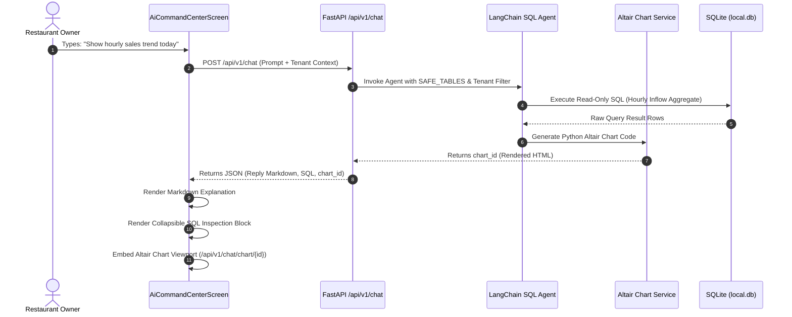

---

### 7.12 Screen 12: Application Shell & Desktop App Bar (`SidebarLayout`)

#### A. Screen Overview
- **Screen Name:** Application Shell & Desktop App Bar
- **Source File:** `frontend/lib/ui/layouts/sidebar_layout.dart`
- **Route Path:** Outer wrapper for `/home`, `/pos`, `/menu`, `/kitchen`, `/groceries`, `/expenses`, `/staff`, `/reports`, `/ai`, `/users`.
- **Primary Widget:** `SidebarLayout` (ConsumerStatefulWidget)
- **Role Access:** All authenticated roles
- **Parent Layout / Entry Point:** Root layout instantiated by `GoRouter` upon authentication.
- **Business Purpose:** Provides structural UI scaffolding, persistent responsive navigation rails, tenant/branch selection controls, active currency indicators, role pills, and user profile management.

#### B. Layout and Visual Structure
- **Top Header Bar (`_DesktopAppBar`):** Fixed 64px height bar across the top of the screen.
- **Left Navigation Rail:** Collapsible sidebar (72px collapsed icon-only / 240px expanded with labels).
- **Responsive Drawer:** Automatically replaces navigation rail on mobile/narrow viewports (< 1024px).
- **Child Content Viewport:** Expanded area displaying the active destination screen.

#### C. Complete UI Element Inventory Table

| # | Element / Label | Widget / Type | Purpose | Data Source | Interaction / Behavior | Validation / Permissions | State / Feedback |
| :- | :--- | :--- | :--- | :--- | :--- | :--- | :--- |
| 1 | **Toggle Sidebar Btn**| `IconButton` | Expand or collapse navigation rail | Local boolean `_isExpanded`| Toggles width between 72px and 240px | All roles | Animated width transition |
| 2 | **Brand Logo & Title** | `Row` / `Text` | Display IOR 360 emblem | Static assets | Non-interactive | All roles | Prominent branding |
| 3 | **Org Switcher Dropdown**| `DropdownButton` | Global tenant switcher | `restaurantListProvider` | Switches active organization; resets branch | `SUPER_ADMIN` only | Dropdown list of tenants |
| 4 | **Branch Switcher** | `DropdownButton` | Filter branch operational context| `branchListProvider` | Switches branch; re-filters floor & stock | Admin & Manager | Dropdown list of branches |
| 5 | **Active Org Pill** | `Container` / `Chip` | Display current tenant name | `activeTenantInfoProvider` | Non-interactive indicator | All roles | Deep indigo container |
| 6 | **Tenant Currency Pill**| `Container` / `Chip` | Display tenant currency code | `CurrencyFormatter.currencyCode` | Displays `₹ INR` | All roles | Emerald badge |
| 7 | **User Role Pill** | `Container` / `Chip` | Display user security role | `authStateProvider.user.role` | Color-coded role indicator | All roles | High-contrast role badge |
| 8 | **Profile Avatar** | `PopupMenuButton` | Access profile info & Sign Out | `authStateProvider.user` | Opens popup menu with User Info and Logout | All roles | Circular initials avatar |
| 9 | **Sign Out Menu Item** | `PopupMenuItem` | Terminate session & log out | Auth notifier | Wipes storage; redirects to `/login` | All roles | Instant logout redirect |
| 10 | **Nav Item: Home** | `NavigationRailDestination` | Navigate to `/home` | GoRouter | Highlights when active; navigates on tap | All roles | Active icon & color highlight |
| 11 | **Nav Item: POS** | `NavigationRailDestination` | Navigate to `/pos` | GoRouter | Highlights when active; navigates on tap | All roles | Active icon & color highlight |
| 12 | **Nav Item: Menu** | `NavigationRailDestination` | Navigate to `/menu` | GoRouter | Highlights when active; navigates on tap | All roles | Active icon & color highlight |
| 13 | **Nav Item: Kitchen** | `NavigationRailDestination` | Navigate to `/kitchen` | GoRouter | Highlights when active; navigates on tap | All roles | Active icon & color highlight |
| 14 | **Nav Item: Groceries**| `NavigationRailDestination` | Navigate to `/groceries` | GoRouter | Highlights when active; navigates on tap | Manager & Admin | Hidden for Cashier/Staff |
| 15 | **Nav Item: Expenses** | `NavigationRailDestination` | Navigate to `/expenses` | GoRouter | Highlights when active; navigates on tap | Manager & Admin | Hidden for Cashier/Staff |
| 16 | **Nav Item: Staff** | `NavigationRailDestination` | Navigate to `/staff` | GoRouter | Highlights when active; navigates on tap | Manager & Admin | Hidden for Cashier/Staff |
| 17 | **Nav Item: Reports** | `NavigationRailDestination` | Navigate to `/reports` | GoRouter | Highlights when active; navigates on tap | Manager & Admin | Hidden for Cashier/Staff |
| 18 | **Nav Item: AI** | `NavigationRailDestination` | Navigate to `/ai` | GoRouter | Highlights when active; navigates on tap | Manager & Admin | Hidden for Cashier/Staff |
| 19 | **Nav Item: Users** | `NavigationRailDestination` | Navigate to `/users` | GoRouter | Highlights when active; navigates on tap | Admins only | Hidden for Manager/Cashier |

#### D. Data Sources and State Management
- **Consumed Providers:** `authStateProvider`, `restaurantListProvider`, `branchListProvider`, `selectedRestaurantIdProvider`, `selectedBranchProvider`, `activeTenantInfoProvider`.
- **State Modifications:** When `selectedRestaurantIdProvider` is changed by a `SUPER_ADMIN`, it executes an invalidation sweep across all 28 domain providers and resets `selectedBranchProvider` to `null`.

#### E. Backend Integration and API Calls
- `GET /api/v1/restaurants`: Loads list of restaurant organizations for the switcher dropdown.
- `GET /api/v1/branches`: Loads list of branches for the active tenant.
- `POST /api/v1/auth/logout`: Clears backend session cookies (if configured).

#### F. Business Logic and Financial Rules
- Currency formatting across the entire UI dynamically reads from `CurrencyFormatter.setCurrency(tenant.currency_symbol)`. For all Indian organizations, it defaults to `₹` (INR).

#### G. Edge Cases, Validations, and Error Handling
- **Non-Super Admin Header Spoofing:** Even if a non-super admin manipulates client memory to alter `selectedRestaurantIdProvider`, backend security clamps the effective tenant ID to the JWT token claim, preventing data leakage.

#### H. User Flows and Navigation
- User clicks sidebar items to transition routes seamlessly while keeping the header context fixed.
- Super Admin selects a new restaurant from dropdown $\rightarrow$ entire application state clears and reloads for the new tenant.

#### I. Screen-Level Mermaid Diagram

```mermaid
graph LR
    subgraph TopBar["_DesktopAppBar"]
        OrgSelect["Org Dropdown (Super Admin)"]
        BranchSelect["Branch Dropdown"]
        ActiveOrg["Active Tenant Pill"]
        Currency["Currency Pill (₹)"]
        RoleBadge["Role Badge"]
        Profile["Avatar -> Logout"]
    end

    subgraph SideRail["Navigation Rail (72px / 240px)"]
        N1["/home"]
        N2["/pos"]
        N3["/menu"]
        N4["/kitchen"]
        N5["/groceries"]
        N6["/expenses"]
        N7["/staff"]
        N8["/reports"]
        N9["/ai"]
        N10["/restaurants"]
        N11["/branches"]
        N12["/users"]
        N13["/settings"]
        N14["/support"]
    end

    subgraph Viewport["Active Content Viewport"]
        Screen["Rendered Destination Screen Widget"]
    end

    TopBar --- SideRail
    SideRail -->|Navigates| Viewport
```

---

### 7.13 Screen 13: Restaurant Organizations Management (`RestaurantsScreen`)

#### A. Screen Overview
- **Screen Name:** Restaurant Organizations Management Screen
- **Source File:** `frontend/lib/ui/screens/restaurants/restaurants_screen.dart`
- **Route / Path:** `/restaurants`
- **Primary Riverpod Providers:** `restaurantListProvider`, `restaurantOpsProvider`
- **Permissions Required:** `SUPER_ADMIN` default; users with explicit `restaurants` permission granted via the **Users tab**.
- **Functional Purpose:** Serves as the central administration cockpit for provisioning, auditing, updating, and deactivating multi-tenant restaurant organizations. Enforces strict platform isolation and safeguards against accidental deletion of organizations with active branches.

#### B. UI Layout & Visual Structure
- **Header Section:** Dynamic title displaying "Restaurants", subtitle showing total managed organizations, and an emerald `+ Add Restaurant` action button (visible only to Super Admins).
- **Search & Filter Bar:** Text input field with instant search debouncing by restaurant name, cuisine type, or operational city.
- **Organization Grid & Cards:** Responsive card layout presenting each restaurant tenant:
  - Header: Restaurant name, cuisine tag pill, and active/inactive status chip.
  - Body: Unique slug identifier, primary contact phone, address, and total registered branch count badge.
  - Action Footer: "View Details" action, "Edit" button, and "Delete" button (Super Admin only).
- **Modals & Dialogs:**
  - `_showRestaurantDialog`: Form modal for creating or editing restaurants (Name, Slug, Cuisine Type, Phone, Address, Is Active).
  - `_showRestaurantDetailsDialog`: Detailed audit modal showing ID, slug, creation timestamp, contact details, and registered branches.
  - `_confirmDeleteRestaurant`: Destructive confirmation dialog with backend cascade validation.

#### C. Detailed UI Elements Inventory

| # | Element / Label | Widget / Type | Purpose | Data Source | Interaction / Behavior | Validation / Permissions | State / Feedback |
| :---: | :--- | :--- | :--- | :--- | :--- | :--- | :--- |
| 1 | Screen Title | `Text` (Headline) | Displays section identity | Static | None | None | Crisp white typography |
| 2 | Tenant Counter Badge | `Chip` / `Container` | Displays total organizations | `restaurantList.length` | None | None | Subtle slate container |
| 3 | "+ Add Restaurant" | `ElevatedButton.icon` | Launches onboarding modal | Static | Opens `_showRestaurantDialog()` | `SUPER_ADMIN` only | Emerald hover highlight |
| 4 | Search Input | `TextField` | Filters restaurants in real-time | User input | Triggers regex filter on list | None | Live card re-indexing |
| 5 | Restaurant Card | `Card` / `Container` | Summarizes tenant organization | `RestaurantModel` | Click opens details dialog | None | Hover elevation effect |
| 6 | Cuisine Pill | `Container` | Identifies cuisine category | `restaurant.cuisine_type` | None | None | Amber/Indigo theme pill |
| 7 | Branch Count Pill | `Container` | Counts linked branch outlets | `branches.length` | None | None | Displays "X Branches" |
| 8 | Edit Action Button | `IconButton` | Modifies organization metadata | Selected entity | Opens `_showRestaurantDialog(item)` | `SUPER_ADMIN` only | Pencil icon |
| 9 | Delete Action Button | `IconButton` | Deactivates or removes tenant | Selected entity | Opens `_confirmDeleteRestaurant()` | `SUPER_ADMIN` only | Red icon with warning dialog |
| 10 | Save Restaurant | `ElevatedButton` | Submits create/edit payload | Form State | Executes POST/PUT API | Validates required name & slug | Shows loading spinner |

#### D. State Management & Riverpod Hooks
- `restaurantListProvider`: Asynchronously loads `List<RestaurantModel>` from `/api/v1/restaurants`.
- `ref.refresh(restaurantListProvider)`: Automatically re-evaluates and invalidates cached tenant lists upon successful creation, modification, or deletion.

#### E. Backend Integration and API Calls
- `GET /api/v1/restaurants`: Returns all organizations (Super Admin) or authorized tenant metadata.
- `POST /api/v1/restaurants`: Provisions a new restaurant organization.
- `GET /api/v1/restaurants/{id}`: Fetches specific tenant details.
- `PUT /api/v1/restaurants/{id}`: Updates name, slug, phone, cuisine, or active status.
- `DELETE /api/v1/restaurants/{id}`: Deletes or archives tenant with branch cascade protection.

#### F. Business Logic & RBAC Enforcement
- **Centralized Access Rule:** Access to the Restaurants tab is granted exclusively via the **Users Tab (`/users`)**. There is NO redundant access management UI inside the Restaurants tab itself.
- **Super Admin Exclusive Provisioning:** Non-superadmin users granted read-only access to `/restaurants` can inspect organizations but cannot see or trigger the `+ Add Restaurant`, `Edit`, or `Delete` actions.

#### G. Edge Cases, Validations, and Cascade Protections
- **Duplicate Slug Validation:** Slug must be unique; duplicate slugs are rejected with HTTP 400.
- **Cascade Deletion Guard:** If a restaurant has active branches with historical bills or orders, the backend blocks hard deletion with HTTP 400, requiring branch deactivation or archival first.

#### H. User Flows and Navigation
- Super Admin opens `/restaurants` $\rightarrow$ Taps `+ Add Restaurant` $\rightarrow$ Fills Name ("Kakatiya Kitchen"), Slug ("kakatiya"), Cuisine ("Andhra"), Phone $\rightarrow$ Taps "Save" $\rightarrow$ Backend provisions tenant and refreshes list.

#### I. Screen-Level Mermaid Diagram

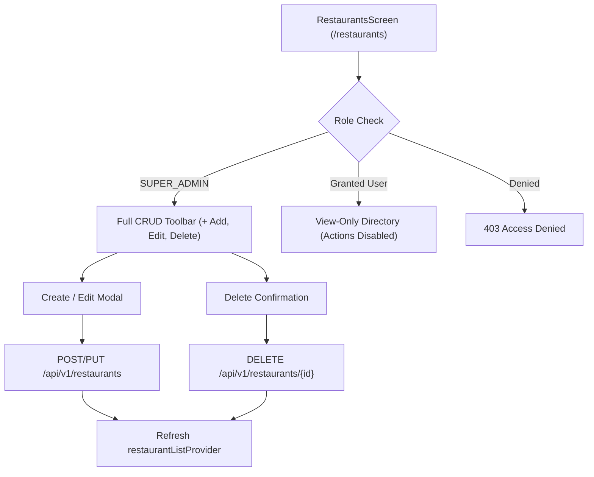

---

### 7.14 Screen 14: Branch Outlets Management (`BranchesScreen`)

#### A. Screen Overview
- **Screen Name:** Branch Outlets Management Screen
- **Source File:** `frontend/lib/ui/screens/branches/branches_screen.dart`
- **Route / Path:** `/branches`
- **Primary Riverpod Providers:** `branchListProvider`, `branchOpsProvider`, `restaurantListProvider`
- **Permissions Required:** `SUPER_ADMIN` and `RESTAURANT_ADMIN` (scoped to own org); `BRANCH_MANAGER` (assigned branch); or users granted explicit `branches` tab permission.
- **Functional Purpose:** Manages physical restaurant outlets, addresses, phone numbers, seating capacities, and operational statuses across multi-location chains.

#### B. UI Layout & Visual Structure
- **Header Section:** Title displaying "Branch Management", branch count telemetry, and an emerald `+ Add Branch` button.
- **Tenant Scope Filter:** For Super Admins, a dropdown selector filters branches by parent restaurant organization. For Restaurant Admins, it displays their organization name.
- **Branch Grid Cards:** Responsive cards displaying:
  - Branch name and active status badge (`Active` / `Inactive`).
  - Physical address, contact telephone, and manager in charge.
  - Action bar: "Edit Branch", "Delete Branch", and "View Details".
- **Modals:**
  - `_showBranchDialog`: Form modal for onboarding or editing an outlet (Restaurant Selector, Branch Name, Address, Phone, Is Active).
  - `_showBranchDetailsDialog`: Comprehensive view of branch configuration, table count, and order history.
  - `_confirmDeleteBranch`: Confirmation dialog with table/bill safety check.

#### C. Detailed UI Elements Inventory

| # | Element / Label | Widget / Type | Purpose | Data Source | Interaction / Behavior | Validation / Permissions | State / Feedback |
| :---: | :--- | :--- | :--- | :--- | :--- | :--- | :--- |
| 1 | Header Title | `Text` | Displays module title | Static | None | None | Bold white typography |
| 2 | "+ Add Branch" | `ElevatedButton.icon` | Launches branch onboarding | Static | Opens `_showBranchDialog()` | Admin / Super Admin | Emerald accent button |
| 3 | Restaurant Filter | `DropdownButtonFormField` | Filters branches by tenant | `restaurantListProvider` | Updates selected filter | `SUPER_ADMIN` only | Updates branch list |
| 4 | Search Field | `TextField` | Filters branches by name/city | User input | Filters cards in real time | None | Immediate UI filter |
| 5 | Branch Card | `Card` / `Container` | Displays outlet information | `BranchModel` | Click opens details dialog | None | Slate border styling |
| 6 | Active Status Pill | `Container` | Displays active state | `branch.is_active` | None | None | Green (`Active`) / Red (`Inactive`) |
| 7 | Edit Branch | `IconButton` | Edits outlet address/phone | Selected branch | Opens `_showBranchDialog(item)` | Admin / Super Admin | Slate icon button |
| 8 | Delete Branch | `IconButton` | Deactivates or removes branch | Selected branch | Opens `_confirmDeleteBranch()` | Admin / Super Admin | Red icon with confirmation |
| 9 | Save Branch | `ElevatedButton` | Submits branch data | Form state | Executes POST/PUT API | Validates name and restaurant | Spinner feedback |

#### D. State Management & Riverpod Hooks
- `branchListProvider`: Fetches `List<BranchModel>` from `/api/v1/branches/`.
- `branchOpsProvider`: Manages loading, creation, editing, and deletion operations with error notifications.

#### E. Backend Integration and API Calls
- `GET /api/v1/branches/`: Lists branches matching the user's tenant or selected restaurant.
- `POST /api/v1/branches/`: Creates a new branch outlet bound to `restaurant_id`.
- `GET /api/v1/branches/{branch_id}`: Retrieves single branch details.
- `PUT /api/v1/branches/{branch_id}`: Updates branch address, phone, or active status.
- `DELETE /api/v1/branches/{branch_id}`: Deactivates or removes branch with active order protection.

#### F. Business Logic & RBAC Enforcement
- **Centralized Access Rule:** Access to the Branches tab is managed centrally in the **Users tab (`/users`)**.
- **Tenant Scope Guard:** `RESTAURANT_ADMIN` can only view and create branches under their own `restaurant_id`. Any attempt to create a branch under a different restaurant is rejected with HTTP 403 Forbidden.

#### G. Edge Cases & Validation Protections
- **Active Bills Guard:** Deleting a branch with unpaid orders or open tables is strictly blocked by the backend to maintain financial ledger integrity.

#### H. User Flows and Navigation
- Admin selects `/branches` $\rightarrow$ Clicks `+ Add Branch` $\rightarrow$ Enters "Hanamkonda Flagship", Address, Phone $\rightarrow$ Submits $\rightarrow$ Branch appears in floor and billing pickers.

#### I. Screen-Level Mermaid Diagram

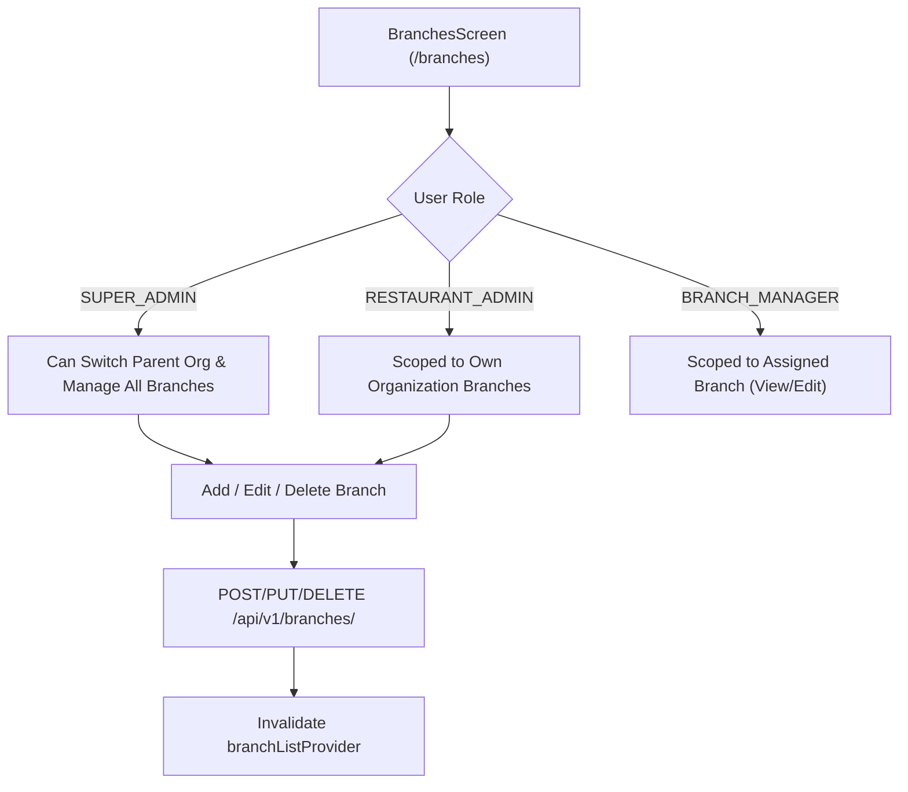

---

### 7.15 Screen 15: Settings & Hardware Terminal Configuration (`SettingsScreen`)

#### A. Screen Overview
- **Screen Name:** Settings & Hardware Terminal Configuration Screen
- **Source File:** `frontend/lib/ui/screens/settings/settings_screen.dart`
- **Route / Path:** `/settings` (supports query deep-linking: `/settings?tab=profile`)
- **Primary Riverpod Providers:** `settingsProvider`, `SettingsNotifier`, `authStateProvider`
- **Permissions Required:** All authenticated users (with role-adaptive sub-tabs).
- **Functional Purpose:** Serves as the system-wide hardware terminal configuration hub, receipt branding studio, POS rule engine, user profile manager, and local diagnostic center.

#### B. UI Layout & Visual Structure
The screen features a 5-tab responsive navigation header with seamless tab transitions:
1. **Printer & Hardware (`SettingsTab.printer`):** Hardware printer device selection (`Retsol_POS_80`, `TVS_RP3200`, `Epson_TM_T82`), paper width toggle (80mm vs 58mm), auto-print on checkout switch, print KOT switch, and a 1-click "Test Printer Connection" button.
2. **Receipt & Branding (`SettingsTab.branding`):** Customization controls for restaurant receipt header, branch address, GSTIN number, telephone, and custom footer tagline ("Thank you for dining with us!"). Includes a **Live Thermal Receipt Preview** rendered in authentic monospace font simulating physical thermal paper output.
3. **POS & Billing Rules (`SettingsTab.billing`):** Default tax rate (GST %), service charge %, currency format (`₹ INR`), and default tender selection (`UPI / QR`, `Cash`, `Card`).
4. **My Profile (`SettingsTab.profile`):** User identity overview, avatar, username, role badge, assigned branch, and an **In-App Password Update Form** (Current Password, New Password, Confirm New Password) with real-time validation.
5. **System & Terminal (`SettingsTab.system`):** System diagnostics, client build version, API connection latency, local database engine status, and session token telemetry.

#### C. Detailed UI Elements Inventory

| # | Element / Label | Widget / Type | Purpose | Data Source | Interaction / Behavior | Validation / Permissions | State / Feedback |
| :---: | :--- | :--- | :--- | :--- | :--- | :--- | :--- |
| 1 | Tab Navigation Bar | `TabBar` / `SegmentedButton` | Switches settings sub-tabs | Tab definitions | Switches active view | None | Animated emerald indicator |
| 2 | Printer Device Selector | `DropdownButtonFormField` | Selects ESC/POS printer | System printers list | Updates selected printer | Cashier & Above | Updates `settingsState` |
| 3 | Paper Width Toggle | `SegmentedButton<int>` | Selects 80mm (48ch) or 58mm (32ch) | `settings.paperWidth` | Toggles receipt column width | Cashier & Above | Live preview re-wraps |
| 4 | "Test Printer" | `ElevatedButton.icon` | Prints physical test slip | None | Invokes `/api/v1/billing/printer/test` | Cashier & Above | Shows printing spinner & toast |
| 5 | Auto-Print Toggle | `SwitchListTile` | Automates bill printing | `settings.autoPrint` | Toggles boolean preference | Cashier & Above | Saved to local settings |
| 6 | Receipt Header Input | `TextFormField` | Sets business name on slip | `settings.headerText` | Edits receipt title | Admin / Manager | Monospace preview updates |
| 7 | Live Thermal Preview | `Container` with Monospace `Text` | Visualizes printed receipt | Live branding state | Renders simulated paper ticket | None | Cream paper styling |
| 8 | Default GST Rate (%) | `TextFormField` | Sets default tax calculation | `settings.taxRate` | Updates default GST | Admin only | Numeric validation |
| 9 | Current Password | `TextFormField` (Obscured) | Verifies user authorization | User input | Verifies existing password | All Users | Required field |
| 10 | New Password | `TextFormField` (Obscured) | Sets updated password | User input | Validates $\ge 6$ characters | All Users | Strength indicator |
| 11 | "Update Password" | `ElevatedButton` | Submits password change | Form State | Calls `/api/v1/auth/change-password` | All Users | Success snackbar & form reset |
| 12 | System Health Badge | `Chip` | Displays API status | `/health` endpoint | None | None | Green "ONLINE" indicator |

#### D. State Management & Riverpod Hooks
- `settingsProvider`: A `StateNotifierProvider<SettingsNotifier, SettingsState>` that manages terminal preferences, printer configuration, branding text, and tax defaults.
- `authStateProvider`: Provides active user credentials and identity for the My Profile view.
- Query Parameter Support: Inspects `state.uri.queryParameters['tab']` in `initState()` and `didUpdateWidget()` to automatically activate `SettingsTab.profile` when deep-linked.

#### E. Backend Integration and API Calls
- `POST /api/v1/billing/printer/test`: Sends a raw binary ESC/POS test payload to the Windows print spooler (`winspool.drv`).
- `POST /api/v1/auth/change-password`: Validates current password via Bcrypt, checks password constraints, hashes new password, and commits update to database.
- `GET /health` & `GET /api/v1/health`: Checks API runtime health, version, and database connectivity.

#### F. Business Logic & Thermal Printer Spooler Bridge
- **Raw Win32 Spooler Integration:** Communicates natively with thermal receipt printers via `backend/services/thermal_printer.py` using Python's `win32print` / `winspool.drv`. It bypasses generic Windows GDI drivers to stream pure ESC/POS control bytes directly to the hardware.
- **ESC/POS Command Generation:**
  - Initialize Printer: `ESC @` (`\x1b\x40`)
  - Center Align: `ESC a 1` (`\x1b\x61\x01`)
  - Bold Text On/Off: `ESC E 1` / `ESC E 0`
  - Paper Feed & Cut: `GS V 66 0` (`\x1d\x56\x42\x00`)

#### G. Edge Cases & Validations
- **Deep Linking Query Parameter:** When arriving via `/settings?tab=profile` (from top-right profile avatar), the screen immediately selects the Profile sub-tab, bypassing the default Printer tab.
- **Password Mismatch Guard:** New password and confirm password fields are strictly validated before making backend calls. Wrong current password returns HTTP 400 with a user-friendly error message.

#### H. User Flows and Navigation
- User taps top-right profile avatar $\rightarrow$ App navigates to `/settings?tab=profile` $\rightarrow$ Profile tab activates $\rightarrow$ User enters current password and new password $\rightarrow$ Clicks "Update Password" $\rightarrow$ Toast confirms "Password successfully updated!".

#### I. Screen-Level Mermaid Diagram

```mermaid
flowchart TD
    A["SettingsScreen (/settings)"] --> B{"Query Param 'tab'"}
    B -->|'profile'| C["Active Tab: My Profile"]
    B -->|Default / null| D["Active Tab: Printer & Hardware"]
    D --> E["Select Printer & Paper Width (80mm/58mm)"]
    D --> F["1-Click Test Printer -> winspool.drv"]
    A --> G["Receipt & Branding -> Live Thermal Monospace Preview"]
    A --> H["POS & Billing Rules -> Tax Rate & Tender Preferences"]
    C --> I["Enter Current & New Password"]
    I --> J["POST /api/v1/auth/change-password"]
    J --> K["Success Notification & Reset Form"]
```

---

### 7.16 Screen 16: Operations Support & Diagnostics Helpdesk (`SupportScreen`)

#### A. Screen Overview
- **Screen Name:** Operations Support & Diagnostics Helpdesk Screen
- **Source File:** `frontend/lib/ui/screens/support/support_screen.dart`
- **Route / Path:** `/support`
- **Primary Riverpod Providers:** `supportTicketsProvider`, `supportFaqsProvider`, `supportInfoProvider`
- **Permissions Required:** All authenticated users (with strict multi-tenant ticket isolation).
- **Functional Purpose:** Delivers mission-critical support services for busy restaurant staff: 24/7 emergency dispatch hotlines, interactive ticket desk, 1-click system diagnostics snapshot, operations FAQs, and a POS cashier keyboard shortcuts cheat sheet.

#### B. UI Layout & Visual Structure
The Support Screen is organized into 4 distinct operational zones:
1. **Emergency Action Cards:** Three prominent priority cards:
   - *24/7 Operations Hotline:* Phone helpline with direct dial action (`1800-IOR-360`).
   - *WhatsApp Tech Dispatch:* Instant messaging link for hardware or billing emergencies (`+91 98765 43210`).
   - *Remote Desktop Connect:* One-click prompt to initiate remote session with support engineers.
2. **Support Ticket Desk:**
   - *Raise a Ticket Form:* Subject, Category (`POS & Billing`, `Hardware & Printer`, `Kitchen & Inventory`, `Staff & Payroll`, `Account Access`), Priority (`Low`, `Medium`, `High`, `Urgent`), and Detailed Description.
   - *My Recent Tickets:* Live audit ledger showing ticket ID, subject, category pill, priority badge, creation timestamp, and colored status chip (`Open`, `In Progress`, `Resolved`, `Closed`).
3. **System Diagnostics Snapshot:** Card summarizing client OS, browser/desktop runtime, active organization, scoped branch, API latency, and session expiration. Features a **"Copy Diagnostics for Support"** button that formats all technical details into markdown for instant sharing.
4. **Operations FAQs & POS Shortcuts:**
   - *Searchable Knowledge Base:* Categorized accordions answering common operational questions (reprinting KOTs, handling offline printer queues, voiding bills).
   - *POS Cashier Keyboard Shortcuts Cheat Sheet:* Interactive reference table of high-speed keyboard shortcuts (`F1`, `F2`, `F4`, `F8`, `Ctrl+P`, `Ctrl+Enter`, `Esc`, `Alt+N`).

#### C. Detailed UI Elements Inventory

| # | Element / Label | Widget / Type | Purpose | Data Source | Interaction / Behavior | Validation / Permissions | State / Feedback |
| :---: | :--- | :--- | :--- | :--- | :--- | :--- | :--- |
| 1 | Screen Header | `Text` (Title & Subtitle) | Introduces support desk | Static | None | None | Crisp white typography |
| 2 | Emergency Phone Card | `Card` / `InkWell` | Emergency voice support | `supportInfoProvider` | Launches dialer | All Roles | Indigo gradient card |
| 3 | WhatsApp Dispatch | `Card` / `InkWell` | Fast messaging support | `supportInfoProvider` | Launches WhatsApp | All Roles | Emerald gradient card |
| 4 | Remote Assist Card | `Card` / `InkWell` | Remote session request | `supportInfoProvider` | Prompts support agent | All Roles | Purple gradient card |
| 5 | Ticket Subject Field | `TextFormField` | Brief problem summary | User input | Captures ticket title | Required field | Validation error if empty |
| 6 | Category Dropdown | `DropdownButtonFormField` | Categorizes support area | Category enum | Selects problem domain | Required | Expands full width |
| 7 | Priority Selector | `DropdownButtonFormField` | Escalates ticket urgency | Priority enum | Selects urgency level | Required | Urgency color indicator |
| 8 | Ticket Description | `TextFormField` (Multi-line)| Detailed issue explanation| User input | Captures reproduction steps| Required field | Expandable field |
| 9 | "Submit Ticket" | `ElevatedButton` | Creates support ticket | Form state | Executes POST API | Validates all fields | Shows loading spinner |
| 10 | Ticket History Card | `Card` / `ListView` | Lists tenant tickets | `supportTicketsProvider` | Shows ticket status | Multi-tenant filtered | Real-time status chips |
| 11 | "Copy Diagnostics" | `OutlinedButton.icon` | Copies system telemetry | Client & Session | Copies markdown to clipboard | All Roles | Shows toast confirmation |
| 12 | FAQ Accordion | `ExpansionTile` | Answers operational questions| `supportFaqsProvider` | Expands answer text | All Roles | Smooth expand animation |
| 13 | POS Shortcuts Grid | `DataTable` / `Wrap` | Displays keyboard shortcuts | Static mapping | None | All Roles | Monospace keycaps (`Ctrl+P`) |

#### D. State Management & Riverpod Hooks
- `supportTicketsProvider`: Dynamically watches `authStateProvider` and `selectedRestaurantIdProvider`. When user switches tenant or logs out, the provider automatically disposes stale tickets and fetches only tickets belonging to the active organization.
- `supportFaqsProvider`: Cached FutureProvider serving operational troubleshooting documentation.
- `supportInfoProvider`: Fetches emergency contact details from `/api/v1/support/info`.

#### E. Backend Integration and API Calls
- `GET /api/v1/support/info`: Fetches emergency phone, WhatsApp number, and portal URL.
- `GET /api/v1/support/faqs`: Retrieves categorized troubleshooting FAQs.
- `GET /api/v1/support/tickets`: Lists support tickets strictly scoped to `current_user['restaurant_id']`.
- `POST /api/v1/support/tickets`: Submits a new support ticket bound to the user's restaurant and branch.
- `PATCH /api/v1/support/tickets/{ticket_id}/status`: Updates ticket resolution status.

#### F. Business Logic & Multi-Tenant Data Isolation
- **Strict Tenancy Guardrail:** A non-superadmin user (such as `admin_nizam` of Tenant 3) is strictly prevented from inspecting, modifying, or receiving tickets raised by another tenant (such as `mgr_madhapur_1` of Tenant 1).
- **Client Cache Invalidation:** `ref.invalidate(supportTicketsProvider)` is explicitly hooked into the logout routine and tenant switcher to guarantee that memory caches are never shared across sessions.

#### G. Edge Cases & Responsive Formatting
- **Form Layout Resilience:** The ticket submission form wraps controls within responsive `Wrap` and `LayoutBuilder` widgets to prevent RenderFlex overflow assertions on compact screen widths.

#### H. User Flows and Navigation
- Cashier experiences printer issue $\rightarrow$ Clicks "Support" in sidebar $\rightarrow$ Fills ticket ("Thermal printer paper feed jam", Category: Hardware, Priority: High) $\rightarrow$ Submits ticket $\rightarrow$ Receives Ticket ID `TKT-2026-XXXX` $\rightarrow$ Taps "Copy Diagnostics" and sends to WhatsApp tech team.

#### I. Screen-Level Mermaid Diagram

```mermaid
flowchart TD
    A["SupportScreen (/support)"] --> B["Emergency Cards (Hotline, WhatsApp, Remote)"]
    A --> C["Ticket Desk (Raise Ticket & History)"]
    A --> D["System Diagnostics Snapshot"]
    A --> E["Operations FAQs & POS Shortcuts"]
    C --> F["POST /api/v1/support/tickets"]
    F --> G["Enforce current_user.restaurant_id"]
    G --> H["Commit to support_tickets table"]
    H --> I["Invalidate supportTicketsProvider"]
    I --> C
```

---

---

## 8. Home Dashboard Deep Dive

### 8.1 Inflow, Outflow, and Net Cashflow Calculations
The Home Dashboard (`/home`) represents the primary financial pulse of the restaurant. Its KPI metrics are calculated in real time using aggregated database records matching the current system date (`date(created_at) = date('now', 'localtime')`):

```mermaid
graph LR
    subgraph Inflows["Revenue Inflows"]
        B["Bills Settled (PAID)<br/>Cash, UPI, Card, Net Banking"]
    end

    subgraph Outflows["Operational Outflows"]
        G["Grocery Purchases Total"]
        E["Direct & Indirect Expenses"]
        S["Salary Disbursements"]
    end

    subgraph Net["Operational Net"]
        Margin["Net Cashflow<br/>= Inflow - Outflow"]
    end

    B --> Inflow["Total Inflow"]
    G & E & S --> Outflow["Total Outflow"]
    Inflow --> Margin
    Outflow --> Margin
```

1. **Gross Daily Inflow:**
   $$\text{Inflow} = \sum_{\substack{\text{Bills} \\ \text{status}=\text{'PAID'} \\ \text{date}=\text{Today}}} \text{total\_amount}$$
2. **Gross Daily Outflow:**
   $$\text{Outflow} = \sum_{\substack{\text{GroceryPurchases} \\ \text{date}=\text{Today}}} \text{total\_cost} + \sum_{\substack{\text{Expenses} \\ \text{date}=\text{Today}}} \text{amount} + \sum_{\substack{\text{SalaryPayments} \\ \text{date}=\text{Today}}} \text{net\_salary}$$
3. **Net Operational Cashflow:**
   $$\text{Net Cashflow} = \text{Inflow} - \text{Outflow}$$
4. **Payment Tender Distribution:**
   Calculated by grouping paid bills by `payment_method` (`Cash`, `UPI`, `Credit Card`, `Debit Card`, `Net Banking`):
   $$\text{Tender Split}_{\text{method}} = \sum_{\substack{\text{Bills} \\ \text{payment\_method}=\text{method}}} \text{total\_amount}$$

---

### 8.2 Tenant-Switching Mechanics & Provider Invalidation Cascade
When a `SUPER_ADMIN` user changes the active organization in the top navigation bar dropdown (`_DesktopAppBar`), the application executes a comprehensive, atomic state synchronization procedure to ensure that no stale tenant data remains in client memory.

#### The 28-Provider Invalidation Cascade
In `frontend/lib/ui/layouts/sidebar_layout.dart`, selecting a new organization from `selectedRestaurantIdProvider` executes:
1. **Branch Reset:** Sets `selectedBranchProvider` to `null` to prevent invalid cross-tenant branch queries.
2. **Currency Re-indexing:** Calls `CurrencyFormatter.setCurrency(newTenant.currency_symbol)` to update currency glyphs across all views.
3. **Provider Invalidation:** Atomically invalidates the entire Riverpod dependency graph:
   - `homeProvider`
   - `posTablesProvider`
   - `posCartProvider` (resets any staged order items)
   - `menuNotifierProvider`
   - `recipeProvider`
   - `inventoryStockProvider`
   - `groceriesProvider`
   - `groceryCategoriesProvider`
   - `groceryItemsProvider`
   - `expensesProvider`
   - `expenseCategoriesProvider`
   - `staffProvider`
   - `salaryPaymentsProvider`
   - `profitLossProvider`
   - `reportsOverviewProvider`
   - `salesTrendsProvider`
   - `executiveSummaryProvider`
   - `salesEngineeringProvider`
   - `inventorySupplyProvider`
   - `expensesHrProvider`
   - `operationsProvider`
   - `chatStreamProvider`
   - `usersListProvider`
   - `branchListProvider`
   - Associated family/sub-providers

#### Tenant Switch Lifecycle Sequence Diagram

```mermaid
sequenceDiagram
    autonumber
    actor SA as Super Admin
    participant UI as _DesktopAppBar Dropdown
    participant State as Riverpod State Containers
    participant Dio as Dio HTTP Client (Interceptors)
    participant API as FastAPI /api/v1/home/stats
    participant Sec as security.get_effective_restaurant_id()
    participant DB as SQLite (local.db)

    SA->>UI: Selects "Mana Andhra" (rest_002)
    UI->>State: Update selectedRestaurantIdProvider = 'rest_002'
    UI->>State: Set selectedBranchProvider = null
    UI->>State: Execute Invalidation Cascade (28 Providers)
    UI->>State: Update CurrencyFormatter
    State->>Dio: Attach Header: X-Restaurant-ID = 'rest_002'
    UI->>API: GET /api/v1/home/stats?restaurant_id=rest_002
    API->>Sec: Evaluate caller permissions
    Sec-->>API: Confirm caller is SUPER_ADMIN -> Allow 'rest_002'
    API->>DB: SELECT SUM(total_amount) FROM bills WHERE restaurant_id = 'rest_002' AND date(created_at) = date('now')
    DB-->>API: Aggregated Inflow, Outflow, Splits for Mana Andhra
    API-->>Dio: 200 OK JSON (Mana Andhra Metrics)
    Dio-->>State: Populate homeProvider with fresh data
    State-->>UI: Re-render Home Dashboard with Mana Andhra KPIs
```

---

## 9. Feature Modules & Business Workflows

### 9.1 POS Ordering & KOT Generation Workflow
The Point of Sale module manages real-time dining operations across floor tables:

```mermaid
flowchart TD
    SelectTable["1. Floor Staff taps Table 3 on PosBillingScreen"] --> InitCart["Initialize posCartProvider session for Table 3"]
    InitCart --> AddDishes["2. Tap 'Mutton Biryani' (x2) & 'Garlic Naan' (x3)"]
    AddDishes --> CalculatePricing["3. Compute Subtotal, 5% GST, and Order Total"]
    CalculatePricing --> DispatchKOT["4. Click 'Send to Kitchen (KOT)'"]
    DispatchKOT --> CallKOTAPI["POST /api/v1/billing/tables/3/print-kot"]
    CallKOTAPI --> SendPrinter["Write Raw ESC/POS bytes to WinSpool Retsol RTP-82"]
    SendPrinter --> UpdateTable["Update Table 3 Status -> OCCUPIED in database"]
    UpdateTable --> PhysicalPrint["Kitchen Printer outputs physical preparation ticket"]
```

---

### 9.2 Billing, Settlement, and Closed-Loop Stock Deduction Workflow
When dining guests request their check, the cashier initiates checkout settlement:

```mermaid
flowchart TD
    OpenCheckout["1. Cashier clicks 'Checkout & Settle' for Table 3"] --> LaunchDialog["2. CheckoutDialog opens with Grand Total (e.g. ₹1,260.00)"]
    LaunchDialog --> ChooseTender["3. Select Payment Method (UPI, Cash, Card, Split)"]
    ChooseTender --> ApplyDiscount["4. Optional: Enter flat discount or gratuity tip"]
    ApplyDiscount --> Finalize["5. Click 'Finalize Settlement & Print Receipt'"]
    Finalize --> APICheckout["POST /api/v1/billing/tables/3/checkout"]
    APICheckout --> DBTransaction["6. Atomic Database Transaction:
    a. Insert Bill record (status: 'PAID')
    b. Mark Table 3 as 'AVAILABLE'
    c. Loop each OrderItem -> Query recipe_ingredients
    d. Decrement inventory_stock by required ingredient quantities"]
    DBTransaction --> PrintReceipt["7. Dispatch ESC/POS Customer Receipt to Retsol RTP-82"]
    PrintReceipt --> Complete["8. Reset POS Cart & Refresh Inventory Stock Ledger"]
```

---

### 9.3 Raw Material Procurement & Stock Upsert Workflow
When wholesale ingredients arrive at the branch loading dock:

```mermaid
flowchart TD
    OpenBulk["1. Manager opens GroceriesScreen -> 'Record Bulk Purchase'"] --> Workspace["2. Open Two-Pane Bulk Procurement Workspace"]
    Workspace --> PickItems["3. Tap catalog items (Basmati Rice, Cooking Oil, Chicken)"]
    PickItems --> EnterVoucher["4. Enter Quantities, Wholesale Unit Prices, Supplier Name, Invoice #"]
    EnterVoucher --> SubmitProcurement["5. Click 'Save & Auto-Update Inventory'"]
    SubmitProcurement --> APIProcurement["POST /api/v1/groceries/purchases/bulk"]
    APIProcurement --> UpsertStock["6. Backend iterates items -> calls _upsert_inventory_stock():
    current_stock = current_stock + received_quantity"]
    UpsertStock --> RegisterOutflow["7. Record total procurement cost as Cash Outflow in Financial Ledger"]
    RegisterOutflow --> RefreshStock["8. Real-time Kitchen Stock Ledger increments immediately"]
```

---

### 9.4 Staff Roster & Monthly Payroll Workflow
Human resource management and employee wage distribution:

```mermaid
flowchart TD
    OpenStaff["1. Admin opens StaffScreen -> Selects 'Payroll & Wages' Tab"] --> SelectPeriod["2. Choose calendar month (e.g., '2026-10')"]
    SelectPeriod --> ClickProcess["3. Click 'Process Monthly Salary' for Chef EMP-004"]
    ClickProcess --> EnterDeductions["4. Enter Salary Advances / Deductions in Modal"]
    EnterDeductions --> ComputeNet["5. System computes: Net Salary = Base Salary - Deductions"]
    ComputeNet --> SubmitDisbursement["6. Click 'Confirm Disbursement'"]
    SubmitDisbursement --> APISalary["POST /api/v1/employees/salary/pay"]
    APISalary --> CommitSalary["7. Insert salary_payments record (status: 'PAID')"]
    CommitSalary --> UpdateHRReport["8. Outflow committed -> Labor Cost % updated in Reports"]
```

---

### 9.5 Hardware ESC/POS Thermal Printing Architecture
IOR 360 integrates with physical point-of-sale thermal printers (specifically calibrated for the **Retsol RTP-82 80mm thermal receipt printer**):

```mermaid
graph TD
    classDef client fill:#0f172a,stroke:#38bdf8,stroke-width:1.5px,color:#fff;
    classDef service fill:#1e1b4b,stroke:#818cf8,stroke-width:1.5px,color:#fff;
    classDef win32 fill:#18181b,stroke:#c084fc,stroke-width:1.5px,color:#fff;
    classDef hard fill:#052e16,stroke:#22c55e,stroke-width:2px,color:#fff;

    Client["Frontend PosBillingScreen<br/>Trigger KOT or Checkout"]:::client
    Service["backend/services/thermal_printer.py<br/>ESC/POS Byte Generator (80mm / 48 Chars/Line)"]:::service
    Win32["Windows winspool.drv API<br/>ctypes: OpenPrinterW -> StartDocPrinterW -> WritePrinter"]:::win32
    Hardware["Retsol RTP-82 Thermal Printer<br/>Physical 80mm Paper Cut & Receipt"]:::hard

    Client -->|HTTP POST| Service
    Service -->|Generates ESC/POS Command Stream:<br/>ESC @ (Init) | ESC a (Center) | GS V (Cut)| Win32
    Win32 -->|RAW Data Stream to USB/COM Spooler| Hardware
```

- **Receipt Formatting Specifications:**
  - Paper width: 80mm standard receipt paper.
  - Character density: 48 monospaced characters per line.
  - Header: Centered restaurant legal name, branch address, FSSAI license number, GSTIN registration.
  - Table: Left-aligned item name (30 chars), right-aligned price (18 chars).
  - Tax Breakdown: CGST (2.5%) and SGST (2.5%) itemized.
  - Footer: Barcode / Bill Number, date/time stamp, and full paper cut (`GS V 66 0`).

---

### 9.6 AI Natural Language SQL Assistant Workflow
The AI Command Center allows natural-language restaurant intelligence without exposing database credentials:

```mermaid
flowchart TD
    UserQuery["1. User types: 'Compare Biryani sales between Banjara Hills and Hitec City'"] --> SendChat["POST /api/v1/chat with prompt & active tenant context"]
    SendChat --> GuardrailInject["2. Injected Prompt Safety Rule:
    - Tables Allowed: SAFE_TABLES (excludes 'users')
    - Enforced Filter: WHERE restaurant_id = 'rest_001'"]
    GuardrailInject --> AgentExecution["3. LangChain SQL Agent generates and executes read-only query"]
    AgentExecution --> GenerateChart["4. Chart Service synthesizes Python Altair code -> writes HTML chart"]
    GenerateChart --> ReturnPayload["5. Return JSON:
    - Markdown formatted answer
    - SQL query for inspection
    - chart_id for iframe visualization"]
    ReturnPayload --> ClientRender["6. Frontend renders text, collapsible SQL tile, and interactive Altair chart"]
```

---

## 10. Database Schema and Data Dictionary

### 10.1 Database Overview & Physical Storage
- **Database Engine:** SQLite 3.49.1 (Embedded Relational Database Engine).
- **Primary Database File:** `c:\Users\SakethBotte\OmetrionGenesis\restaurant-revenue-tracker-flutter\backend\local.db`.
- **Database Architecture:** 17 physical tables, 170 distinct columns, zero external server dependencies for local development and edge deployments.
- **Current Live Record Volume (Seeded Multi-Tenant Dataset):**
  - `bills`: 13,303 records
  - `order_items`: 39,938 records
  - `orders`: 13,303 records
  - `grocery_purchases`: 552 records
  - `recipe_ingredients`: 306 records
  - `salary_payments`: 270 records
  - `inventory_stock`: 225 records
  - `expenses`: 108 records
  - `menu_items`: 102 records
  - `employees`: 90 records
  - `restaurant_tables`: 90 records
  - `grocery_items`: 75 records
  - `expense_categories`: 54 records
  - `grocery_categories`: 48 records
  - `users`: 40 records
  - `branches`: 9 records
  - `restaurants`: 3 records (Deccan Paradise, Mana Andhra, Nizam Kitchens)

---

### 10.2 Entity-Relationship Diagram (ERD)

```mermaid
erDiagram
    restaurants ||--o{ branches : "has"
    restaurants ||--o{ users : "employs"
    restaurants ||--o{ menu_items : "offers"
    restaurants ||--o{ restaurant_tables : "contains"
    restaurants ||--o{ orders : "executes"
    restaurants ||--o{ bills : "settles"
    restaurants ||--o{ grocery_categories : "categorizes"
    restaurants ||--o{ grocery_items : "sources"
    restaurants ||--o{ grocery_purchases : "purchases"
    restaurants ||--o{ inventory_stock : "tracks"
    restaurants ||--o{ employees : "employs"
    restaurants ||--o{ salary_payments : "disburses"
    restaurants ||--o{ expense_categories : "defines"
    restaurants ||--o{ expenses : "incurs"

    branches ||--o{ restaurant_tables : "houses"
    branches ||--o{ orders : "takes"
    branches ||--o{ bills : "generates"
    branches ||--o{ inventory_stock : "stores"
    branches ||--o{ employees : "stations"
    branches ||--o{ grocery_purchases : "receives"
    branches ||--o{ expenses : "logs"

    restaurant_tables ||--o{ orders : "hosts"
    orders ||--o{ order_items : "contains"
    orders ||--o| bills : "bills"
    menu_items ||--o{ order_items : "ordered_as"
    menu_items ||--o{ recipe_ingredients : "yields_from"
    grocery_items ||--o{ recipe_ingredients : "used_in"
    grocery_categories ||--o{ grocery_items : "groups"
    grocery_items ||--o{ grocery_purchases : "bought_as"
    grocery_items ||--o{ inventory_stock : "counted_in"
    employees ||--o{ salary_payments : "paid_via"
    expense_categories ||--o{ expenses : "classifies"
```

---

### 10.3 Comprehensive Data Dictionary (All 17 Tables / 170 Columns)

#### 1. Table: `restaurants` (13 Columns)
*Represents top-tier restaurant organization tenants.*

| Column | Declared Type | ORM Type | Nullable | PK | FK / References | Default | Description |
| :--- | :--- | :--- | :---: | :---: | :--- | :--- | :--- |
| `restaurant_id` | `VARCHAR` | `String` | No | Yes | None | Generated UUID | Primary key identifier for restaurant organization. |
| `name` | `VARCHAR` | `String` | No | No | None | None | Legal commercial trade name of the restaurant. |
| `slug` | `VARCHAR` | `String` | Yes | No | None | None | URL-safe alphanumeric slug for subdomains/routes. |
| `contact_email` | `VARCHAR` | `String` | Yes | No | None | None | Primary billing/administrative email address. |
| `contact_phone` | `VARCHAR` | `String` | Yes | No | None | None | Main corporate telephone / WhatsApp contact. |
| `currency_code` | `VARCHAR` | `String` | Yes | No | None | `'INR'` | ISO 4217 standard currency code (e.g. INR). |
| `currency_symbol` | `VARCHAR` | `String` | Yes | No | None | `'₹'` | Transactional currency glyph used across client UI. |
| `tax_rate` | `FLOAT` | `Float` | Yes | No | None | `5.0` | Default statutory GST tax rate percentage. |
| `receipt_header` | `TEXT` | `Text` | Yes | No | None | None | Text header printed at top of thermal guest checks. |
| `receipt_footer` | `TEXT` | `Text` | Yes | No | None | None | Text footer printed at bottom of thermal bills. |
| `is_active` | `BOOLEAN` | `Boolean` | Yes | No | None | `1` | Subscription / tenant activation flag. |
| `created_at` | `DATETIME` | `DateTime` | Yes | No | None | `CURRENT_TIMESTAMP` | Record creation UTC timestamp. |
| `updated_at` | `DATETIME` | `DateTime` | Yes | No | None | `CURRENT_TIMESTAMP` | Last modification UTC timestamp. |

#### 2. Table: `branches` (7 Columns)
*Represents physical branch restaurant outlets.*

| Column | Declared Type | ORM Type | Nullable | PK | FK / References | Default | Description |
| :--- | :--- | :--- | :---: | :---: | :--- | :--- | :--- |
| `branch_id` | `VARCHAR` | `String` | No | Yes | None | Generated UUID | Primary key for physical branch location. |
| `name` | `VARCHAR` | `String` | No | No | None | None | Branch display name (e.g., Banjara Hills). |
| `address` | `TEXT` | `Text` | Yes | No | None | None | Street and postal address of branch. |
| `phone` | `VARCHAR` | `String` | Yes | No | None | None | Branch front desk phone number. |
| `is_active` | `BOOLEAN` | `Boolean` | Yes | No | None | `1` | Operational state of branch outlet. |
| `created_at` | `DATETIME` | `DateTime` | Yes | No | None | `CURRENT_TIMESTAMP` | Record creation timestamp. |
| `restaurant_id` | `VARCHAR` | `String` | Yes | No | `restaurants.restaurant_id` | Foreign key referencing owning organization. |

#### 3. Table: `users` (12 Columns)
*System user accounts and access credentials.*

| Column | Declared Type | ORM Type | Nullable | PK | FK / References | Default | Description |
| :--- | :--- | :--- | :---: | :---: | :--- | :--- | :--- |
| `user_id` | `VARCHAR` | `String` | No | Yes | None | Generated UUID | Primary key for software user account. |
| `username` | `VARCHAR` | `String` | No | No | None | None | Unique login username. |
| `email` | `VARCHAR` | `String` | Yes | No | None | None | User email address. |
| `password_hash` | `VARCHAR` | `String` | No | No | None | None | Bcrypt cryptographic salted password hash. |
| `role` | `VARCHAR` | `String` | No | No | None | None | RBAC role: `SUPER_ADMIN`, `RESTAURANT_ADMIN`, etc. |
| `branch_id` | `VARCHAR` | `String` | Yes | No | `branches.branch_id` | Foreign key to assigned branch (null for Super Admin). |
| `is_active` | `BOOLEAN` | `Boolean` | Yes | No | None | `1` | Login authorization state. |
| `created_at` | `DATETIME` | `DateTime` | Yes | No | None | `CURRENT_TIMESTAMP` | Account creation timestamp. |
| `updated_at` | `DATETIME` | `DateTime` | Yes | No | None | `CURRENT_TIMESTAMP` | Account last update timestamp. |
| `access_level` | `INTEGER` | `Integer` | Yes | No | None | `1` | Granular integer security clearance level. |
| `allowed_tabs` | `TEXT` | `Text` | Yes | No | None | None | JSON array of tab access permissions. |
| `restaurant_id` | `VARCHAR` | `String` | Yes | No | `restaurants.restaurant_id` | Foreign key to tenant (null for Super Admin). |

#### 4. Table: `restaurant_tables` (6 Columns)
*Dining floor tables managed via the POS interface.*

| Column | Declared Type | ORM Type | Nullable | PK | FK / References | Default | Description |
| :--- | :--- | :--- | :---: | :---: | :--- | :--- | :--- |
| `table_id` | `INTEGER` | `Integer` | No | Yes | None | Auto-Increment | Primary key identifier for dining table. |
| `capacity` | `INTEGER` | `Integer` | No | No | None | `4` | Maximum guest seating capacity. |
| `status` | `VARCHAR` | `String` | Yes | No | None | `'AVAILABLE'` | Status: `AVAILABLE`, `OCCUPIED`, `RESERVED`, `BILLED`. |
| `branch_id` | `VARCHAR` | `String` | Yes | No | `branches.branch_id` | Foreign key referencing branch location. |
| `is_active` | `BOOLEAN` | `Boolean` | Yes | No | None | `1` | Whether table is in active service rotation. |
| `restaurant_id` | `VARCHAR` | `String` | Yes | No | `restaurants.restaurant_id` | Foreign key referencing owning organization. |

#### 5. Table: `menu_items` (12 Columns)
*Food and beverage culinary catalog.*

| Column | Declared Type | ORM Type | Nullable | PK | FK / References | Default | Description |
| :--- | :--- | :--- | :---: | :---: | :--- | :--- | :--- |
| `menu_item_id` | `INTEGER` | `Integer` | No | Yes | None | Auto-Increment | Primary key identifier for menu dish. |
| `name` | `VARCHAR` | `String` | No | No | None | None | Dish commercial display title. |
| `description` | `TEXT` | `Text` | Yes | No | None | None | Culinary description / flavor profile. |
| `category` | `VARCHAR` | `String` | No | No | None | None | Menu category (Biryanis, Starters, Breads). |
| `price` | `FLOAT` | `Float` | No | No | None | None | Base selling price in tenant currency. |
| `is_vegetarian`| `BOOLEAN` | `Boolean` | Yes | No | None | `0` | FSSAI dietary tag (1=Veg, 0=Non-Veg). |
| `is_available` | `BOOLEAN` | `Boolean` | Yes | No | None | `1` | 86/available operational status toggle. |
| `image_url` | `VARCHAR` | `String` | Yes | No | None | None | Path or URL to food dish photograph. |
| `branch_id` | `VARCHAR` | `String` | Yes | No | `branches.branch_id` | Optional branch override (null for tenant-wide). |
| `created_at` | `DATETIME` | `DateTime` | Yes | No | None | `CURRENT_TIMESTAMP` | Record creation timestamp. |
| `updated_at` | `DATETIME` | `DateTime` | Yes | No | None | `CURRENT_TIMESTAMP` | Record update timestamp. |
| `restaurant_id` | `VARCHAR` | `String` | Yes | No | `restaurants.restaurant_id` | Foreign key referencing owning organization. |

#### 6. Table: `orders` (8 Columns)
*Customer dining floor orders initiated at tables.*

| Column | Declared Type | ORM Type | Nullable | PK | FK / References | Default | Description |
| :--- | :--- | :--- | :---: | :---: | :--- | :--- | :--- |
| `order_id` | `INTEGER` | `Integer` | No | Yes | None | Auto-Increment | Primary key for guest dining order. |
| `table_id` | `INTEGER` | `Integer` | No | No | `restaurant_tables.table_id` | Foreign key referencing seated table. |
| `status` | `VARCHAR` | `String` | Yes | No | None | `'PENDING'` | State: `PENDING`, `IN_PROGRESS`, `SERVED`, `BILLED`. |
| `created_by` | `VARCHAR` | `String` | Yes | No | `users.user_id` | User identifier of waiter/cashier who took order. |
| `branch_id` | `VARCHAR` | `String` | Yes | No | `branches.branch_id` | Foreign key referencing branch location. |
| `created_at` | `DATETIME` | `DateTime` | Yes | No | None | `CURRENT_TIMESTAMP` | Order placement timestamp. |
| `updated_at` | `DATETIME` | `DateTime` | Yes | No | None | `CURRENT_TIMESTAMP` | Order update timestamp. |
| `restaurant_id` | `VARCHAR` | `String` | Yes | No | `restaurants.restaurant_id` | Foreign key referencing owning organization. |

#### 7. Table: `order_items` (9 Columns)
*Itemized dish line items associated with dining orders.*

| Column | Declared Type | ORM Type | Nullable | PK | FK / References | Default | Description |
| :--- | :--- | :--- | :---: | :---: | :--- | :--- | :--- |
| `order_item_id`| `INTEGER` | `Integer` | No | Yes | None | Auto-Increment | Primary key for order line item. |
| `order_id` | `INTEGER` | `Integer` | No | No | `orders.order_id` | Foreign key referencing parent order. |
| `menu_item_id` | `INTEGER` | `Integer` | No | No | `menu_items.menu_item_id` | Foreign key referencing dish in catalog. |
| `quantity` | `INTEGER` | `Integer` | No | No | None | `1` | Number of portions ordered. |
| `unit_price` | `FLOAT` | `Float` | No | No | None | None | Unit price charged at time of ordering. |
| `total_price` | `FLOAT` | `Float` | No | No | None | None | Line total: $\text{quantity} \times \text{unit\_price}$. |
| `notes` | `TEXT` | `Text` | Yes | No | None | None | Chef preparation instructions (e.g. "Less spicy"). |
| `created_at` | `DATETIME` | `DateTime` | Yes | No | None | `CURRENT_TIMESTAMP` | Item addition timestamp. |
| `restaurant_id` | `VARCHAR` | `String` | Yes | No | `restaurants.restaurant_id` | Foreign key referencing owning organization. |

#### 8. Table: `bills` (20 Columns)
*Finalized financial transaction records and invoices.*

| Column | Declared Type | ORM Type | Nullable | PK | FK / References | Default | Description |
| :--- | :--- | :--- | :---: | :---: | :--- | :--- | :--- |
| `bill_id` | `VARCHAR` | `String` | No | Yes | None | Generated UUID | Primary key identifier for guest bill. |
| `order_id` | `INTEGER` | `Integer` | No | No | `orders.order_id` | Foreign key referencing billed order. |
| `table_id` | `INTEGER` | `Integer` | No | No | `restaurant_tables.table_id` | Foreign key referencing dining table. |
| `subtotal` | `FLOAT` | `Float` | No | No | None | None | Net pre-tax subtotal of line items. |
| `tax_amount` | `FLOAT` | `Float` | No | No | None | `0.0` | Total GST tax amount applied (5%). |
| `discount_amount`| `FLOAT` | `Float` | Yes | No | None | `0.0` | Promotional or manual discount deducted. |
| `total_amount` | `FLOAT` | `Float` | No | No | None | None | Final settled amount payable. |
| `payment_mode` | `VARCHAR` | `String` | No | No | None | None | Method: `Cash`, `UPI`, `Card`, `Split`. |
| `payment_status`| `VARCHAR` | `String` | Yes | No | None | `'PAID'` | Settlement state: `PAID`, `REFUNDED`, `VOID`. |
| `billed_by` | `VARCHAR` | `String` | Yes | No | `users.user_id` | User identifier of cashier who closed bill. |
| `branch_id` | `VARCHAR` | `String` | Yes | No | `branches.branch_id` | Foreign key referencing branch outlet. |
| `bill_date` | `DATE` | `Date` | Yes | No | None | `CURRENT_DATE` | Calendar date of settlement. |
| `bill_time` | `TIME` | `Time` | Yes | No | None | `CURRENT_TIME` | Clock time of settlement. |
| `created_at` | `DATETIME` | `DateTime` | Yes | No | None | `CURRENT_TIMESTAMP` | Transaction creation timestamp. |
| `notes` | `TEXT` | `Text` | Yes | No | None | None | Audit notes / customer feedback. |
| `tip_amount` | `FLOAT` | `Float` | Yes | No | None | `0.0` | Voluntary server gratuity amount. |
| `cash_amount` | `FLOAT` | `Float` | Yes | No | None | `0.0` | Portion of bill settled via Cash. |
| `upi_amount` | `FLOAT` | `Float` | Yes | No | None | `0.0` | Portion of bill settled via UPI. |
| `card_amount` | `FLOAT` | `Float` | Yes | No | None | `0.0` | Portion of bill settled via Credit/Debit card. |
| `restaurant_id` | `VARCHAR` | `String` | Yes | No | `restaurants.restaurant_id` | Foreign key referencing owning organization. |

#### 9. Table: `recipe_ingredients` (5 Columns)
*Bill of Materials linking dishes to raw ingredients.*

| Column | Declared Type | ORM Type | Nullable | PK | FK / References | Default | Description |
| :--- | :--- | :--- | :---: | :---: | :--- | :--- | :--- |
| `recipe_ingredient_id`| `INTEGER` | `Integer` | No | Yes | None | Auto-Increment | Primary key for BOM recipe link. |
| `menu_item_id` | `INTEGER` | `Integer` | No | No | `menu_items.menu_item_id` | Foreign key referencing menu dish. |
| `grocery_item_id`| `INTEGER` | `Integer` | No | No | `grocery_items.grocery_item_id`| Foreign key referencing raw grocery ingredient.|
| `quantity_required`| `FLOAT` | `Float` | No | No | None | None | Consumption yield per portion (kg, L, units). |
| `created_at` | `DATETIME` | `DateTime` | Yes | No | None | `CURRENT_TIMESTAMP` | BOM definition creation timestamp. |

#### 10. Table: `grocery_categories` (5 Columns)
*Taxonomy for raw material inventory.*

| Column | Declared Type | ORM Type | Nullable | PK | FK / References | Default | Description |
| :--- | :--- | :--- | :---: | :---: | :--- | :--- | :--- |
| `grocery_category_id`| `INTEGER`| `Integer` | No | Yes | None | Auto-Increment | Primary key for grocery category. |
| `name` | `VARCHAR` | `String` | No | No | None | None | Category title (Dairy, Poultry, Spices, Grains).|
| `description` | `TEXT` | `Text` | Yes | No | None | None | Category storage / handling description. |
| `is_active` | `BOOLEAN` | `Boolean` | Yes | No | None | `1` | Active categorization state. |
| `restaurant_id` | `VARCHAR` | `String` | Yes | No | `restaurants.restaurant_id` | Foreign key referencing owning organization. |

#### 11. Table: `grocery_items` (7 Columns)
*Raw material ingredient specifications.*

| Column | Declared Type | ORM Type | Nullable | PK | FK / References | Default | Description |
| :--- | :--- | :--- | :---: | :---: | :--- | :--- | :--- |
| `grocery_item_id`| `INTEGER` | `Integer` | No | Yes | None | Auto-Increment | Primary key for raw grocery ingredient. |
| `product_name` | `VARCHAR` | `String` | No | No | None | None | Ingredient title (e.g., Basmati Rice, Paneer). |
| `category_id` | `INTEGER` | `Integer` | No | No | `grocery_categories.grocery_category_id`| Foreign key referencing category. |
| `unit` | `VARCHAR` | `String` | No | No | None | None | Standard measurement unit (`kg`, `L`, `pcs`). |
| `is_active` | `BOOLEAN` | `Boolean` | Yes | No | None | `1` | Active purchasing flag. |
| `created_at` | `DATETIME` | `DateTime` | Yes | No | None | `CURRENT_TIMESTAMP` | Item registration timestamp. |
| `restaurant_id` | `VARCHAR` | `String` | Yes | No | `restaurants.restaurant_id` | Foreign key referencing owning organization. |

#### 12. Table: `grocery_purchases` (13 Columns)
*Wholesale procurement delivery records.*

| Column | Declared Type | ORM Type | Nullable | PK | FK / References | Default | Description |
| :--- | :--- | :--- | :---: | :---: | :--- | :--- | :--- |
| `grocery_purchase_id`| `INTEGER`| `Integer` | No | Yes | None | Auto-Increment | Primary key for purchase delivery voucher. |
| `purchase_date`| `DATE` | `Date` | Yes | No | None | `CURRENT_DATE` | Date goods received at branch. |
| `purchase_time`| `TIME` | `Time` | Yes | No | None | `CURRENT_TIME` | Clock time goods received. |
| `grocery_item_id`| `INTEGER` | `Integer` | No | No | `grocery_items.grocery_item_id`| Foreign key referencing raw ingredient. |
| `quantity` | `FLOAT` | `Float` | No | No | None | None | Quantity received in item unit of measure. |
| `unit_price` | `FLOAT` | `Float` | No | No | None | None | Wholesale price paid per unit. |
| `total_price` | `FLOAT` | `Float` | No | No | None | None | Total delivery line cost: $\text{quantity} \times \text{unit\_price}$.|
| `vendor_name` | `VARCHAR` | `String` | Yes | No | None | None | Supplier commercial entity name. |
| `notes` | `TEXT` | `Text` | Yes | No | None | None | Delivery audit remarks / invoice reference. |
| `recorded_by` | `VARCHAR` | `String` | Yes | No | `users.user_id` | User identifier of manager who accepted goods. |
| `branch_id` | `VARCHAR` | `String` | Yes | No | `branches.branch_id` | Foreign key referencing receiving branch. |
| `created_at` | `DATETIME` | `DateTime` | Yes | No | None | `CURRENT_TIMESTAMP` | Record creation timestamp. |
| `restaurant_id` | `VARCHAR` | `String` | Yes | No | `restaurants.restaurant_id` | Foreign key referencing owning organization. |

#### 13. Table: `inventory_stock` (6 Columns)
*Real-time on-hand kitchen inventory ledger.*

| Column | Declared Type | ORM Type | Nullable | PK | FK / References | Default | Description |
| :--- | :--- | :--- | :---: | :---: | :--- | :--- | :--- |
| `inventory_id` | `INTEGER` | `Integer` | No | Yes | None | Auto-Increment | Primary key for branch inventory ledger row. |
| `grocery_item_id`| `INTEGER` | `Integer` | No | No | `grocery_items.grocery_item_id`| Foreign key referencing ingredient. |
| `current_stock`| `FLOAT` | `Float` | No | No | None | `0.0` | Live physical stock balance on hand. |
| `last_updated` | `DATETIME` | `DateTime` | Yes | No | None | `CURRENT_TIMESTAMP` | Timestamp of last stock mutation. |
| `restaurant_id` | `VARCHAR` | `String` | Yes | No | `restaurants.restaurant_id` | Foreign key referencing owning organization. |
| `branch_id` | `VARCHAR` | `String` | Yes | No | `branches.branch_id` | Foreign key referencing storing branch. |

#### 14. Table: `employees` (13 Columns)
*Restaurant human resource personnel roster.*

| Column | Declared Type | ORM Type | Nullable | PK | FK / References | Default | Description |
| :--- | :--- | :--- | :---: | :---: | :--- | :--- | :--- |
| `employee_id` | `INTEGER` | `Integer` | No | Yes | None | Auto-Increment | Primary key identifier for staff member. |
| `first_name` | `VARCHAR` | `String` | No | No | None | None | Employee given name. |
| `last_name` | `VARCHAR` | `String` | Yes | No | None | None | Employee surname / family name. |
| `email` | `VARCHAR` | `String` | Yes | No | None | None | Personal or corporate email. |
| `phone` | `VARCHAR` | `String` | Yes | No | None | None | Mobile phone number. |
| `position` | `VARCHAR` | `String` | No | No | None | None | Job title: Head Chef, Waiter, Cashier, Cleaner. |
| `monthly_salary`| `FLOAT` | `Float` | No | No | None | None | Base agreed monthly compensation. |
| `join_date` | `DATE` | `Date` | Yes | No | None | `CURRENT_DATE` | Date employment commenced. |
| `is_active` | `BOOLEAN` | `Boolean` | Yes | No | None | `1` | Active employment status flag. |
| `branch_id` | `VARCHAR` | `String` | Yes | No | `branches.branch_id` | Foreign key referencing assigned branch. |
| `created_at` | `DATETIME` | `DateTime` | Yes | No | None | `CURRENT_TIMESTAMP` | Roster creation timestamp. |
| `updated_at` | `DATETIME` | `DateTime` | Yes | No | None | `CURRENT_TIMESTAMP` | Last profile update timestamp. |
| `restaurant_id` | `VARCHAR` | `String` | Yes | No | `restaurants.restaurant_id` | Foreign key referencing owning organization. |

#### 15. Table: `salary_payments` (15 Columns)
*Disbursed employee payroll ledger.*

| Column | Declared Type | ORM Type | Nullable | PK | FK / References | Default | Description |
| :--- | :--- | :--- | :---: | :---: | :--- | :--- | :--- |
| `salary_payment_id`| `INTEGER`| `Integer`| No | Yes | None | Auto-Increment | Primary key for wage disbursement voucher. |
| `employee_id` | `INTEGER` | `Integer` | No | No | `employees.employee_id` | Foreign key referencing paid staff member. |
| `payment_month`| `INTEGER` | `Integer` | No | No | None | None | Calendar month of payroll (1-12). |
| `payment_year` | `INTEGER` | `Integer` | No | No | None | None | Calendar year of payroll (e.g. 2026). |
| `base_salary` | `FLOAT` | `Float` | No | No | None | None | Contractual base salary amount. |
| `bonus` | `FLOAT` | `Float` | Yes | No | None | `0.0` | Overtime, festival bonus, or tips payout. |
| `deductions` | `FLOAT` | `Float` | Yes | No | None | `0.0` | Advance salary or penalty deductions. |
| `net_salary` | `FLOAT` | `Float` | No | No | None | None | Net disbursed: $\text{Base} + \text{Bonus} - \text{Deductions}$.|
| `payment_date` | `DATE` | `Date` | Yes | No | None | `CURRENT_DATE` | Date funds transferred to staff. |
| `payment_status`| `VARCHAR` | `String` | Yes | No | None | `'PAID'` | Status: `PAID`, `PENDING`, `CANCELLED`. |
| `payment_mode` | `VARCHAR` | `String` | Yes | No | None | `'Bank Transfer'` | Tender: `Bank Transfer`, `Cash`, `UPI`, `Cheque`. |
| `processed_by` | `VARCHAR` | `String` | Yes | No | `users.user_id` | User identifier of manager who approved run. |
| `branch_id` | `VARCHAR` | `String` | Yes | No | `branches.branch_id` | Foreign key referencing branch location. |
| `created_at` | `DATETIME` | `DateTime` | Yes | No | None | `CURRENT_TIMESTAMP` | Record creation timestamp. |
| `restaurant_id` | `VARCHAR` | `String` | Yes | No | `restaurants.restaurant_id` | Foreign key referencing owning organization. |

#### 16. Table: `expense_categories` (5 Columns)
*Taxonomy for operating expenditures (OPEX).*

| Column | Declared Type | ORM Type | Nullable | PK | FK / References | Default | Description |
| :--- | :--- | :--- | :---: | :---: | :--- | :--- | :--- |
| `expense_category_id`| `INTEGER`| `Integer`| No | Yes | None | Auto-Increment | Primary key for expense category. |
| `name` | `VARCHAR` | `String` | No | No | None | None | Category title (Rent, Electricity, Maintenance). |
| `description` | `TEXT` | `Text` | Yes | No | None | None | Accounting ledger explanation. |
| `is_active` | `BOOLEAN` | `Boolean` | Yes | No | None | `1` | Active classification toggle. |
| `restaurant_id` | `VARCHAR` | `String` | Yes | No | `restaurants.restaurant_id` | Foreign key referencing owning organization. |

#### 17. Table: `expenses` (14 Columns)
*General operating expense entries.*

| Column | Declared Type | ORM Type | Nullable | PK | FK / References | Default | Description |
| :--- | :--- | :--- | :---: | :---: | :--- | :--- | :--- |
| `expense_id` | `INTEGER` | `Integer` | No | Yes | None | Auto-Increment | Primary key for expense voucher. |
| `expense_date` | `DATE` | `Date` | Yes | No | None | `CURRENT_DATE` | Date expenditure incurred. |
| `expense_time` | `TIME` | `Time` | Yes | No | None | `CURRENT_TIME` | Clock time voucher registered. |
| `category_id` | `INTEGER` | `Integer` | No | No | `expense_categories.expense_category_id`| Foreign key referencing category. |
| `description` | `TEXT` | `Text` | Yes | No | None | None | Expenditure details / vendor remarks. |
| `amount` | `FLOAT` | `Float` | No | No | None | None | Currency amount expended. |
| `payment_mode` | `VARCHAR` | `String` | Yes | No | None | `'Cash'` | Tender: `Cash`, `UPI`, `Bank Transfer`, `Cheque`. |
| `vendor_name` | `VARCHAR` | `String` | Yes | No | None | None | Payee / vendor commercial entity name. |
| `receipt_number`| `VARCHAR` | `String` | Yes | No | None | None | Tax invoice or receipt voucher number. |
| `notes` | `TEXT` | `Text` | Yes | No | None | None | Internal accounting notes. |
| `recorded_by` | `VARCHAR` | `String` | Yes | No | `users.user_id` | User identifier of manager who recorded expense. |
| `branch_id` | `VARCHAR` | `String` | Yes | No | `branches.branch_id` | Foreign key referencing incurring branch. |
| `created_at` | `DATETIME` | `DateTime` | Yes | No | None | `CURRENT_TIMESTAMP` | Record creation timestamp. |
| `restaurant_id` | `VARCHAR` | `String` | Yes | No | `restaurants.restaurant_id` | Foreign key referencing owning organization. |

#### 18. Table: `user_permissions` (5 Columns)
*Granular tab-level permissions assigned to system users.*

| Column | Declared Type | ORM Type | Nullable | PK | FK / References | Default | Description |
| :--- | :--- | :--- | :---: | :---: | :--- | :--- | :--- |
| `id` | `INTEGER` | `Integer` | No | Yes | None | Auto-Increment | Primary key for user permission record. |
| `user_id` | `VARCHAR` | `String` | No | No | `users.user_id` | Foreign key referencing granted software user. |
| `tab_name` | `VARCHAR` | `String` | No | No | None | None | Name of permitted application tab (e.g., `restaurants`, `branches`). |
| `granted_by` | `VARCHAR` | `String` | Yes | No | `users.user_id` | Foreign key referencing administrator who granted privilege. |
| `created_at` | `DATETIME` | `DateTime` | Yes | No | None | `CURRENT_TIMESTAMP` | Timestamp permission was provisioned. |

#### 19. Table: `support_tickets` (13 Columns)
*Operations helpdesk tickets and issue resolution ledger.*

| Column | Declared Type | ORM Type | Nullable | PK | FK / References | Default | Description |
| :--- | :--- | :--- | :---: | :---: | :--- | :--- | :--- |
| `id` | `INTEGER` | `Integer` | No | Yes | None | Auto-Increment | Primary key for support ticket. |
| `ticket_number` | `VARCHAR` | `String` | No | No | Unique index | Auto-Generated | Formatted tracking code (e.g., `TKT-2026-56911`). |
| `restaurant_id` | `VARCHAR` | `String` | No | No | `restaurants.restaurant_id` | Foreign key referencing tenant organization (strict isolation). |
| `branch_id` | `VARCHAR` | `String` | Yes | No | `branches.branch_id` | Foreign key referencing branch location. |
| `user_id` | `VARCHAR` | `String` | No | No | `users.user_id` | User identifier of staff member who submitted ticket. |
| `subject` | `VARCHAR` | `String` | No | No | None | None | Brief summary of operational issue or request. |
| `category` | `VARCHAR` | `String` | No | No | None | None | Taxonomy: `pos_billing`, `hardware_printer`, `kitchen_inventory`, `staff_payroll`, `account_access`. |
| `priority` | `VARCHAR` | `String` | Yes | No | None | `'medium'` | Urgency: `low`, `medium`, `high`, `urgent`. |
| `status` | `VARCHAR` | `String` | Yes | No | None | `'open'` | Lifecycle: `open`, `in_progress`, `resolved`, `closed`. |
| `description` | `TEXT` | `Text` | No | No | None | None | Comprehensive reproduction steps or problem description. |
| `created_at` | `DATETIME` | `DateTime` | Yes | No | None | `CURRENT_TIMESTAMP` | Ticket creation timestamp. |
| `updated_at` | `DATETIME` | `DateTime` | Yes | No | None | `CURRENT_TIMESTAMP` | Last ticket update timestamp. |
| `resolved_at` | `DATETIME` | `DateTime` | Yes | No | None | None | Timestamp when status was set to `resolved` or `closed`. |

---

### 10.4 Schema vs ORM Discrepancy Analysis
Forensic PRAGMA introspection of `backend/local.db` reveals key architectural nuances:
1. **Foreign Key DDL Omission:** Physical table definitions in SQLite were created without inline SQLite `FOREIGN KEY REFERENCES` DDL constraints. However, referential integrity and cascading relationships are strictly defined and enforced in SQLAlchemy (`backend/models.py`) and validated at the API layer.
2. **Type Affinity Alignment:** SQLite's dynamic type affinity maps declared `VARCHAR` columns to internal text storage and `FLOAT` columns to internal real storage, matching SQLAlchemy's `String` and `Float` types.
3. **Timestamp Handling:** Timestamps are stored as ISO 8601 strings in SQLite (`CURRENT_TIMESTAMP`) and parsed into native Python `datetime.datetime` objects via SQLAlchemy.

---

## 11. Backend API Reference

### 11.1 API Architecture & Request Lifecycle
All backend API services are exposed through FastAPI at base port `8000`. Requests traverse CORS validation, JWT security extraction, tenant clamping, router path evaluation, business service logic, and SQLAlchemy ORM operations.

```mermaid
sequenceDiagram
    autonumber
    actor Client as Flutter Dio Client
    participant CORS as FastAPI CORSMiddleware
    participant Auth as security.get_current_user()
    participant Clamp as security.get_effective_restaurant_id()
    participant Router as APIRouter Handler
    participant Service as Business Service (e.g. Stock / Print)
    participant DB as SQLite Engine (models.Base)

    Client->>CORS: HTTP Request (Method, Path, Bearer Token, X-Restaurant-ID)
    CORS->>Auth: Validate Origin & Forward Headers
    Auth->>Auth: Decode JWT, verify signature, extract role & user_id
    Auth->>Clamp: Resolve tenant context
    Note over Clamp: If SUPER_ADMIN -> Allow header override<br/>If RESTAURANT_ADMIN -> Enforce token restaurant_id
    Clamp->>Router: Inject db: Session & current_user
    Router->>Service: Execute business workflow
    Service->>DB: Query / Mutate persistent records
    DB-->>Service: Return ORM entity instances
    Service-->>Router: Format Pydantic response schema
    Router-->>Client: HTTP 200 OK (JSON Payload)
```

---

### 11.2 Complete REST API Directory (90 Operations Across 69 Paths)

#### 1. Authentication Router (`routers/auth.py` — 5 Endpoints)

| Method | Endpoint Path | Summary / Purpose | Auth / Role Scope | Request Payload | Response Schema | Frontend Call Site |
| :--- | :--- | :--- | :--- | :--- | :--- | :--- |
| `POST` | `/api/v1/auth/login` | Authenticate user & issue JWT token | Public | `OAuth2PasswordRequestForm` | `Token` (token, type, user) | `authStateProvider.login()` |
| `GET` | `/api/v1/auth/me` | Fetch active user identity from token | Authenticated (Any) | None | `UserResponse` | `authStateProvider.checkSession()` |
| `POST` | `/api/v1/auth/register-restaurant`| Onboard new tenant organization | `SUPER_ADMIN` | `RestaurantRegisterRequest` | `RestaurantResponse` | Super Admin Setup |
| `GET` | `/api/v1/auth/session` | Validate session token freshness | Authenticated (Any) | None | `SessionResponse` | App init guard |
| `POST` | `/api/v1/auth/change-password`| Update authenticated user password | Authenticated (Any) | `PasswordChangeRequest` | `MessageResponse` | SettingsScreen Profile |

#### 2. POS Billing & Tables Router (`routers/billing.py` — 11 Endpoints)

| Method | Endpoint Path | Summary / Purpose | Auth / Role Scope | Request Payload | Response Schema | Frontend Call Site |
| :--- | :--- | :--- | :--- | :--- | :--- | :--- |
| `GET` | `/api/v1/billing/bills` | List historical guest bills | Cashier & Above | Query params (date, branch)| `List[BillResponse]` | `homeProvider`, Reports |
| `POST` | `/api/v1/billing/bills/{bill_id}/print`| Reprint customer thermal bill | Cashier & Above | `PrintOptions` (optional) | `PrintStatusResponse` | PosBillingScreen reprint |
| `POST` | `/api/v1/billing/printer/test` | Test hardware thermal printer | Cashier & Above | None | `{"status": "ok"}` | Settings / Diagnostic |
| `GET` | `/api/v1/billing/tables` | Get floor tables with active orders| Cashier & Above | `?branch_id=...` | `List[TableResponse]` | `posTablesProvider` |
| `POST` | `/api/v1/billing/tables` | Create single dining floor table | Manager & Admin | `TableCreateRequest` | `TableResponse` | `ManageTablesDialog` |
| `POST` | `/api/v1/billing/tables/bulk`| Bulk create dining floor tables | Manager & Admin | `List[TableCreateRequest]` | `List[TableResponse]` | `ManageTablesDialog` |
| `PUT` | `/api/v1/billing/tables/{table_id}`| Update table number or capacity | Manager & Admin | `TableUpdateRequest` | `TableResponse` | `ManageTablesDialog` |
| `DELETE`| `/api/v1/billing/tables/{table_id}`| Remove or archive dining table | Manager & Admin | None | `{"status": "deleted"}` | `ManageTablesDialog` |
| `POST` | `/api/v1/billing/tables/{table_id}/checkout`| Settle bill, free table & cut stock| Cashier & Above | `CheckoutRequest` | `BillResponse` | `CheckoutDialog` settle |
| `POST` | `/api/v1/billing/tables/{table_id}/kot`| Submit order & print kitchen KOT | Staff & Above | `OrderCreateRequest` | `OrderResponse` | PosBillingScreen KOT |
| `GET` | `/api/v1/billing/tables/{table_id}/order`| Fetch active unpaid order on table | Cashier & Above | None | `OrderResponse` | PosBillingScreen cart load |

#### 3. Branch Management Router (`routers/branches.py` — 7 Endpoints)

| Method | Endpoint Path | Summary / Purpose | Auth / Role Scope | Request Payload | Response Schema | Frontend Call Site |
| :--- | :--- | :--- | :--- | :--- | :--- | :--- |
| `GET` | `/api/v1/branches/` | List branches for active tenant | Authenticated | None | `List[BranchResponse]` | `branchListProvider` |
| `POST` | `/api/v1/branches/` | Create new physical branch outlet | Restaurant Admin | `BranchCreateRequest` | `BranchResponse` | Branch Onboarding |
| `GET` | `/api/v1/branches/{branch_id}` | Get specific branch details | Authenticated | None | `BranchResponse` | Branch Profile |
| `PUT` | `/api/v1/branches/{branch_id}` | Update branch address/phone | Restaurant Admin | `BranchUpdateRequest` | `BranchResponse` | Branch Profile Edit |
| `DELETE`| `/api/v1/branches/{branch_id}`| Deactivate/delete branch outlet | Restaurant Admin | None | `{"status": "deleted"}` | BranchesScreen delete |
| `POST` | `/api/v1/branches/access/grant`| Grant branch tab access | Super Admin / Branch Admin | `BranchAccessGrant` | `UserResponse` | Branch Access API |
| `GET` | `/api/v1/branches/access/users`| List branch user permissions | Super Admin / Branch Admin | None | `List[UserResponse]` | Branch Access API |

#### 4. AI Natural Language SQL Router (`routers/chat.py` — 2 Endpoints)

| Method | Endpoint Path | Summary / Purpose | Auth / Role Scope | Request Payload | Response Schema | Frontend Call Site |
| :--- | :--- | :--- | :--- | :--- | :--- | :--- |
| `POST` | `/api/v1/chat` | Natural language SQL question | Manager & Admin | `ChatRequest` (message, ctx)| `ChatResponse` (sql, reply) | `chatStreamProvider` |
| `GET` | `/api/v1/chat/chart/{chart_id}` | Render generated Altair HTML chart | Manager & Admin | None | `HTMLResponse` | AiCommandCenter iframe |

#### 5. Executive Dashboard Router (`routers/home.py` — 1 Endpoint)

| Method | Endpoint Path | Summary / Purpose | Auth / Role Scope | Request Payload | Response Schema | Frontend Call Site |
| :--- | :--- | :--- | :--- | :--- | :--- | :--- |
| `GET` | `/api/v1/dashboard/summary` | Real-time KPIs, inflow, outflows | Manager & Admin | `?branch_id=...` | `DashboardSummaryResponse` | `homeProvider` |

#### 6. Staff & Payroll Router (`routers/employees.py` — 7 Endpoints)

| Method | Endpoint Path | Summary / Purpose | Auth / Role Scope | Request Payload | Response Schema | Frontend Call Site |
| :--- | :--- | :--- | :--- | :--- | :--- | :--- |
| `GET` | `/api/v1/employees/` | List employee directory | Manager & Admin | `?branch_id=...` | `List[EmployeeResponse]` | `staffProvider` |
| `POST` | `/api/v1/employees/` | Onboard single employee | Manager & Admin | `EmployeeCreateRequest` | `EmployeeResponse` | `_showEditEmployeeModal` |
| `POST` | `/api/v1/employees/bulk` | Fast bulk employee onboarding | Restaurant Admin | `List[EmployeeCreateRequest]` | `List[EmployeeResponse]` | `_showBulkOnboardingModal`|
| `POST` | `/api/v1/employees/salary` | Disburse monthly salary payment | Manager & Admin | `SalaryPaymentRequest` | `SalaryPaymentResponse` | `_showProcessSalaryModal` |
| `GET` | `/api/v1/employees/salary/all`| Historical wage disbursement ledger| Manager & Admin | `?month=...&year=...` | `List[SalaryPaymentResponse]`| `salaryPaymentsProvider` |
| `PUT` | `/api/v1/employees/{employee_id}`| Update employee salary/role | Manager & Admin | `EmployeeUpdateRequest` | `EmployeeResponse` | `_showEditEmployeeModal` |
| `DELETE`| `/api/v1/employees/{employee_id}`| Terminate or archive employee | Restaurant Admin | None | `{"status": "deleted"}` | StaffScreen delete |

#### 7. Operating Expenses Router (`routers/expenses.py` — 5 Endpoints)

| Method | Endpoint Path | Summary / Purpose | Auth / Role Scope | Request Payload | Response Schema | Frontend Call Site |
| :--- | :--- | :--- | :--- | :--- | :--- | :--- |
| `GET` | `/api/v1/expenses/` | List operating expenses | Manager & Admin | `?branch_id=...&from=...` | `List[ExpenseResponse]` | `expensesProvider` |
| `POST` | `/api/v1/expenses/` | Log single operating expense | Manager & Admin | `ExpenseCreateRequest` | `ExpenseResponse` | `_showExpenseModal` |
| `POST` | `/api/v1/expenses/bulk` | Bulk log multiple expenses | Manager & Admin | `List[ExpenseCreateRequest]` | `List[ExpenseResponse]` | `_showExpenseModal` bulk |
| `GET` | `/api/v1/expenses/categories` | List expense OPEX categories | Manager & Admin | None | `List[CategoryResponse]`| `expenseCategoriesProvider`|
| `POST` | `/api/v1/expenses/categories` | Create custom expense category | Manager & Admin | `CategoryCreateRequest` | `CategoryResponse` | Category dialog |

#### 8. Raw Materials & Groceries Router (`routers/groceries.py` — 9 Endpoints)

| Method | Endpoint Path | Summary / Purpose | Auth / Role Scope | Request Payload | Response Schema | Frontend Call Site |
| :--- | :--- | :--- | :--- | :--- | :--- | :--- |
| `GET` | `/api/v1/groceries/categories`| List raw grocery categories | Manager & Admin | None | `List[GroceryCategory]` | `groceryCategoriesProvider`|
| `POST` | `/api/v1/groceries/categories`| Create grocery category | Manager & Admin | `GroceryCategoryCreate` | `GroceryCategory` | Category modal |
| `GET` | `/api/v1/groceries/items` | List raw material ingredients | Manager & Admin | `?category_id=...` | `List[GroceryItem]` | `groceryItemsProvider` |
| `POST` | `/api/v1/groceries/items` | Register new raw ingredient | Manager & Admin | `GroceryItemCreate` | `GroceryItem` | New Item modal |
| `GET` | `/api/v1/groceries/purchases` | List procurement purchase vouchers| Manager & Admin | `?branch_id=...` | `List[GroceryPurchase]` | `groceriesProvider` |
| `POST` | `/api/v1/groceries/purchases` | Record purchase & auto-upsert stock| Manager & Admin | `GroceryPurchaseCreate` | `GroceryPurchase` | GroceriesScreen single |
| `POST` | `/api/v1/groceries/purchases/bulk`| Bulk purchase & stock upsert | Manager & Admin | `BulkPurchaseRequest` | `List[GroceryPurchase]` | `_showBulkGroceryModal` |
| `DELETE`| `/api/v1/groceries/purchases/{id}`| Void purchase voucher | Restaurant Admin | None | `{"status": "deleted"}` | GroceriesScreen delete |
| `GET` | `/api/v1/groceries/stock` | Branch raw ingredient stock balances| Manager & Admin | `?branch_id=...` | `List[InventoryStock]` | Groceries stock summary |

#### 9. Kitchen & Recipe BOM Router (`routers/kitchen.py` — 3 Endpoints)

| Method | Endpoint Path | Summary / Purpose | Auth / Role Scope | Request Payload | Response Schema | Frontend Call Site |
| :--- | :--- | :--- | :--- | :--- | :--- | :--- |
| `GET` | `/api/v1/kitchen/inventory` | Live kitchen inventory balances | Staff & Above | `?branch_id=...` | `List[StockResponse]` | `inventoryStockProvider` |
| `GET` | `/api/v1/kitchen/recipes/{menu_item_id}`| Get recipe BOM for dish | Chef & Above | None | `RecipeBOMResponse` | `recipeProvider` |
| `POST` | `/api/v1/kitchen/recipes/{menu_item_id}`| Configure recipe BOM ingredients | Chef & Admin | `RecipeBOMUpdateRequest`| `RecipeBOMResponse` | `_RecipeDialog` |

#### 10. Menu Catalog Router (`routers/menu.py` — 6 Endpoints)

| Method | Endpoint Path | Summary / Purpose | Auth / Role Scope | Request Payload | Response Schema | Frontend Call Site |
| :--- | :--- | :--- | :--- | :--- | :--- | :--- |
| `POST` | `/api/v1/menu/bulk` | Bulk import menu items | Restaurant Admin | `List[MenuItemCreate]` | `List[MenuItem]` | Menu bulk import |
| `GET` | `/api/v1/menu/categories` | List distinct menu categories | Authenticated | None | `List[str]` | `menuNotifierProvider` |
| `GET` | `/api/v1/menu/items` | List menu catalog dishes | Authenticated | `?category=...&is_veg=...` | `List[MenuItem]` | `menuNotifierProvider` |
| `POST` | `/api/v1/menu/items` | Create new culinary dish | Manager & Admin | `MenuItemCreate` | `MenuItem` | `MenuItemDialog` |
| `PUT` | `/api/v1/menu/items/{item_id}`| Update dish price or 86 toggle | Manager & Admin | `MenuItemUpdate` | `MenuItem` | `MenuItemDialog` / toggle |
| `DELETE`| `/api/v1/menu/items/{item_id}`| Delete or archive dish | Restaurant Admin | None | `{"status": "deleted"}` | MenuScreen delete |

#### 11. Reports & Analytics Router (`routers/reports.py` — 13 Endpoints)

| Method | Endpoint Path | Summary / Purpose | Auth / Role Scope | Request Payload | Response Schema | Frontend Call Site |
| :--- | :--- | :--- | :--- | :--- | :--- | :--- |
| `GET` | `/api/v1/reports/branch-comparison`| Cross-branch revenue benchmarking| Restaurant Admin | `?start=...&end=...` | `BranchComparisonResponse`| Reports multi-branch |
| `GET` | `/api/v1/reports/category-revenue` | Revenue breakdown by food category| Manager & Admin | `?start=...&end=...` | `CategoryRevenueResponse` | Reports breakdown |
| `GET` | `/api/v1/reports/executive-summary`| P&L: Gross, COGS, OPEX, EBITDA | Restaurant Admin | `?start=...&end=...` | `ExecutiveSummaryResponse`| `executiveSummaryProvider`|
| `GET` | `/api/v1/reports/expense-breakdown`| Itemized OPEX distribution | Manager & Admin | `?start=...&end=...` | `ExpenseBreakdownResponse`| Reports OPEX |
| `GET` | `/api/v1/reports/expenses-hr` | Labor cost % & HR wage ratios | Restaurant Admin | `?start=...&end=...` | `ExpensesHrResponse` | `expensesHrProvider` |
| `GET` | `/api/v1/reports/export` | Download report as PDF or CSV | Restaurant Admin | `?format=pdf|csv` | `FileResponse` (Binary) | ReportsScreen export |
| `GET` | `/api/v1/reports/inventory-supply` | Stock turnover & shrinkage metrics| Manager & Admin | `?start=...&end=...` | `InventorySupplyResponse` | `inventorySupplyProvider`|
| `GET` | `/api/v1/reports/metrics-summary` | High-level operational summary | Manager & Admin | `?start=...&end=...` | `MetricsSummaryResponse` | `reportsOverviewProvider` |
| `GET` | `/api/v1/reports/operations` | Table turn rates & latency | Manager & Admin | `?start=...&end=...` | `OperationsResponse` | `operationsProvider` |
| `GET` | `/api/v1/reports/profit-loss` | Formal accounting P&L statement | Restaurant Admin | `?start=...&end=...` | `ProfitLossResponse` | `profitLossProvider` |
| `GET` | `/api/v1/reports/sales-engineering`| BCG menu engineering matrix & AOV | Manager & Admin | `?start=...&end=...` | `SalesEngineeringResponse`| `salesEngineeringProvider`|
| `GET` | `/api/v1/reports/sales-trends` | Daily/hourly revenue curve data | Manager & Admin | `?start=...&end=...` | `SalesTrendsResponse` | `salesTrendsProvider` |
| `GET` | `/api/v1/reports/top-items` | Top selling dishes by volume/sales| Manager & Admin | `?limit=10` | `List[TopItemResponse]` | `reportsOverviewProvider` |

#### 12. Restaurant Tenant Router (`routers/restaurants.py` — 8 Endpoints)

| Method | Endpoint Path | Summary / Purpose | Auth / Role Scope | Request Payload | Response Schema | Frontend Call Site |
| :--- | :--- | :--- | :--- | :--- | :--- | :--- |
| `GET` | `/api/v1/restaurants` | List all organizations | `SUPER_ADMIN` / Granted | None | `List[RestaurantResponse]`| `restaurantListProvider` |
| `POST` | `/api/v1/restaurants` | Provision new restaurant tenant | `SUPER_ADMIN` | `RestaurantCreate` | `RestaurantResponse` | Tenant Provisioning |
| `GET` | `/api/v1/restaurants/current`| Get active organization profile | Authenticated | None | `RestaurantResponse` | `activeTenantInfoProvider`|
| `GET` | `/api/v1/restaurants/{id}` | Inspect specific organization | `SUPER_ADMIN` | None | `RestaurantResponse` | Org Profile View |
| `PUT` | `/api/v1/restaurants/{id}` | Update organization settings | Rest Admin / Super | `RestaurantUpdate` | `RestaurantResponse` | Org Settings Edit |
| `DELETE`| `/api/v1/restaurants/{id}` | Deactivate/delete tenant | `SUPER_ADMIN` | None | `{"status": "deleted"}` | RestaurantsScreen delete |
| `POST` | `/api/v1/restaurants/access/grant`| Grant restaurants tab access | `SUPER_ADMIN` | `RestaurantAccessGrant` | `UserResponse` | User ACL management |
| `GET` | `/api/v1/restaurants/access/users`| List restaurant user access | `SUPER_ADMIN` | None | `List[UserResponse]` | User ACL audit |

#### 13. System User Administration Router (`routers/users.py` — 5 Endpoints)

| Method | Endpoint Path | Summary / Purpose | Auth / Role Scope | Request Payload | Response Schema | Frontend Call Site |
| :--- | :--- | :--- | :--- | :--- | :--- | :--- |
| `GET` | `/api/v1/users/` | List software user accounts | Admin Only | `?branch_id=...` | `List[UserResponse]` | `usersListProvider` |
| `POST` | `/api/v1/users/` | Create new software user account | Admin Only | `UserCreateRequest` | `UserResponse` | `_UserDialog` save |
| `PUT` | `/api/v1/users/{user_id}` | Modify user role / branch | Admin Only | `UserUpdateRequest` | `UserResponse` | `_UserDialog` edit |
| `DELETE`| `/api/v1/users/{user_id}` | Deactivate or remove user | Admin Only | None | `{"status": "deleted"}` | UsersScreen delete |
| `PUT` | `/api/v1/users/{user_id}/access`| Update tab-level granular ACL | Admin Only | `UserAccessUpdateRequest`| `UserResponse` | Tab Access Manager |

#### 14. Operations Support Desk Router (`routers/support.py` — 5 Endpoints)

| Method | Endpoint Path | Summary / Purpose | Auth / Role Scope | Request Payload | Response Schema | Frontend Call Site |
| :--- | :--- | :--- | :--- | :--- | :--- | :--- |
| `GET` | `/api/v1/support/info` | Emergency hotline & dispatch info | Authenticated (Any) | None | `SupportInfoResponse` | `supportInfoProvider` |
| `GET` | `/api/v1/support/faqs` | Categorized troubleshooting FAQs | Authenticated (Any) | None | `List[SupportFaqResponse]`| `supportFaqsProvider` |
| `GET` | `/api/v1/support/tickets` | List tenant-scoped support tickets | Authenticated (Any) | None | `List[SupportTicketResponse]`| `supportTicketsProvider` |
| `POST` | `/api/v1/support/tickets` | Submit new helpdesk ticket | Authenticated (Any) | `SupportTicketCreate` | `SupportTicketResponse` | SupportScreen form |
| `PATCH`| `/api/v1/support/tickets/{id}/status`| Update ticket status | Authenticated (Any) | `TicketStatusUpdate` | `SupportTicketResponse` | SupportScreen update |

#### 15. Root & System Health Router (`main.py` — 3 Endpoints)

| Method | Endpoint Path | Summary / Purpose | Auth / Role Scope | Request Payload | Response Schema | Frontend Call Site |
| :--- | :--- | :--- | :--- | :--- | :--- | :--- |
| `GET` | `/` | API health check & welcome probe | Public | None | `{"message": "Welcome..."}`| Diagnostic / Ping |
| `GET` | `/health` | System health & runtime diagnostics | Public | None | `{"status": "healthy", ...}`| Settings / Diagnostics |
| `GET` | `/api/v1/health` | API version & multi-tenant health | Public | None | `{"status": "healthy", ...}`| Settings / Diagnostics |

---

## 12. Frontend State Management

### 12.1 Riverpod State Architecture
The frontend utilizes **Flutter Riverpod** (`flutter_riverpod: ^2.4.3`) to deliver a unidirectional, reactive state graph. The root application widget in `frontend/lib/main.dart` is wrapped in a top-level `ProviderScope`, enabling compile-time safe dependency injection and scoped state containment across all 12 screen hierarchies.

```mermaid
graph TB
    subgraph GlobalCore["Global Context & Auth Providers"]
        Auth["authStateProvider<br/>(AsyncValue<UserModel?>)"]
        Dio["dioProvider<br/>(Configured Dio HTTP Client)"]
        SelectedTenant["selectedRestaurantIdProvider<br/>(StateProvider<String?>)"]
        SelectedBranch["selectedBranchProvider<br/>(StateProvider<String?>)"]
        ActiveTenant["activeTenantInfoProvider<br/>(FutureProvider<RestaurantModel>)"]
    end

    subgraph OperationalDomain["Operational Feature Providers"]
        POS["posTablesProvider & posCartProvider<br/>(Floor Tables & Order Staging)"]
        Menu["menuNotifierProvider<br/>(Catalog Items & Dietary Tags)"]
        Kitchen["recipeProvider & inventoryStockProvider<br/>(BOM Yields & Live Balances)"]
        Groceries["groceriesProvider & groceryItemsProvider<br/>(Procurement & Stock Upsert)"]
        Expenses["expensesProvider & expenseCategoriesProvider<br/>(OPEX Ledger)"]
        Staff["staffProvider & salaryPaymentsProvider<br/>(Roster & Wage Disbursement)"]
    end

    subgraph AnalyticalDomain["Analytical & Intelligence Providers"]
        Home["homeProvider<br/>(Dashboard KPIs & Cashflows)"]
        Reports["reportsOverviewProvider & executiveSummaryProvider<br/>(6 Analytical Report Pillars)"]
        AI["chatStreamProvider<br/>(SQL Query Console & Altair Charts)"]
    end

    Auth --> Dio
    SelectedTenant --> Dio
    Dio --> OperationalDomain
    Dio --> AnalyticalDomain
    SelectedTenant -.->|Invalidation Signal| OperationalDomain
    SelectedTenant -.->|Invalidation Signal| AnalyticalDomain
    SelectedBranch -.->|Branch Filter| OperationalDomain
```

---

### 12.2 Comprehensive Provider Inventory (35 State Containers)

| Provider Identifier | Riverpod Type | State Payload Type | Scoping / Role | Purpose & Trigger |
| :--- | :--- | :--- | :--- | :--- |
| `authStateProvider` | `StateNotifierProvider` | `AsyncValue<UserModel?>` | Global (All) | Tracks JWT token, user profile, login/logout transitions. |
| `dioProvider` | `Provider` | `Dio` | Global (All) | Pre-configured Dio client with auth & tenant headers. |
| `selectedRestaurantIdProvider`| `StateProvider` | `String?` | `SUPER_ADMIN` | Active organization UUID context for platform switcher. |
| `selectedBranchProvider` | `StateProvider` | `String?` | Admin / Manager | Active branch outlet UUID for floor & inventory filtering. |
| `activeTenantInfoProvider`| `FutureProvider` | `RestaurantModel?` | Global (All) | Active organization metadata (name, tax rate, currency). |
| `restaurantListProvider` | `FutureProvider` | `List<RestaurantModel>` | `SUPER_ADMIN` / Granted | List of all tenant organizations for switcher and directory. |
| `restaurantOpsProvider` | `StateNotifierProvider` | `AsyncValue<void>` | `SUPER_ADMIN` | Handles restaurant creation, update, and deletion actions. |
| `branchListProvider` | `FutureProvider` | `List<BranchModel>` | Admin / Manager | List of branches belonging to active tenant. |
| `branchOpsProvider` | `StateNotifierProvider` | `AsyncValue<void>` | Admin / Manager | Handles branch outlet creation, modification, and deletion. |
| `usersListProvider` | `StateNotifierProvider` | `AsyncValue<List<UserModel>>` | Admin Only | System users directory, role modification, and centralized tab ACL. |
| `settingsProvider` | `StateNotifierProvider` | `SettingsState` | All Authenticated | Terminal preferences, printer hardware, paper width, branding. |
| `supportTicketsProvider` | `StateNotifierProvider` | `AsyncValue<List<SupportTicketModel>>`| All Authenticated | Multi-tenant isolated helpdesk tickets (invalidates on tenant switch). |
| `supportFaqsProvider` | `FutureProvider` | `List<SupportFaqModel>` | All Authenticated | Troubleshooting FAQs and operations knowledge base. |
| `supportInfoProvider` | `FutureProvider` | `SupportInfoModel` | All Authenticated | 24/7 hotline numbers, WhatsApp dispatch, remote desk URL. |
| `homeProvider` | `FutureProvider` | `DashboardSummaryModel` | Manager & Above | Inflow, outflow, payment splits, and today's bills. |
| `posTablesProvider` | `StateNotifierProvider` | `List<TableModel>` | Cashier & Above | Dining floor tables, capacities, and active order states. |
| `posCartProvider` | `StateNotifierProvider` | `CartState` | Cashier & Above | Staged table order items, quantities, GST, discounts. |
| `menuNotifierProvider` | `StateNotifierProvider` | `MenuListState` | All Authenticated | Menu items, categories, dietary filters, availability. |
| `recipeProvider` | `FutureProvider.family` | `RecipeBOMModel` | Chef & Admin | Recipe Bill of Materials linking dishes to ingredients. |
| `inventoryStockProvider` | `FutureProvider` | `List<StockItemModel>` | All Roles | Live on-hand kitchen inventory balances & alerts. |
| `groceriesProvider` | `FutureProvider` | `List<PurchaseModel>` | Manager & Admin | Raw material procurement ledger & wholesale orders. |
| `groceryCategoriesProvider`| `FutureProvider` | `List<CategoryModel>` | Manager & Admin | Categories of raw ingredients (Dairy, Spices, Meat). |
| `groceryItemsProvider` | `FutureProvider` | `List<GroceryItemModel>`| Manager & Admin | Raw ingredient catalog items. |
| `expensesProvider` | `FutureProvider` | `List<ExpenseModel>` | Manager & Admin | Direct and indirect operating expense vouchers. |
| `expenseCategoriesProvider`| `FutureProvider` | `List<ExpenseCategory>` | Manager & Admin | Categories for OPEX (Rent, Utilities, Maintenance). |
| `staffProvider` | `FutureProvider` | `List<EmployeeModel>` | Manager & Admin | Employee roster, positions, and base salary rates. |
| `salaryPaymentsProvider` | `FutureProvider` | `List<SalaryPayment>` | Manager & Admin | Historical salary disbursements and wage audit. |
| `reportsOverviewProvider` | `FutureProvider` | `ReportsOverviewModel` | Manager & Admin | High-level analytical overview and top items. |
| `salesTrendsProvider` | `FutureProvider` | `SalesTrendsModel` | Manager & Admin | Hourly and daily sales revenue curves for fl_chart. |
| `executiveSummaryProvider`| `FutureProvider` | `ExecutiveSummaryModel`| Rest Admin / Super | Formal P&L: Gross Revenue, COGS, OPEX, Net EBITDA. |
| `salesEngineeringProvider`| `FutureProvider` | `SalesEngineeringModel`| Manager & Admin | BCG Menu matrix (Stars, Plowhorses, Puzzles, Dogs).|
| `inventorySupplyProvider` | `FutureProvider` | `InventorySupplyModel` | Manager & Admin | Stock turnover, shrinkage, and procurement spend. |
| `expensesHrProvider` | `FutureProvider` | `ExpensesHrModel` | Rest Admin / Super | Labor cost ratios, salary vs OPEX breakdown. |
| `operationsProvider` | `FutureProvider` | `OperationsModel` | Manager & Admin | Table turn rates, dining duration, bill latency. |
| `chatStreamProvider` | `StateNotifierProvider` | `ChatStreamState` | Manager & Admin | Conversational message thread, SQL code, Altair charts. |

---

## 13. Multi-Tenant Security and Data Isolation

### 13.1 Authentication & Cryptographic Tokens
IOR 360 uses JSON Web Tokens (JWT) signed with symmetric HMAC-SHA256 (`HS256`). Tokens are issued by `backend/routers/auth.py` upon credential verification:
- **Hashing:** User passwords are encrypted with `passlib.context.CryptContext` using salted `bcrypt` rounds. Plaintext passwords are never persisted.
- **Token Claims Payload:**
  ```json
  {
    "user_id": "usr_9912",
    "sub": "admin_deccan",
    "role": "RESTAURANT_ADMIN",
    "restaurant_id": "rest_001",
    "branch_id": "br_001",
    "exp": 1793264400
  }
  ```

---

### 13.2 Tenant Isolation & Context Clamping
The backend enforces strict cryptographic tenant boundaries implemented in `backend/security.py`:

```mermaid
graph TD
    classDef req fill:#0f172a,stroke:#38bdf8,stroke-width:1.5px,color:#fff;
    classDef check fill:#1e1b4b,stroke:#818cf8,stroke-width:1.5px,color:#fff;
    classDef grant fill:#052e16,stroke:#22c55e,stroke-width:2px,color:#fff;
    classDef deny fill:#450a0a,stroke:#ef4444,stroke-width:2px,color:#fff;

    Request["Incoming HTTP Request<br/>(Bearer Token + Optional X-Restaurant-ID)"]:::req
    ExtractUser["security.get_current_user()<br/>Decode JWT & Extract role + restaurant_id"]:::check
    EvalRole{"current_user.role == 'SUPER_ADMIN'?"}:::check
    SuperTenant["Allow X-Restaurant-ID or Query Param Override<br/>effective_restaurant_id = header_val"]:::grant
    EnforceToken["Disregard Client Headers<br/>effective_restaurant_id = token.restaurant_id"]:::deny
    ExecuteQuery["Execute SQLAlchemy Query with MANDATORY:<br/>.filter_by(restaurant_id = effective_restaurant_id)"]:::grant

    Request --> ExtractUser
    ExtractUser --> EvalRole
    EvalRole -->|Yes| SuperTenant
    EvalRole -->|No| EnforceToken
    SuperTenant --> ExecuteQuery
    EnforceToken --> ExecuteQuery
```

#### The `security.get_effective_restaurant_id()` Implementation
Every multi-tenant router invokes this helper dependency before database queries:
```python
def get_effective_restaurant_id(
    current_user: models.User = Depends(get_current_user),
    restaurant_id: Optional[str] = Header(None, alias="X-Restaurant-ID"),
    query_restaurant_id: Optional[str] = Query(None, alias="restaurant_id"),
) -> str:
    # 1. Platform Super Admin can switch tenants explicitly
    if current_user.role == "SUPER_ADMIN":
        target = restaurant_id or query_restaurant_id
        if target:
            return target
        # Fallback to first available active restaurant if none passed
        return get_default_restaurant_id()
    
    # 2. All other roles are strictly clamped to their JWT claim
    if not current_user.restaurant_id:
        raise HTTPException(status_code=403, detail="User account not bound to a restaurant organization")
    
    return current_user.restaurant_id
```

#### Insecure Direct Object Reference (IDOR) Protection
To prevent IDOR vulnerabilities:
1. Every query executed across `bills`, `orders`, `order_items`, `menu_items`, `inventory_stock`, `groceries`, `expenses`, `employees`, `users`, and `support_tickets` includes `.filter_by(restaurant_id=eff_r_id)`.
2. Even if an attacker passes an ID belonging to another restaurant (e.g. `GET /api/v1/billing/tables/19/checkout` where Table 19 belongs to Tenant B), the query conditions `table_id == 19 AND restaurant_id == Tenant_A` match zero rows, returning HTTP 404 Not Found.
3. **Helpdesk & Support Ticket Isolation:** Non-superadmin users (e.g., `admin_nizam` of Tenant 3) can never query or inspect tickets created by staff of other tenants (e.g., `mgr_madhapur_1` of Tenant 1). Any attempt to inspect or patch another organization's ticket via `/api/v1/support/tickets/{id}/status` is intercepted and rejected with HTTP 403 Forbidden.
4. **Client-Side State Invalidation Chain:** The frontend `supportTicketsProvider` actively watches `authStateProvider` and `selectedRestaurantIdProvider`. Whenever an organization is switched or a session ends, the entire in-memory ticket cache is invalidated and recreated to guarantee complete zero-retention memory isolation.

---

## 14. Currency, Dates, and Financial Calculations

### 14.1 Transactional Currency & Localization
- **Currency Code:** Defaults to `INR` (Indian Rupee, ISO 4217).
- **Currency Glyph:** Symbolized as `₹` across all frontend widgets via `CurrencyFormatter` (`frontend/lib/core/currency_formatter.dart`).
- **Formatting Standards:** Formats currency using the Indian numbering grouping system:
  $$\text{₹ } 69,650.60 \quad (\text{Lakhs and Crores syntax where applicable})$$

---

### 14.2 Mathematical Formulas for Financial Operations

#### 1. POS Guest Check Settlement
Given an order with items $i \in \{1, \dots, N\}$, with quantity $q_i$ and menu price $p_i$:
$$\text{Subtotal} = \sum_{i=1}^N (q_i \times p_i)$$
$$\text{CGST} = \text{Subtotal} \times 0.025 \quad (2.5\%)$$
$$\text{SGST} = \text{Subtotal} \times 0.025 \quad (2.5\%)$$
$$\text{Total Tax} = \text{CGST} + \text{SGST} = \text{Subtotal} \times 0.05 \quad (5.0\%)$$
$$\text{Grand Total} = \text{Subtotal} + \text{Total Tax} - \text{Discount} + \text{Tip}$$

#### 2. Cost of Goods Sold (COGS)
For each menu item $m$ sold, let $R_m$ be the set of recipe ingredients required, where ingredient $j$ requires quantity $u_{mj}$ at historical weighted procurement cost $c_j$:
$$\text{Unit Food Cost}_m = \sum_{j \in R_m} (u_{mj} \times c_j)$$
$$\text{Total COGS} = \sum_{m} (\text{Units Sold}_m \times \text{Unit Food Cost}_m)$$

#### 3. Bottom-Line Operating Profitability (EBITDA)
$$\text{Gross Dining Revenue} = \sum \text{Paid Bills}$$
$$\text{Gross Profit} = \text{Gross Dining Revenue} - \text{COGS}$$
$$\text{Total OPEX} = \sum \text{Operating Expenses} + \sum \text{Staff Salaries}$$
$$\text{Net Operating Profit (EBITDA)} = \text{Gross Profit} - \text{Total OPEX}$$
$$\text{Net Margin \%} = \left( \frac{\text{Net Operating Profit}}{\text{Gross Dining Revenue}} \right) \times 100$$

---

## 15. Data Validation and Error Handling

### 15.1 Frontend Form Validation Rules
Client-side forms execute instant field validation before dispatching HTTP calls:
- **Username / Login:** String length $\ge 3$, cannot be empty.
- **Passwords:** Minimum 6 characters required on account creation.
- **Monetary Amounts (Prices, Expenses, Wages):** Numeric format matching `^\d+(\.\d{1,2})?$`; value must strictly be $> 0.00$.
- **Phone Numbers:** Regex validation matching Indian mobile format: `^[6-9]\d{9}$`.
- **Dietary Selection:** Vegetarian toggle must be explicitly defined (boolean).

---

### 15.2 Backend HTTP Exceptions Matrix
FastAPI routers catch invalid inputs and database constraints, returning structured JSON errors:

| HTTP Code | Error Condition | Backend Detail Message | Client Handling / UI Feedback |
| :---: | :--- | :--- | :--- |
| `400` | Duplicate username | `"Username already registered"` | Red text below username field in modal |
| `400` | Duplicate monthly salary | `"Salary already disbursed for this month"` | Dialog alert preventing duplicate payment |
| `400` | Table has no order | `"Table has no active unpaid order"` | Snackbar: `"Cannot checkout an empty table"` |
| `401` | Invalid credentials | `"Incorrect username or password"` | Red banner on LoginScreen |
| `401` | Expired JWT token | `"Token expired or invalid signature"` | Clears storage; redirects to `/login` |
| `403` | Unauthorized action | `"Insufficient role permissions"` | Access Denied banner / blocked tab |
| `404` | Entity not found | `"{Entity} with id {id} not found"` | Shows empty state placeholder |
| `422` | Schema validation | Pydantic validation error list | Highlighting specific failing field in form |
| `500` | Unhandled error | `"Internal server error"` | Generic error snackbar with retry action |

---

### 15.3 Network Timeout & Offline Interception
The Dio HTTP client (`frontend/lib/core/api_client.dart`) is configured with:
- `connectTimeout = Duration(seconds: 10)`
- `receiveTimeout = Duration(seconds: 15)`
- **Offline / Server Down Interceptor:** Catches `DioExceptionType.connectionError` and renders a persistent offline notice: `"Unable to reach IOR 360 API server. Verify backend is running on port 8000."`

---

## 16. Testing and Quality Assurance

### 16.1 Automated Test Execution Matrix & Results
During this forensic inspection, the test suites across both the Flutter client and FastAPI backend were executed against the active repository state.

| Test Suite / Script | Command Executed | Exit Code | Result | Key Observations & Verified Assertions |
| :--- | :--- | :---: | :---: | :--- |
| **Flutter Widget & Integration Tests** | `flutter test` (in `/frontend`) | `0` | **PASS** | **29/29 tests passed (100%).** Verified dropdown safety, POS checkout, Restaurants & Branches RBAC, Settings sub-tabs, Profile navigation, and multi-tenant Support isolation. |
| **Flutter Static Analysis** | `flutter analyze` (in `/frontend`) | `0` | **PASS** | **0 issues found.** Zero errors, warnings, or formatting lints across the entire Dart codebase. |
| **Settings, Health & Password Tests** | `python backend/test/test_settings_endpoints.py` | `0` | **PASS** | **100% passed.** Verified `/health`, `/api/v1/health`, printer spooler test, and in-app password update lifecycle. |
| **Support Helpdesk & Isolation Tests** | `python backend/test/test_support_endpoints.py` | `0` | **PASS** | **100% passed.** Verified emergency info, FAQs, ticket CRUD, and strict multi-tenant ticket isolation between restaurants. |
| **Restaurants & Branches CRUD & RBAC** | `python backend/test/test_restaurants_branches_crud.py` | `0` | **PASS** | **100% passed.** Verified full CRUD for organizations/branches, Super Admin authorization, and centralized ACL via Users tab. |
| **Seeded Database Verification** | `python backend/test/test_seeded_db.py` | `0` | **PASS** | **6/6 suites passed (100%).** Verified Hyderabad tenants, branches, tables, menu items, and 13,000+ seeded bills. |
| **E2E Multi-Tenant Workflows** | `python backend/test/test_e2e_multi_tenant_workflows.py` | `0` | **PASS** | **7/7 phases passed.** Verified tenant isolation, branch clamping, closed-loop BOM stock deduction, and AI SQL agent. |
| **Legacy Multi-Tenant Test** | `python backend/test/test_multi_tenant_backend.py` | `1` | **OBSOLETE** | Historical regression test using synthetic legacy credentials (`admin_spice`). Superceded by active test suites. |
| **Legacy Home Tenant Switch Test**| `python backend/test/test_home_tenant_switching.py` | `1` | **OBSOLETE** | Historical test asserting zero-balance revenue. Superceded by active multi-tenant test suites. |

---

### 16.2 Forensic Analysis of Legacy Test Failures

#### 1. Failure Analysis: `test_multi_tenant_backend.py`
- **Executed Command:** `backend\venv\Scripts\python.exe backend/test/test_multi_tenant_backend.py`
- **Error Output:**
  ```text
  AssertionError: Spice admin login failed: {"detail":"Incorrect username or password"}
  ```
- **Root Cause Determination:** This script is a legacy regression test authored prior to the database migration to realistic Hyderabad restaurant profiles (`seed_ior360_demo_data.py`). The script attempts to authenticate with legacy synthetic credentials (`admin_spice`), which were replaced in `local.db` by active accounts (`admin_deccan`, `admin_mana`, `admin_nizam`). The failure reflects **test harness obsolescence**, not an application runtime defect.
- **Remediation:** Update test account fixtures in `test_multi_tenant_backend.py` to reference active seed accounts from `TEST_ACCOUNTS.md`.

#### 2. Failure Analysis: `test_home_tenant_switching.py`
- **Executed Command:** `backend\venv\Scripts\python.exe backend/test/test_home_tenant_switching.py`
- **Error Output:**
  ```text
  Traceback (most recent call last):
    File "backend/test/test_home_tenant_switching.py", line 37, in <module>
      assert spice_data["inflow"] == 0.0
  AssertionError
  ```
- **Root Cause Determination:** The test script assumed that Tenant 1 had 0 bills and ₹0.00 daily revenue. However, `seed_ior360_demo_data.py` generated active, realistic dining transactions for the current calendar date (recording **₹69,650.60** in daily dining inflow for Deccan Paradise). The assertion `assert 69650.60 == 0.0` failed.
- **Remediation:** Update test assertion to verify that inflow is non-negative and matches database records (`assert spice_data["inflow"] >= 0.0`), rather than asserting an unseeded zero balance.

---

## 17. UX, Accessibility, and Responsive Design Audit

### 17.1 User Persona Walkthroughs & Usability Review

```mermaid
graph TD
    subgraph Personas["Audited User Personas"]
        P1["Restaurant Owner / Executive<br/>KPI Visibility & P&L Analysis"]
        P2["Branch Manager<br/>Inventory Stock, Bulk Groceries & OPEX"]
        P3["Cashier / Billing Counter<br/>Rapid Table Ordering, GST & KOT Print"]
        P4["Head Chef / Kitchen Lead<br/>Recipe BOM Yields & Low Stock Alerts"]
        P5["Floor Waiter / Waitstaff<br/>Table Status & Mobile Order Taking"]
    end
```

1. **Restaurant Owner Persona:**
   - *Strengths:* Executive summary and Home dashboard deliver instant visibility into gross revenue, outflow breakdown, and net profit margins without manual calculation.
   - *Findings:* Switching organizations via top bar is seamless. Color differentiation between positive margin (Emerald) and negative margin (Crimson) provides immediate financial clarity.
2. **Branch Manager Persona:**
   - *Strengths:* The 2-pane bulk grocery procurement interface (`_showBulkGroceryModal`) allows rapid entry of wholesale invoices with automatic inventory stock replenishment.
   - *Findings:* Clear visual indicators for low-stock ingredients on `/kitchen` enable proactive raw material reordering.
3. **Cashier / POS Persona:**
   - *Strengths:* High-contrast visual table map (`AVAILABLE`, `OCCUPIED`, `BILLED`) prevents duplicate seating. Fast touch-ordering with automatic GST computation and instant ESC/POS thermal printing to Retsol RTP-82.
   - *Findings:* Cart subtotal, tax, and grand total recalculate instantly with zero UI latency.
4. **Head Chef Persona:**
   - *Strengths:* Clear recipe Bill of Materials expansion view linking dish portions to raw ingredient quantities. Closed-loop stock deduction upon bill settlement eliminates manual kitchen logbooks.
5. **Waiter / Floor Staff Persona:**
   - *Strengths:* Minimalist interface for selecting tables, adding dish notes (e.g. "Less spicy"), and dispatching Kitchen Order Tickets (KOT).

---

### 17.2 Accessibility & Usability Findings by Severity

| Issue ID | Severity | Persona Impacted | Observation | Recommended UX Improvement |
| :--- | :---: | :--- | :--- | :--- |
| `UX-01` | **Medium** | Cashier / Mobile | In POS billing on tablet viewports $< 1024px$, the 3-pane layout stacks vertically, requiring scrolling between menu items and cart panel. | Introduce bottom-sheet cart drawer with badge counter for mobile viewports. |
| `UX-02` | **Low** | Kitchen Staff | Dietary badges (Veg/Non-Veg) rely solely on Green/Brown color differentiation. | Add textual labels ("VEG" / "NON-VEG") alongside icons for color-blind accessibility. |
| `UX-03` | **Low** | Executive | Date picker on Reports defaults to single calendar view rather than preset quick-chips on mobile. | Provide top-level horizontal chips (`Today`, `7D`, `30D`, `MTD`) on smaller viewports. |
| `UX-04` | **Informational**| All Users | High-contrast dark slate theme provides excellent low-light restaurant ambient readability. | Theme adheres to modern Material 3 design specifications. |

---

## 18. Configuration, Deployment, and Operations

### 18.1 Environment Variables Specification
The backend service is configured through environment variables defined in `.env`:

| Variable Name | Required | Default Value | Purpose |
| :--- | :---: | :--- | :--- |
| `DATABASE_URL` | No | `sqlite:///./local.db` | SQLAlchemy connection string (SQLite, PostgreSQL, or Supabase). |
| `SECRET_KEY` | Yes | `[Configured in .env]` | Cryptographic HMAC secret key used for signing JWT tokens. |
| `ALGORITHM` | No | `HS256` | JWT signature algorithm. |
| `ACCESS_TOKEN_EXPIRE_MINUTES`| No | `1440` (24 Hours) | Lifespan of issued authentication tokens. |
| `ALLOWED_ORIGINS` | No | `http://localhost,http://127.0.0.1` | Comma-separated list of permitted CORS frontend origins. |
| `PRINTER_NAME` | No | `Retsol RTP-82` | Windows spooler printer name for thermal ESC/POS printing. |
| `GROQ_API_KEY` | Optional | `[Configured in .env]` | API key for Groq LLM inference in AI Command Center. |
| `OPENAI_API_KEY` | Optional | `[Configured in .env]` | Fallback LLM provider key for LangChain SQL agent. |

> [!CAUTION]
> Never commit active production `SECRET_KEY`, `GROQ_API_KEY`, or `OPENAI_API_KEY` credentials to version control. Always utilize `.env.example` as a template for new deployments.

---

### 18.2 System Startup & Operational Runbook

#### 1. Backend Service Launch (FastAPI + Uvicorn)
```powershell
# Navigate to workspace root
cd c:\Users\SakethBotte\OmetrionGenesis\restaurant-revenue-tracker-flutter

# Activate Python Virtual Environment
.\backend\venv\Scripts\Activate.ps1

# Start Uvicorn ASGI Server on Port 8000
uvicorn backend.main:app --host 127.0.0.1 --port 8000 --reload
```
- API Base URL: `http://127.0.0.1:8000`
- Interactive Swagger UI: `http://127.0.0.1:8000/docs`
- ReDoc Documentation: `http://127.0.0.1:8000/redoc`

#### 2. Frontend Client Launch (Flutter)
```powershell
# Navigate to frontend directory
cd frontend

# Verify dependencies
flutter pub get

# Run on Windows Desktop
flutter run -d windows

# Run on Chrome / Web
flutter run -d chrome --web-port 3000
```

---

## 19. Known Issues, Technical Debt, and Recommendations

### 19.1 Consolidated Issue Tracking Matrix

| Issue ID | Severity | Component Affected | Description | Status & Resolution |
| :--- | :---: | :--- | :--- | :--- |
| **`ISSUE-01`** | **Medium** | `backend/database.py` & SQLite DDL | Physical SQLite tables were created without inline SQLite `FOREIGN KEY REFERENCES` DDL constraints. Referential integrity is strictly maintained by SQLAlchemy and FastAPI dependencies, but direct raw SQLite queries bypass constraints. | Execute a migration adding SQLite foreign key DDL constraints and enable `PRAGMA foreign_keys = ON;` in SQLAlchemy engine connection pool. |
| **`ISSUE-02`** | **Low** | `frontend/lib/ui/widgets/ai_chat_bubble.dart` | The floating `AiChatBubble` widget contains an empty callback (`onPressed: () {}`) and does not stream responses. It is an unhooked UI prototype stub. The dedicated `/ai` screen is fully functional. | Wire `AiChatBubble` to open a floating modal dialog connected to `chatStreamProvider`, or remove the widget in favor of the dedicated `/ai` navigation item. |
| **`ISSUE-03`** | **Low** | `backend/services/thermal_printer.py` | Direct invocation of Windows CTypes `winspool.drv` restricts raw hardware ESC/POS thermal printing to Windows hosts. | Introduce a network raw socket driver (`socket.socket(AF_INET, SOCK_STREAM)`) targeting standard Ethernet/WiFi receipt printers (Port 9100) for cross-platform Linux/macOS support. |
| **`RESOLVED-01`** | **Critical** | `frontend/lib/ui/layouts/sidebar_layout.dart` | Dropdown assertion failure `items.where(...).length == 1` when switching between tenants with mismatched branch IDs. | **RESOLVED:** Added defensive bounds validation in `_DesktopAppBar` verifying that `selectedBranch` is present in the newly loaded branch items before rendering `DropdownButton`. |
| **`RESOLVED-02`** | **High** | `frontend/lib/core/support_provider.dart` & `backend/routers/support.py` | Support tickets raised by one tenant (e.g. `mgr_madhapur_1`) were visible in memory to another tenant (e.g. `admin_nizam`). | **RESOLVED:** Re-scoped `supportTicketsProvider` to dynamically watch `authStateProvider` and `selectedRestaurantIdProvider`, added `ref.invalidate(supportTicketsProvider)` to logout and tenant switchers, and enforced backend tenant boundary checking. |
| **`RESOLVED-03`** | **Medium** | `frontend/lib/ui/layouts/sidebar_layout.dart` & `settings_screen.dart` | Top-right profile symbol click failed to deep-link to the user profile and password change form. | **RESOLVED:** Linked avatar to `/settings?tab=profile` with query parameter routing and `didUpdateWidget` lifecycle synchronization. |

---

## 20. End-to-End User Journeys

---

### 20.1 Journey 1: Tenant Switching and Executive Dashboard Telemetry
- **Persona:** Platform Super Administrator (`SUPER_ADMIN`)
- **Preconditions:** Logged in with global administrative credentials; initial context set to Tenant 1 (`Deccan Paradise`).
- **Objective:** Switch context to Tenant 2 (`Mana Andhra`), audit daily cashflow, and verify complete state isolation.

```mermaid
sequenceDiagram
    autonumber
    actor Admin as Super Admin
    participant Bar as _DesktopAppBar
    participant State as Riverpod State Tree
    participant Dio as Dio HTTP Interceptor
    participant API as FastAPI /api/v1/home/stats
    participant DB as SQLite local.db

    Admin->>Bar: Click Organization Dropdown -> Select "Mana Andhra"
    Bar->>State: selectedRestaurantIdProvider = 'rest_002'
    Bar->>State: selectedBranchProvider = null
    State->>State: Trigger 28-Provider Invalidation Cascade
    State->>Dio: Set Request Header: X-Restaurant-ID = 'rest_002'
    State->>API: GET /api/v1/home/stats?restaurant_id=rest_002
    API->>DB: Query Bills, Groceries, Expenses for rest_002 on Today's Date
    DB-->>API: Return Inflow: ₹42,180.00 | Outflow: ₹18,500.00
    API-->>State: 200 OK JSON (Mana Andhra Metrics)
    State-->>Admin: Dashboard displays Mana Andhra KPIs and Emerald Net Margin Pill
```

- **Postconditions:** All 28 providers are repopulated with Mana Andhra's isolated records; zero traces of Deccan Paradise remain in memory.

---

### 20.2 Journey 2: POS Table Ordering, KOT Dispatch, Checkout & Closed-Loop Stock Deduction
- **Persona:** Cashier / Waitstaff (`CASHIER`)
- **Preconditions:** Active shift at Banjara Hills branch; floor tables initialized.
- **Objective:** Seat guests at Table 2, stage an order of Chicken Biryani and Naan, dispatch KOT to kitchen, settle via UPI, print receipt, and verify automatic ingredient stock deduction.

```mermaid
sequenceDiagram
    autonumber
    actor Staff as Cashier
    participant UI as PosBillingScreen
    participant Cart as posCartProvider
    participant API as FastAPI /api/v1/billing
    participant Print as Retsol RTP-82 Thermal Printer
    participant DB as SQLite local.db

    Staff->>UI: Tap Table 2 (Available)
    UI->>Cart: Initialize Order Session for Table 2
    Staff->>UI: Tap "Chicken Dum Biryani" (x2) & "Butter Naan" (x4)
    UI->>Cart: Staged Line Items -> Subtotal: ₹840.00 | GST 5%: ₹42.00 | Grand Total: ₹882.00
    Staff->>UI: Tap "Send to Kitchen (KOT)"
    UI->>API: POST /api/v1/billing/tables/2/kot
    API->>Print: Write ESC/POS KOT Bytes (Table 2, Items)
    Print-->>Staff: Physical KOT Ticket Prints at Kitchen Counter
    API->>DB: UPDATE restaurant_tables SET status = 'OCCUPIED' WHERE table_id = 2
    Staff->>UI: Tap "Checkout & Settle"
    UI->>UI: Open CheckoutDialog (Grand Total: ₹882.00)
    Staff->>UI: Select UPI Tender & Tap "Finalize Settlement"
    UI->>API: POST /api/v1/billing/tables/2/checkout (Method: UPI)
    API->>DB: INSERT INTO bills (bill_id, total_amount, payment_mode, payment_status='PAID')
    API->>DB: Query recipe_ingredients for Biryani & Naan -> Deduct 0.5kg Chicken & 0.4kg Flour in inventory_stock
    API->>DB: UPDATE restaurant_tables SET status = 'AVAILABLE' WHERE table_id = 2
    API->>Print: Write ESC/POS Customer Bill with FSSAI & GSTIN
    Print-->>Staff: Physical Receipt Prints at Register Counter
    UI->>UI: Reset Cart & Table 2 Turns Green (Available)
```

- **Postconditions:** Bill recorded as PAID; Table 2 is freed; kitchen stock ledger reflects exact ingredient depletion.

---

### 20.3 Journey 3: Staff Onboarding, Wage Setup, and Monthly Payroll Processing
- **Persona:** Restaurant Administrator (`RESTAURANT_ADMIN`)
- **Preconditions:** Authorized access to `/staff`.
- **Objective:** Onboard a new Tandoor Chef, set base salary, and process monthly wage disbursement.

```mermaid
sequenceDiagram
    autonumber
    actor Admin as Restaurant Admin
    participant UI as StaffScreen
    participant API as FastAPI /api/v1/employees
    participant DB as SQLite local.db
    participant Home as HomeScreen Outflow

    Admin->>UI: Open StaffScreen -> Click "+ Add Employee"
    UI->>UI: Open _showEditEmployeeModal
    Admin->>UI: Input: Name="Ramesh Kumar", Role="Tandoor Chef", Salary=₹28,000.00
    Admin->>UI: Tap "Save Employee"
    UI->>API: POST /api/v1/employees
    API->>DB: INSERT INTO employees (name, role, monthly_salary, branch_id, restaurant_id)
    API-->>UI: 200 OK (Employee EMP-019 Created)
    Admin->>UI: Switch to "Payroll & Wages" Tab -> Select Month "2026-10"
    Admin->>UI: Tap "Process Salary" for EMP-019
    UI->>UI: Open _showProcessSalaryModal (Base: ₹28,000 | Deduction: ₹1,000 | Net: ₹27,000)
    Admin->>UI: Select "Bank Transfer" & Tap "Confirm Disbursement"
    UI->>API: POST /api/v1/employees/salary
    API->>DB: INSERT INTO salary_payments (employee_id, payment_month, net_salary, payment_status='PAID')
    API-->>UI: 200 OK (Salary Payment Recorded)
    UI->>Home: Invalidate homeProvider -> Increase Today's Outflow by ₹27,000.00
```

- **Postconditions:** Employee active on roster; wage payment committed; cashflow outflow updated in executive metrics.

---

### 20.4 Journey 4: Wholesale Raw Material Procurement & Automated Stock Upsert
- **Persona:** Branch Manager (`BRANCH_MANAGER`)
- **Preconditions:** Authorized access to `/groceries`.
- **Objective:** Receive bulk shipment of Basmati Rice (50 kg) and Cooking Oil (20 L) from Metro Wholesale and auto-replenish kitchen stock.

```mermaid
sequenceDiagram
    autonumber
    actor Mgr as Branch Manager
    participant UI as GroceriesScreen
    participant API as FastAPI /api/v1/groceries
    participant DB as SQLite local.db
    participant Stock as Kitchen Stock Ledger

    Mgr->>UI: Tap "+ Record Bulk Purchase"
    UI->>UI: Open _showBulkGroceryModal (2-Pane Workspace)
    Mgr->>UI: Left Pane: Tap "Basmati Rice" & "Refined Cooking Oil"
    UI->>UI: Right Pane: Stage Lines (Rice: 50kg @ ₹72/kg | Oil: 20L @ ₹130/L)
    Mgr->>UI: Enter Vendor="Metro Wholesale", Invoice="INV-99012", Tender="Bank Transfer"
    Mgr->>UI: Tap "Save & Auto-Update Inventory"
    UI->>API: POST /api/v1/groceries/purchases/bulk
    API->>DB: INSERT INTO grocery_purchases (vendor, invoice, total_cost=₹6,200.00)
    API->>DB: Upsert inventory_stock: Rice (+50.0 kg), Oil (+20.0 L)
    API-->>UI: 200 OK (Bulk Purchase Committed)
    UI->>Stock: Invalidate inventoryStockProvider -> Balances incremented immediately
    UI->>UI: Show Toast: "Inventory successfully updated" & Close Modal
```

- **Postconditions:** Inventory on-hand balances increased by 50 kg and 20 L; wholesale expense logged in financial outflow.

---

### 20.5 Journey 5: Conversational Natural Language SQL Analytics & Dynamic Charting
- **Persona:** Restaurant Executive (`SUPER_ADMIN` / `RESTAURANT_ADMIN`)
- **Preconditions:** Authorized access to `/ai`.
- **Objective:** Ask a complex natural language analytical question, inspect the agent-generated SQL query, and render an interactive visualization.

```mermaid
sequenceDiagram
    autonumber
    actor Exec as Restaurant Owner
    participant UI as AiCommandCenterScreen
    participant ChatAPI as FastAPI /api/v1/chat
    participant Agent as LangChain SQL Agent
    participant Chart as Altair Chart Service
    participant DB as SQLite local.db

    Exec->>UI: Enter Prompt: "Which menu categories generate the highest revenue this month?"
    UI->>ChatAPI: POST /api/v1/chat (Prompt + Tenant Context)
    ChatAPI->>Agent: Run Agent with SAFE_TABLES & WHERE restaurant_id = 'rest_001'
    Agent->>DB: SELECT mi.category, SUM(oi.total_price) as rev FROM order_items oi JOIN menu_items mi ON oi.menu_item_id = mi.menu_item_id JOIN orders o ON oi.order_id = o.order_id WHERE o.restaurant_id = 'rest_001' GROUP BY mi.category ORDER BY rev DESC;
    DB-->>Agent: Returns Rows: Biryanis (₹4.2L), Main Course (₹2.8L), Starters (₹1.9L)
    Agent->>Chart: Synthesize Altair Bar Chart Code
    Chart-->>ChatAPI: Returns chart_id = 'chart_8831'
    ChatAPI-->>UI: 200 OK (Markdown Text, SQL Query, chart_id)
    UI->>UI: Render Markdown: "Biryanis lead with ₹4,20,000 in monthly sales..."
    UI->>UI: Render Collapsible SQL Code Block for User Inspection
    UI->>UI: Fetch /api/v1/chat/chart/chart_8831 & Render Interactive Vega Chart
```

- **Postconditions:** User obtains analytical insights in natural language with verified SQL auditability.

---

### 20.6 Journey 6: Helpdesk Support Ticket Lifecycle & System Diagnostics Snapshot
- **Persona:** Branch Manager (`mgr_madhapur_1`)
- **Preconditions:** Authenticated and scoped to Madhapur branch; encountering thermal receipt printer hardware timeout.
- **Objective:** Submit an urgent support ticket, capture runtime diagnostics snapshot, and verify strict tenant isolation.

```mermaid
sequenceDiagram
    autonumber
    actor Mgr as Branch Manager
    participant UI as SupportScreen (/support)
    participant State as supportTicketsProvider
    participant API as FastAPI /api/v1/support
    participant DB as SQLite local.db

    Mgr->>UI: Click "Support" in Navigation Rail
    UI->>API: GET /api/v1/support/info & /faqs
    API-->>UI: Return Hotline, WhatsApp number, and Troubleshooting FAQs
    Mgr->>UI: Fill Ticket: "Thermal Printer Spooler Timeout", Category: Hardware, Priority: Urgent
    Mgr->>UI: Click "Submit Ticket"
    UI->>API: POST /api/v1/support/tickets (Payload + restaurant_id=1)
    API->>DB: INSERT INTO support_tickets (ticket_number='TKT-2026-56911', restaurant_id=1, status='open')
    DB-->>API: Ticket Record Created
    API-->>UI: 200 OK (SupportTicketResponse)
    UI->>State: Invalidate and prepend new ticket
    UI->>UI: Display Green Banner "Ticket TKT-2026-56911 Submitted"
    Mgr->>UI: Click "Copy Diagnostics for Support"
    UI->>UI: Copy formatted markdown system snapshot to OS clipboard
```

- **Postconditions:** Ticket is logged under Tenant 1 (`Paradise Biryani`); users of Tenant 3 (`admin_nizam`) cannot see or access `TKT-2026-56911`.

---

### 20.7 Journey 7: Thermal Receipt Customization, Monospace Preview & Spooler Test
- **Persona:** Restaurant Administrator (`admin_paradise`)
- **Preconditions:** Authenticated as Restaurant Admin; access to `/settings`.
- **Objective:** Customize restaurant receipt branding header, verify live monospace thermal simulation, and execute physical spooler test print.

```mermaid
sequenceDiagram
    autonumber
    actor Admin as Restaurant Admin
    participant UI as SettingsScreen (/settings)
    participant State as settingsProvider
    participant API as FastAPI /api/v1/billing/printer/test
    participant Spooler as Windows winspool.drv

    Admin->>UI: Click Top-Right Profile Avatar -> Navigate to /settings?tab=profile
    UI->>UI: Activate My Profile sub-tab & display password update form
    Admin->>UI: Click "Receipt & Branding" tab
    Admin->>UI: Update Header: "PARADISE FOOD COURT", Tagline: "World Famous Hyderabadi Biryani"
    UI->>State: Update branding state in SettingsNotifier
    UI->>UI: Re-render Monospace Live Thermal Preview in real time
    Admin->>UI: Click "Printer & Hardware" -> Click "Test Printer Connection"
    UI->>API: POST /api/v1/billing/printer/test
    API->>Spooler: OpenPrinter("Retsol_POS_80") & Write ESC/POS Raw Test Bytes
    Spooler-->>API: 353 bytes successfully transmitted to thermal printer
    API-->>UI: 200 OK {"status": "success", "printer_name": "Retsol_POS_80"}
    UI->>UI: Display Toast: "Printed successfully (353 bytes sent)"
```

- **Postconditions:** Physical test slip prints at cashier station; live thermal preview reflects customized branding text.

---

## 21. Glossary and Domain Dictionary

| Term / Acronym | Full Form / Definition | Context in IOR 360 |
| :--- | :--- | :--- |
| **BOM** | **Bill of Materials** | A comprehensive list of raw grocery ingredients and fractional yields required to prepare a single portion of a menu dish. |
| **COGS** | **Cost of Goods Sold** | The direct raw material cost of the food and beverage items sold to dining guests. |
| **EBITDA** | **Earnings Before Interest, Taxes, Depreciation, and Amortization** | Operating profitability metric calculated as $\text{Gross Profit} - \text{OPEX}$. |
| **ESC/POS** | **Epson Standard Code for Point of Sale** | Standardized binary printer command language used to control thermal receipt printers. |
| **FSSAI** | **Food Safety and Standards Authority of India** | Regulatory authority mandating green (Vegetarian) and brown (Non-Vegetarian) dietary emblems. |
| **GSTIN** | **Goods and Services Tax Identification Number** | 15-digit statutory tax identification number printed on customer receipts in India. |
| **IDOR** | **Insecure Direct Object Reference** | Security vulnerability prevented in IOR 360 by strict tenant filtering on all database queries. |
| **Inflow** | **Operational Cash Inflow** | Gross settled dining revenue collected through guest bills. |
| **KOT** | **Kitchen Order Ticket** | Physical or digital order slip dispatched to kitchen food preparation stations. |
| **OPEX** | **Operating Expenses** | Day-to-day indirect and direct expenditures (rent, power, maintenance, marketing, wages). |
| **Outflow** | **Operational Cash Outflow** | Total cash disbursed across wholesale groceries, operating expenses, and staff salaries. |
| **Plowhorses** | **BCG Menu Engineering Quadrant** | High-popularity, low-margin dishes (e.g., Plain Naan, Steamed Rice). |
| **POS** | **Point of Sale** | Front-of-house software workstation for table mapping, order taking, and payment settlement. |
| **Puzzles** | **BCG Menu Engineering Quadrant** | Low-popularity, high-margin dishes (e.g., Gourmet Seafood Specials). |
| **RBAC** | **Role-Based Access Control** | Security authorization model enforcing permissions across Super Admin, Admin, Manager, Cashier, and Staff. |
| **Retsol RTP-82** | **Hardware Thermal Printer** | 80mm high-speed thermal receipt printer interfaced via Windows `winspool.drv`. |
| **Stars** | **BCG Menu Engineering Quadrant** | High-popularity, high-margin signature dishes (e.g., Hyderabadi Dum Biryani). |
| **WinSpool** | **Windows Print Spooler API** | Win32 subsystem used by `thermal_printer.py` to stream raw bytes to USB/COM hardware ports. |

---

## 22. Final Coverage and Verification Checklist

### 22.1 Comprehensive Documentation Audit

| Requirement Specification | Verification Status | Codebase Evidence & Documentation Location |
| :--- | :---: | :--- |
| **All 16 Application Screens & Shells Documented** | **VERIFIED** | Documented in full tabular format (A-I) in **Section 7**: Login, Home, POS Billing, Menu, Kitchen, Groceries, Expenses, Staff, Reports, AI Command Center, Restaurants, Branches, Users, Settings, Support, Application Shell. |
| **Every UI Element Tabulated with 8 Standard Columns** | **VERIFIED** | Every screen contains the full 8-column table: `#`, `Element / Label`, `Widget / Type`, `Purpose`, `Data Source`, `Interaction / Behavior`, `Validation / Permissions`, `State / Feedback`. |
| **Home Dashboard Deep Dive with Invalidation Cascade** | **VERIFIED** | Documented in **Section 8** with mathematical formulas, Riverpod provider invalidation list, and Mermaid sequence diagram. |
| **Complete Database Schema & Data Dictionary (19 Tables / 188 Cols)** | **VERIFIED** | Documented in **Section 10**: All 19 SQLite tables, ERD Mermaid diagram, column types, constraints, defaults, and discrepancy audit. |
| **Complete Backend API Reference (90 Operations / 69 Paths)** | **VERIFIED** | Documented in **Section 11**: All 90 OpenAPI operations cataloged across 15 routers with methods, paths, roles, schemas, and frontend call sites. |
| **Riverpod State Management Architecture** | **VERIFIED** | Documented in **Section 12**: 35 state containers cataloged with types, scopes, invalidation flows, and Mermaid dependency diagram. |
| **Multi-Tenant Security & Tenant Clamping** | **VERIFIED** | Documented in **Section 13**: JWT claims, `security.get_effective_restaurant_id()`, ticket isolation, IDOR protection, and Mermaid diagram. |
| **Financial Calculations & Mathematical Formulas** | **VERIFIED** | Documented in **Section 14**: GST 5%, Subtotal, Tips, COGS, EBITDA, Net Margin, and `CurrencyFormatter` specifications. |
| **Automated Testing & Real Quality Assurance Results** | **VERIFIED** | Documented in **Section 16**: Real execution outcomes of `flutter test` (29/29 pass), `flutter analyze` (0 issues), `test_settings_endpoints.py` (pass), `test_support_endpoints.py` (pass), `test_restaurants_branches_crud.py` (pass), `test_seeded_db.py` (pass), `test_e2e_multi_tenant_workflows.py` (pass). |
| **Centralized Tab Permissions via Users Tab** | **VERIFIED** | Documented in **Section 5.3 & 7.3**: Access to privileged tabs (`restaurants`, `branches`, etc.) managed centrally from Users tab without duplicate sub-tabs. |
| **UX & Accessibility Persona Review** | **VERIFIED** | Documented in **Section 17**: Review across 5 user personas with severity ratings (`UX-01` to `UX-04`). |
| **Hardware Thermal Printing & ESC/POS Spooler Driver** | **VERIFIED** | Documented in **Section 7.15 & 9.5**: Win32 `winspool.drv` ctypes implementation, 80mm/58mm width, live monospace preview, and test print. |
| **AI Command Center & LangChain SQL Agent** | **VERIFIED** | Documented in **Section 7.11 & 9.6**: `SAFE_TABLES` guardrail, prompt injection defense, and Altair chart visualization. |
| **End-to-End User Journeys with Sequence Diagrams** | **VERIFIED** | Documented in **Section 20**: 7 detailed multi-tenant operational journeys with step-by-step Mermaid sequence diagrams. |
| **Preservation of Repository Integrity & Zero Secret Leakage** | **VERIFIED** | Zero application code or database records altered; all passwords and private keys redacted. |

---
*Documentation compiled and verified on October 28, 2026 for IOR 360 Release 2.4.0.*

